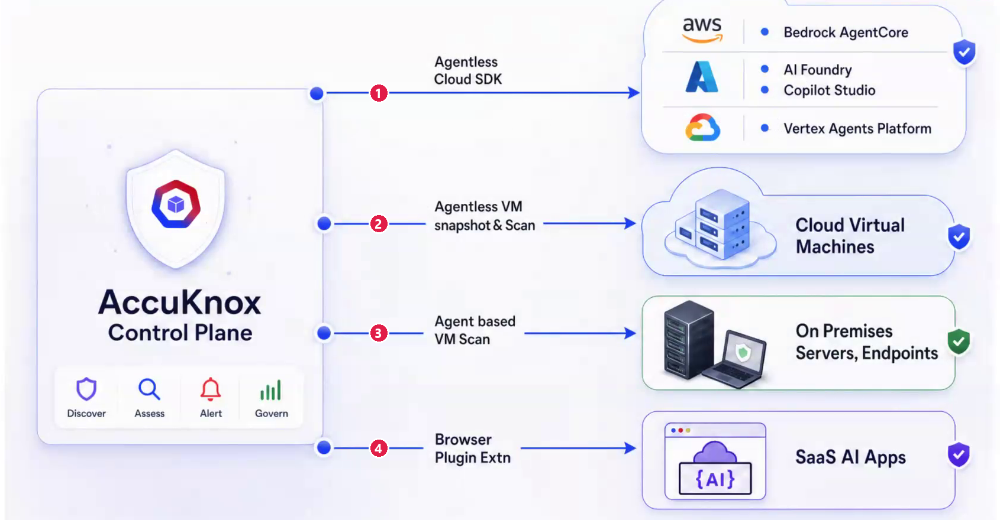
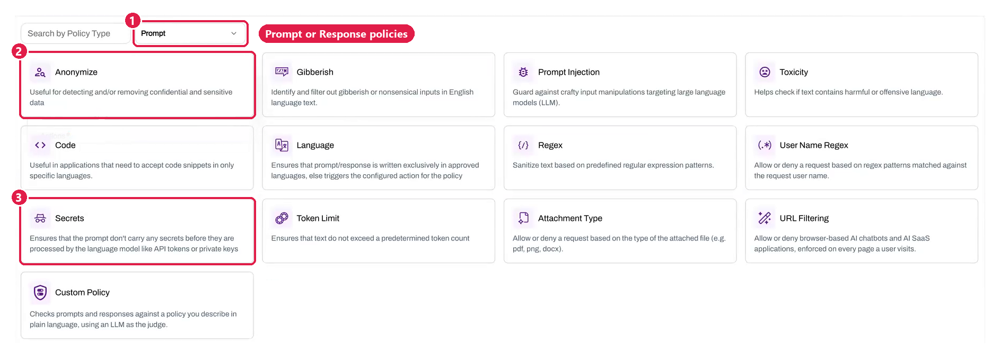
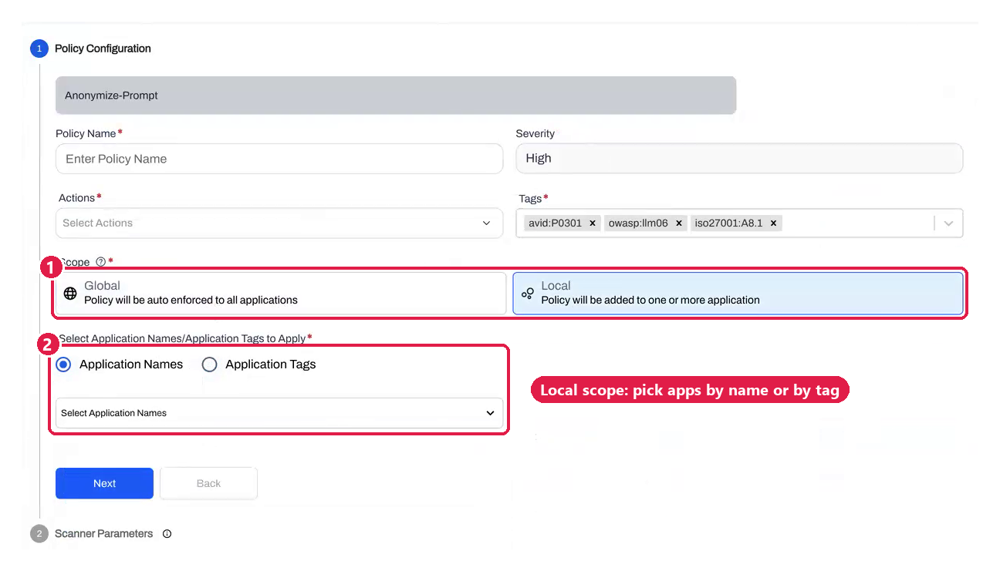
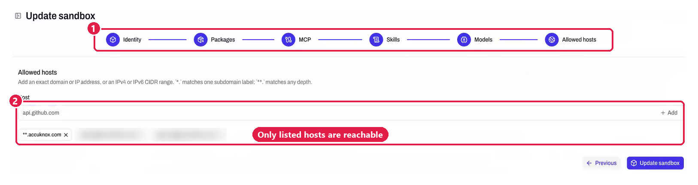
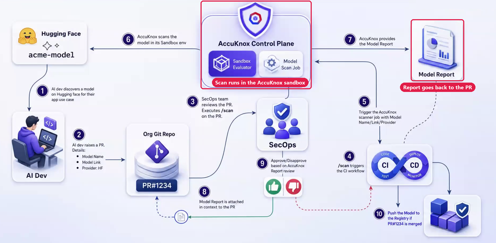
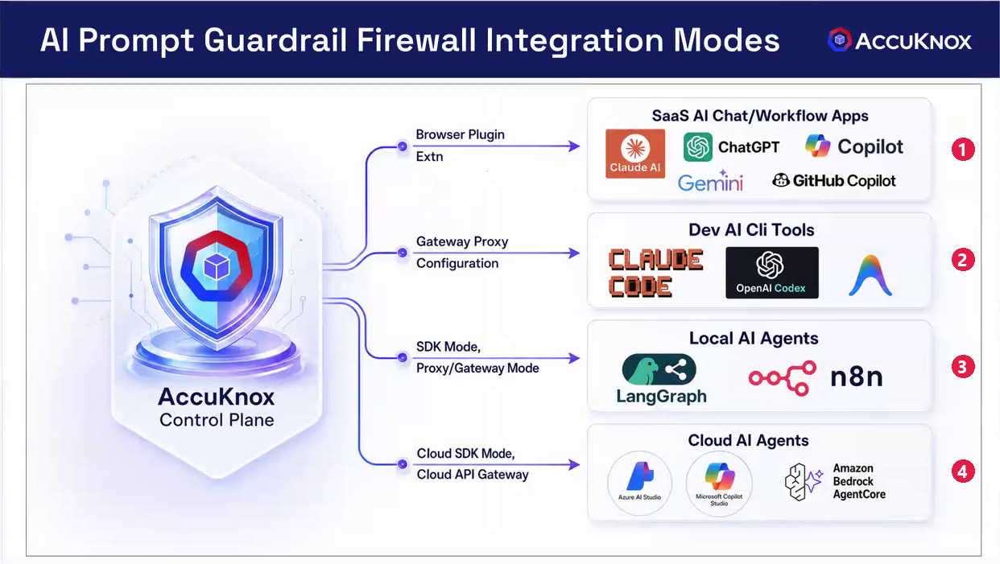

# AI Security

## Core AI Security & Platform

??? "**1. What is AccuKnox AI Security and what does it cover?**"
    AccuKnox AI Security is a Zero Trust, identity-powered security platform for AI models, agents, data pipelines and infrastructure. It is built into the AccuKnox CNAPP as an **integrated module**, so it is not a bolted-on tool. It covers seven areas:

    - **AI-SPM**: Discovers AI/ML assets continuously across cloud and on-prem, and manages their posture and misconfigurations.
    - **AI-DR**: Detects and responds to unauthorized AI deployments, misconfigurations and runtime threats, correlated across cloud control planes.
    - **Prompt Firewall**: Inspects LLM prompts and responses in real time to block injection, jailbreaks and data leakage.
    - **ModelArmor**: Protects AI model artifacts against tampering, theft and supply chain compromise.
    - **Agentic AI Security**: Applies runtime sandboxing, tool-call enforcement and least-privilege controls to AI agents.
    - **Automated Red Teaming**: Runs continuous adversarial simulation against LLMs, ML models and agentic workflows.
    - **AI Compliance**: Maps continuously to NIST AI RMF, EU AI Act, OWASP LLM Top 10, MITRE ATLAS, ISO 42001 and 30+ frameworks.

    **References:**

    - [AI Security Platform Overview](https://accuknox.com/platform/ai-security)

??? "**2. Which platforms and deployment models does AccuKnox AI Security support?**"
    AccuKnox AI Security supports **public cloud, private cloud, on-premises, air-gapped and hybrid** deployments:

    - **Public Cloud**: AWS (Bedrock, SageMaker), Azure (AI Foundry, Copilot Studio) and GCP (Vertex AI, Gemini).
    - **Private Cloud and On-Premises**: OpenStack, VMware, Nutanix and bare-metal Kubernetes.
    - **Air-Gapped Environments**: Full module support, including AI-SPM, CWPP, KSPM and GRC, with no external connectivity dependency.
    - **Hybrid Deployments**: Consistent enforcement and posture across mixed cloud and on-prem AI workloads.
    - **LLM Providers**: Amazon Bedrock, Gemini, Ollama, vLLM and OpenAI-compatible APIs.
    - **Local/Developer AI Assets**: Ollama instances, LangChain/LangGraph agents, MCP clients and servers, CrewAI, NVIDIA Triton inference servers and vector databases.
    - **Kubernetes and Containers**: Native KubeArmor integration for eBPF/LSM-based enforcement across K8s clusters.

    **References:**

    - [AI/ML Support Matrix](https://help.accuknox.com/support-matrix/aiml-support-matrix/)

??? "**3. How does AccuKnox differ from point AI security tools like guardrail-only platforms?**"
    AccuKnox enforces security at **every layer of the AI stack**. Most AI security tools work at only one layer, usually the LLM prompt interface.

    - **Prompt layer**: The Prompt Firewall inspects inputs and outputs for injection, jailbreaks, PII and policy violations.
    - **Runtime layer**: KubeArmor enforces eBPF/LSM-based controls at the kernel level. It controls process execution, file access and network egress for AI workloads. A prompt-only tool cannot do this.
    - **Infrastructure layer**: CSPM and AI-DR detect misconfigurations, unauthorized deployments and publicly exposed model endpoints across cloud control planes.
    - **Identity layer**: KIEM maps AI agent entitlements, over-privileged roles and lateral access paths across cloud and Kubernetes.
    - **Compliance layer**: AccuKnox generates evidence continuously against 30+ frameworks, instead of a quarterly snapshot.

??? "**4. How does AccuKnox reduce false positives in AI security monitoring?**"
    AccuKnox reduces false positives by **up to 95%** with contextual, AI-powered correlation tuned for AI/LLM workload patterns. It uses four methods:

    - **Decoupled policy types**: Regex and keyword policies enforce strictly. Sensitive data classification policies use contextual analysis for better accuracy.
    - **Behavioral baselines**: Runtime baselines tell legitimate AI workload behavior apart from anomalies.
    - **Cross-layer correlation**: AccuKnox correlates alerts across prompt, model, API and infrastructure layers, and filters noise before it shows findings.
    - **Per-use-case tuning**: You tune policies for each application use case to balance precision against strict enforcement.

    **References:**

    - [Prompt Firewall Use Case](https://help.accuknox.com/how-to/prompt-firewall/)

---

## AI Asset Discovery & Shadow AI

??? "**5. How does AccuKnox discover AI assets across multi-cloud environments?**"
    AccuKnox discovers AI assets **continuously and without agents** across cloud accounts, Kubernetes clusters and on-prem environments.

    - **Automatic inventory**: Onboarding an AWS, Azure or GCP account starts an inventory of all AI/ML assets. That includes model endpoints, notebooks, MLOps pipelines, datasets, compute instances and agent toolchains.
    - **Continuous discovery**: Discovery runs all the time instead of as a point-in-time scan. AccuKnox captures new assets as soon as they deploy.
    - **Security graph**: AccuKnox maps every discovered asset into one security graph with lineage, ownership and risk context.
    - **Governance flags**: AccuKnox flags unowned, unregistered or unsanctioned assets for governance review automatically.

??? "**6. How does AccuKnox provide visibility into Shadow AI?**"
    AccuKnox finds Shadow AI with **auto-discovery and network telemetry**:

    - **Cloud onboarding**: Surfaces AI assets that are missing from IAM logs or standard cloud inventories.
    - **Network telemetry**: Analyzes outbound traffic to detect unauthorized API calls from enterprise endpoints to external LLM services.
    - **Browser extension**: Shows AI tool usage at the user and session level.
    - **AI-SPM correlation**: Links usage to user identity and data access patterns to assess risk exposure.
    - **Policy enforcement**: Blocks or alerts on unapproved AI services in real time.

    Shadow AI adds an average of **$670K in extra breach costs**, according to IBM's 2025 Data Breach Report.

    **References:**

    - [Defending Against Shadow AI with AccuKnox AI-SPM](https://accuknox.com/blog/defending-against-shadow-ai-accuknox)

??? "**7. Can AccuKnox detect AI integrations embedded in commercial SaaS tools?**"
    Yes. The **AI Detection and Response (AI-DR)** module finds AI embedded in SaaS platforms. That includes copilots, plugins and third-party AI integrations.

    - **Behavior analysis**: Analyzes application behavior, API calls and data flows to uncover hidden AI usage.
    - **Exposure mapping**: Maps data exposure paths from enterprise systems into embedded AI features.
    - **Policy flags**: Flags unauthorized or risky integrations based on governance policies.
    - **Connector visibility**: Covers plugin ecosystems and external AI connectors, including M365 Copilot, GitHub Copilot and similar tools.

    **References:**

    - [AI-DR Use Case](https://help.accuknox.com/use-cases/aidr/)

??? "**8. How does AccuKnox find unmanaged AI agents, such as OpenClaw or an old LiteLLM version, on VMs and endpoints?**"
    AccuKnox finds them with a package-level scan of each host. A scanner runs on the VM or inside the Kubernetes cluster and lists every installed package. AccuKnox then maps each AI package to one of seven asset types. An OpenClaw install appears under the **Unmanaged** tab with its host, version and vulnerability data. A LiteLLM install appears as an **AI Gateway** asset, with the CVEs for its version.

    

    AccuKnox uses four discovery paths, numbered as in the picture:

    1. **Agentless cloud SDK** reads Bedrock AgentCore, Azure AI Foundry, Copilot Studio and Vertex agents through a read-only API.
    2. **Agentless VM snapshot scan** takes a snapshot of each cloud VM and scans it, with no agent on the VM.
    3. **Agent-based VM scan** runs the VM scanner on on-premises servers and endpoints, on Linux or Windows.
    4. **Browser plugin** records use of SaaS AI apps such as ChatGPT, Claude, Gemini and Copilot.

    **References:**

    - [Shadow AI Discovery](../use-cases/shadow-ai-discovery.md)
    - [Agent-Based VM Scanning for Linux](../how-to/vm-security/agent-based/linux.md)
    - [Agent-Based VM Scanning for Windows](../how-to/vm-security/agent-based/windows.md)

---

## AI-DR: Detection and Response

??? "**9. What is AccuKnox AI-DR and how does it work?**"
    AccuKnox AI-DR (AI Detection and Response) is a cloud-native detection and response module built for AI workloads. It **correlates signals** across cloud control planes, runtime environments and prompt interactions to detect and respond to AI-specific threats.

    - **Cloud Control Plane Monitoring**: Ingests AWS CloudTrail, Azure Logs and GCP Logs continuously. It detects unauthorized AI deployments, publicly exposed model endpoints and usage in non-approved regions.
    - **Cross-Layer Correlation**: Links signals from prompts, models, APIs and infrastructure to rebuild full attack paths. One example is a prompt injection that leads to data exfiltration through an agent tool call.
    - **Automated Response**: Triggers CDR policies and GitOps workflows in real time. These restrict access, make exposed assets private, block risky models or enforce region-specific deployment rules.
    - **Runtime Behavioral Analysis**: Detects anomalous agent behavior, unexpected outbound connections, privilege escalation and unauthorized data access at the workload level.

    **References:**

    - [AI-DR Use Case](https://help.accuknox.com/use-cases/aidr/)

??? "**10. Can AccuKnox AI-DR automatically respond to AI security incidents?**"
    Yes. AccuKnox AI-DR responds automatically through **CDR policies and GitOps workflows**:

    - **Restrict access**: Locks down over-exposed model endpoints or sensitive AI datasets.
    - **Make assets private**: Makes publicly exposed AI assets private as soon as it detects them.
    - **Block models**: Blocks deployment of risky or non-approved models.
    - **Enforce regions**: Enforces region-specific deployment policies to meet data residency requirements.
    - **Notify teams**: Triggers alerts, creates Jira or ServiceNow tickets and notifies Slack or PagerDuty with full incident context.

    You set the response action for each policy: **monitor, alert or enforce**. That gives your team control over automation thresholds.

    **References:**

    - [AI-DR Use Case](https://help.accuknox.com/use-cases/aidr/)

??? "**11. Could AccuKnox have detected a multi-layer AI attack chain like the McKinsey chatbot incident?**"
    Yes. AccuKnox sees the **AI attack surface** across prompts, models, APIs and infrastructure at the same time.

    - **Signal correlation**: Correlates prompt inputs, model behavior, API calls and runtime anomalies to detect chained attack sequences.
    - **Policy enforcement**: Flags prompt injection, data exfiltration and misuse patterns across layers.
    - **Cross-layer correlation**: Combines AI-SPM, runtime and API security to rebuild multi-stage attack paths.
    - **Automated red teaming**: Tests for attack chains before attackers exploit them in production.

    Radware demonstrated the ZombieAgent attack pattern. Against that pattern, AccuKnox **runtime enforcement** would block the unauthorized binary execution that the hidden instruction triggers. It would block the binary even when the attack bypasses prompt-layer detection.

---

## Prompt Firewall & Data Protection

??? "**12. How does AccuKnox Prompt Firewall protect LLM applications?**"
    The AccuKnox Prompt Firewall inspects both **prompt inputs and model responses** in real time. It is a dual-layer policy enforcement engine.

    - **Input Policies**: Detect and block direct and indirect prompt injection, jailbreak attempts, PII/PHI in prompts, embedded credentials, API keys and harmful content.
    - **Response Policies**: Inspect model outputs for data leakage, hallucination patterns, policy violations and regulated content before they reach the end user.
    - **12+ Policy Categories**: Include toxicity, competitor mentions, regulatory violations, custom business logic and sensitive data classification.
    - **Zero Trust Alignment**: Apply a deny-by-default posture to LLM interactions, so only explicitly allowed content passes through.
    - **Configurable Actions**: Let you set monitor, alert, redact or block for each policy.

    The firewall connects to applications through an **SDK or API proxy** and adds minimal latency overhead. For workloads in Kubernetes, it also provides kernel-backed enforcement.

    **References:**

    - [Prompt Firewall Use Case](https://help.accuknox.com/how-to/prompt-firewall/)

??? "**13. Does AccuKnox detect and block sensitive data in prompts, such as PII, API keys and credentials?**"
    Yes. AccuKnox detects **PII, PHI, API keys, credentials and other sensitive data**. It checks both the prompts sent to LLMs and the responses they return.

    - **Coverage**: Covers data in transit to external and internal LLMs, and the generated outputs.
    - **Detection method**: Combines pattern matching with contextual classification, which is more accurate than static keyword rules.
    - **Actions**: Lets you monitor, alert, redact inline or block the whole request, for each data type.
    - **Dataset scanning**: Scans datasets for PII/PHI, which extends protection to training data and vector embeddings in cloud environments.
    - **Outcome**: Helps prevent data leakage, compliance violations and accidental exposure of regulated information in real time.

    **References:**

    - [LLM Static Scan](https://help.accuknox.com/how-to/llm-static-scan/)
    - [ML Static Scan](https://help.accuknox.com/how-to/ml-static-scan/)

??? "**14. How does AccuKnox handle false positives in prompt enforcement, for example a blocked keyword used in a valid context?**"
    AccuKnox separates **strict policies from contextual policies**, so you choose how each use case is enforced.

    - **Strict keyword/regex policies**: Block regardless of context. Use them for high-risk categories such as credentials and PII.
    - **Contextual sensitive data classification policies**: Use semantic analysis of intent and context to reduce false positives in ambiguous cases.
    - **Per-use-case choice**: Pick which policy type applies to each use case, to balance precision against strict enforcement.
    - **Policy decoupling**: A change to one rule does not affect the others, which lowers operational risk when you tune.
    - **Audit logs**: Record every decision with full context, so your team can refine policies from real traffic patterns.

??? "**15. How do I let an approved offensive-security agent through without the Prompt Firewall blocking it?**"
    Onboard the agent as its own application, then scope your policies by application. Each application gets its own AccuKnox token, so the firewall knows which application sent each prompt. A **Global** policy applies to every application. A **Local** policy applies only to the applications you pick, by name or by tag.

    

    

    Set it up in four steps:

    1. Keep the rules every application needs, such as **Secrets** and **Anonymize**, as Global policies.
    2. Make the rules that block attack traffic, such as **Prompt Injection**, Local policies.
    3. Tag your standard applications, for example `standard`, and apply the Local policies to that tag.
    4. Leave the offensive-security agent's application out of that tag.

    The audit log still records every prompt and response from the exempt agent.

    **References:**

    - [Prompt Firewall](../use-cases/prompt-firewall-overview.md)
    - [LLM Safety with Prompt Firewall](../how-to/prompt-firewall.md)

---

## Agentic AI Security

??? "**16. How does AccuKnox secure AI Agents at runtime?**"
    AccuKnox secures AI agents at runtime with **multi-layer sandboxing** and policy enforcement.

    - **Local Process Isolation**: Linux Security Modules (LSMs) enforce policies at the kernel level for agents on the host OS. They control process behavior, file access, network connections and execution permissions. The overhead is extremely low, so it suits production environments.
    - **Remote Container Isolation**: For higher-risk cases, AccuKnox routes LLM-generated code or external tool execution to an isolated container or remote execution service. This keeps malicious code away from the host.
    - **Tool-Call Enforcement**: AccuKnox checks every agent tool or API call against least-privilege policies before it runs. It blocks unauthorized tool usage inline.
    - **Untrusted Code Sandboxing**: Auto-generated or externally sourced code runs in a secure sandbox. This mitigates RCE, privilege escalation and resource overload risks.
    - **Behavioral Monitoring**: Continuous telemetry feeds anomaly detection engines. They flag deviations from baseline agent behavior for forensic analysis and incident response.

    **References:**

    - [Agentic AI Security Solution](https://accuknox.com/solutions/agentic-ai-security)

??? "**17. How does AccuKnox secure MCP servers?**"
    AccuKnox secures MCP servers with its **Zero Trust enforcement layer**.

    - **Sandboxing**: MCP servers run in a sandbox with strict process and network isolation at the kernel level.
    - **Authorization**: Only approved callers with verified identity can invoke MCP tool functions.
    - **Monitoring**: AccuKnox tracks every tool call, data access and external communication through the MCP server.
    - **Risk mapping**: AccuKnox sorts MCP tool risks into three categories: access to private data, exposure to untrusted content and ability to communicate externally.
    - **Attack simulation**: AccuKnox tests MCP server defenses against known attack patterns. These include tool poisoning and indirect prompt injection via MCP tool descriptions.

??? "**18. How does AccuKnox bring visibility and governance to internally built AI agents?**"
    AccuKnox governs internally built agents across the **full agent lifecycle**, from discovery to audit.

    - **Discovery**: Inventories all internally developed agents, models and pipelines across cloud and on-prem environments automatically. This includes assets missing from IAM or cloud inventories.
    - **Mapping**: Maps agent capabilities, data access scope, tool integrations and external API dependencies.
    - **Governance**: Applies policy-as-code controls at build, deploy and runtime stages.
    - **Monitoring**: Tracks agent behavior, drift from baseline and anomalous actions continuously.
    - **Audit**: Keeps AIBOM-based lineage and audit trails for every agent action, as evidence for compliance and incident investigations.

    **References:**

    - [Agentic AI Security Solution](https://accuknox.com/solutions/agentic-ai-security)
    - [AI Security Integrations Overview](https://help.accuknox.com/integrations/ai-overview/)
    - [AWS AI/ML Onboarding](https://help.accuknox.com/how-to/aiml-aws-onboard/)
    - [Azure AI/ML Onboarding](https://help.accuknox.com/how-to/aiml-azure-onboard/)
    - [GCP AI/ML Onboarding](https://help.accuknox.com/how-to/aiml-gcp-onboard/)

??? "**19. How do I stop AI agents from going around the AccuKnox gateway?**"
    Block direct egress to the model providers, so the gateway is the only way out. AccuKnox inspects only the traffic that passes through it. An agent that calls a provider API directly never reaches any gateway.

    Do three things at rollout:

    1. Block outbound traffic from users and workloads to the model provider endpoints. Allow only the gateway to reach them.
    2. Route application traffic through an API gateway you already run. AccuKnox plugs into Azure APIM, AWS API Gateway, Apigee, LiteLLM and Bifrost.
    3. Push the Prompt Firewall browser plugin with your device management tool. Microsoft Intune can force-install it on Chrome and Edge.

    CLI coding agents such as Claude Code and OpenAI Codex use a gateway proxy configuration that points the tool at AccuKnox.

    **References:**

    - [AI Security Integrations](../integrations/ai-overview.md)
    - [Prompt Firewall Plugin Deployment with Intune](../integrations/intune-browser-plugin-deployment.md)

??? "**20. What if a user gives an agent a personal access token and the agent calls an API directly?**"
    A prompt gateway cannot stop that call, because the call never passes through it. Two controls can stop it.

    - **Your API gateway**: When every outbound API call must pass through your API gateway, the gateway sees the direct call and can refuse it.
    - **An AgentZ sandbox**: AgentZ blocks every network call until a policy allows it. A host that is missing from the allowlist stays unreachable, with or without a token. AgentZ also injects scoped credentials at run time, so the agent holds no secret to leak.

    A sandbox works only for agents that start inside it. For agents already running elsewhere, use discovery and the gateway controls above.

    **References:**

    - [AgentZ](../agentz/index.md)

??? "**21. Can I run AI agents in a sandbox from the start, including on-premises or air-gapped?**"
    Yes. Every AgentZ agent runs in a default-deny sandbox from its first run. You decide what the sandbox allows before the agent starts.

    

    Each sandbox holds an allowlist for each of these:

    - **Packages**: the system packages the agent can use.
    - **MCP**: the MCP servers, and the tools inside each server.
    - **Skills** and **Models**: the skills and the models the agent can call.
    - **Allowed hosts**: the domains, IP addresses and CIDR ranges the agent can reach.

    The policy runs at the kernel, next to the agent, so every network call and tool call leaves a record. AgentZ runs on-premises and air-gapped, and logs and audit evidence stay on your infrastructure.

    **References:**

    - [AgentZ](../agentz/index.md)
    - [AgentZ documentation](https://docs.agentzharness.ai/)

---

## AI Governance & Compliance

??? "**22. How do you build a defensible AI governance framework aligned to the EU AI Act?**"
    AccuKnox supports EU AI Act compliance with an **automated, five-part approach**:

    - **Classify**: AccuKnox discovers AI assets and classifies them into EU AI Act risk tiers (minimal, limited, high-risk).
    - **Control**: Policy-as-code governance enforces controls on data usage, model behavior, access and logging across the AI lifecycle.
    - **Monitor**: AI-SPM and the Prompt Firewall watch continuously for drift, bias, prompt risks and anomalous usage.
    - **Audit**: AIBOM, decision logs and lineage tracking give traceability and evidence for regulatory review.
    - **Test**: Automated red teaming assesses safety and regulatory adherence against evolving requirements.

    **References:**

    - [AI Security Platform](https://accuknox.com/platform/ai-security)
    - [AI/ML Overview, How-To](https://help.accuknox.com/how-to/aiml-overview/)
    - [AccuKnox AI Security Roadmap 2026](https://accuknox.com/blog/accuknox-ai-security-platform-roadmap-2026)
    - [AI/ML Support Matrix](https://help.accuknox.com/support-matrix/aiml-support-matrix/)

??? "**23. Can organizations build a custom governance model on top of the AccuKnox platform?**"
    Yes. AccuKnox supports **fully custom policy frameworks** through policy-as-code.

    - **Custom controls**: Tailor controls for multi-cloud, on-prem and hybrid AI environments.
    - **Custom scoring**: Define your own risk scoring and compliance mappings beyond the built-in frameworks.
    - **Integrations**: Connect existing security stacks, such as SIEM, IAM and DevSecOps pipelines, through APIs and plugins.
    - **Industry guardrails**: Build guardrails for industry regulations, such as DORA for financial services or HIPAA for healthcare.
    - **Scoped reporting**: Use custom dashboards and reports that show only the services and frameworks your tenant opted for.

    **References:**

    - [Prompt Firewall Use Case](https://help.accuknox.com/how-to/prompt-firewall/)

---

## ModelArmor & Supply Chain Security

??? "**24. What is ModelArmor and how does it protect AI models?**"
    ModelArmor is the AccuKnox AI model security module. It protects models across the **full model lifecycle**.

    - **Model Integrity**: Detects tampering, unauthorized modifications and integrity violations in trained model artifacts.
    - **Registry Security**: Enforces trusted registries and signed artifact policies, so only approved, verified models can deploy.
    - **Vulnerability Scanning**: Scans ML model files (TensorFlow, Keras, Pickle, PyTorch) continuously for embedded security risks and known CVEs in AI dependencies.
    - **Supply Chain Monitoring**: Detects anomalous behavior from compromised dependencies in model inference pipelines. Examples are unexpected outbound calls, unauthorized data access and execution of injected code.
    - **AIBOM**: Generates AI Bills of Materials that show model lineage, dependencies and provenance for audit and incident response.
    - **Sandboxing**: Uses KubeArmor as a sandboxing engine to constrain untrusted model execution. It prevents cryptomining attacks that use GPUs, remote command injections and malicious payload execution.

    **References:**

    - [ModelArmor Use Case](https://help.accuknox.com/use-cases/modelarmor/)

??? "**25. Can AccuKnox detect supply chain attacks in AI dependencies, for example compromised LLM frameworks?**"
    Yes. AccuKnox gives **AIBOM-based visibility** into models, libraries and dependencies across the AI stack.

    - **Continuous scanning**: Scans for vulnerabilities, malicious packages and integrity violations in AI/ML frameworks. Coverage includes LiteLLM, LangChain, LangGraph, Hugging Face and third-party model registries.
    - **Anomaly detection**: Detects anomalous behavior from compromised dependencies, such as unexpected outbound calls, unauthorized data access or execution of injected payloads.
    - **Trusted sources**: Enforces trusted registries and signed artifact policies for secure model and package usage.
    - **Framework scope**: Brings LLM orchestration frameworks and third-party APIs into the governance scope.

    In 2024, **100 compromised AI models** were uploaded to Hugging Face. AccuKnox continuous scanning and integrity enforcement detect such artifacts before they reach production inference environments.

    **References:**

    - [ModelArmor Use Case](https://help.accuknox.com/use-cases/modelarmor/)

??? "**26. Can my security team check a Hugging Face model before it enters our model registry?**"
    Yes. The model scan gate runs on the pull request that proposes the model. A developer names the model in a pull request. SecOps comments `/scan`, and AccuKnox scans the model inside its own sandbox evaluator. The report lands on the pull request, and only a merge pushes the model to the registry.

    

    The report covers four areas:

    - Supply chain and provenance
    - Adversarial robustness
    - Data and privacy risks
    - Model file security

    Treat a model file security finding as blocking. An unsafe pickle runs code the moment the model loads.

    **References:**

    - [Gate Model Adoption on a Pull Request](../how-to/model-scan-cicd.md)

??? "**27. How is Knox RT red teaming different from a one-shot prompt scan?**"
    Knox RT (AccuKnox Red Teaming) runs multi-turn attacks, so it tests a guardrail the way a patient attacker does. A one-shot scan sends each adversarial prompt once and scores the reply. A guardrail can pass that test and still fail an attack spread across several turns.

    - **Crescendo** escalates over several turns. You set its turn limits.
    - **TAP (Tree of Attacks)** escalates a prompt step by step across turns.
    - **Encoding attacks** hide instructions in Base64, Base16, Hex or ASCII85.
    - The **Deep Adversarial** policy runs multi-turn, iterative attacks on guardrails and agents.

    **References:**

    - [Knox RT Red Teaming Policies](../how-to/knox-rt-red-teaming-policies.md)
    - [AI Red Teaming](../use-cases/red-teaming.md)

---

## Integrations & Onboarding

??? "**28. How does AccuKnox onboard AI/ML assets from AWS, Azure, and GCP?**"
    AccuKnox onboards AI/ML assets from all three public clouds **without agents**.

    - **AWS**: Connect with an IAM role that has read permissions. AccuKnox discovers SageMaker endpoints, Bedrock model deployments, Lambda AI functions and associated data stores automatically.
    - **Azure**: Connect with a service principal or managed identity. AccuKnox discovers Azure AI Foundry, Azure OpenAI Service, Copilot Studio agents, Machine Learning workspaces and associated storage.
    - **GCP**: Connect with a service account that has the right IAM bindings. AccuKnox discovers Vertex AI endpoints, Gemini deployments, AutoML models and Dataflow AI pipelines.

    Onboarding is non-disruptive and installs no agents on your AI infrastructure. Discovery begins **within minutes** of connecting a cloud account.

    **References:**

    - [AWS AI/ML Onboarding](https://help.accuknox.com/how-to/aiml-aws-onboard/)
    - [Azure AI/ML Onboarding](https://help.accuknox.com/how-to/aiml-azure-onboard/)
    - [GCP AI/ML Onboarding](https://help.accuknox.com/how-to/aiml-gcp-onboard/)

??? "**29. Does AccuKnox integrate with OpenAI, Amazon Bedrock, and other LLM providers for prompt firewall enforcement?**"
    Yes. AccuKnox integrates with LLM providers through an **API proxy and SDK-based integration**.

    - **OpenAI**: Browser extension and API proxy integration for prompt and response inspection.
    - **Amazon Bedrock**: Native AgentCore integration for agentic workflow monitoring and guardrailing.
    - **Azure OpenAI / AI Foundry**: Integration for Copilot Studio and AI Foundry-hosted agents.
    - **Google Gemini / Vertex AI**: GCP-native integration for model and pipeline security.
    - **Ollama / vLLM / NVIDIA Triton**: Integration for on-prem and edge LLM providers.
    - **Microsoft Power Apps**: Integration for AI-enhanced low-code application security.

    The Prompt Firewall runs as an **inline proxy**. It intercepts and inspects every interaction between the application and the LLM provider before the interaction completes.

    **References:**

    - [GenAI Browser Integration](https://help.accuknox.com/integrations/chrome-browser-integration/)
    - [Amazon Bedrock AgentCore Integration](https://help.accuknox.com/integrations/bedrock-agentcore/)
    - [Power Apps Integration](https://help.accuknox.com/integrations/powerapps-integration/)

??? "**30. Which ways can I route AI traffic to the AccuKnox Prompt Firewall?**"
    You can route it four ways, and most teams combine two. Pick the way by where the AI traffic starts.

    

    1. **Browser plugin** inspects prompts in ChatGPT, Claude, Gemini, Microsoft Copilot and GitHub Copilot. It runs on Chrome, Edge and Firefox.
    2. **Gateway proxy configuration** points CLI tools such as Claude Code and OpenAI Codex at AccuKnox.
    3. **SDK mode** scans prompts and responses inside your own code, for local agents such as LangGraph and n8n.
    4. **Cloud API gateway** plugs into Azure APIM, AWS API Gateway, Apigee, LiteLLM or Bifrost.

    The SDK needs a code change in every application. A gateway covers each new application behind it with no code change, so it scales better across many teams.

    **References:**

    - [AI Security Integrations](../integrations/ai-overview.md)
    - [Python SDK onboarding](../how-to/llm-defense-app-onboard.md)
    - [Chrome browser integration](../integrations/chrome-browser-integration.md)
    - [LiteLLM integration](../integrations/litellm.md)

## Data Protection & Privacy

??? "**31. Does AccuKnox expose customer data to external LLMs when using the AI Co-Pilot?**"
    No. AccuKnox keeps customer data away from external LLMs with **strict guardrails**:

    - **Data Sanitization**: No telemetry, alert data or information with potential PII/PHI ever goes to external LLMs. That holds for analysis and for remediation suggestions.
    - **Tenant-Level Control**: You can disable AI-assisted remediation completely for each tenant. That gives you full control over whether any of your data interacts with an LLM.
    - **Data Boundary**: All AI Co-Pilot functions run inside the tenant's data boundary. Where external LLM calls are used, they receive only anonymized, sanitized context.

??? "**32. How does AccuKnox handle AI dataset security and data poisoning prevention?**"
    AccuKnox secures datasets across the **AI data lifecycle** and monitors for data poisoning.

    - **PII/PHI Scanning**: Scans AI/ML training datasets and vector embeddings for regulated data that should not be in model training pipelines.
    - **Dataset Lineage**: Tracks data provenance from ingestion through training to deployment, as a complete audit trail.
    - **Poisoning Detection**: Monitors dataset updates and training runs for anomalous patterns that may indicate data poisoning attempts.
    - **Compliance Checks**: Validates datasets automatically against HIPAA, GDPR and NIST AI RMF data handling requirements.
    - **Data Fencing**: Enforces access boundaries on training data stores, so unauthorized agents or workloads cannot read or modify sensitive datasets.

    **References:**

    - [ML Static Scan](https://help.accuknox.com/how-to/ml-static-scan/)
    - [LLM Static Scan](https://help.accuknox.com/how-to/llm-static-scan/)
    - [ModelArmor Use Case](https://help.accuknox.com/use-cases/modelarmor/)

---

[SCHEDULE DEMO](https://www.accuknox.com/contact-us){ .md-button .md-button--primary }