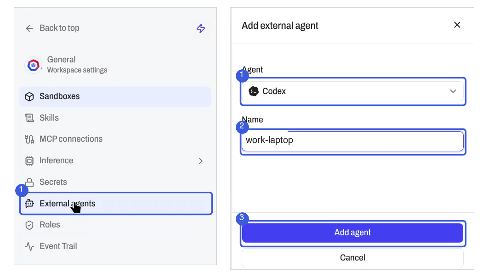
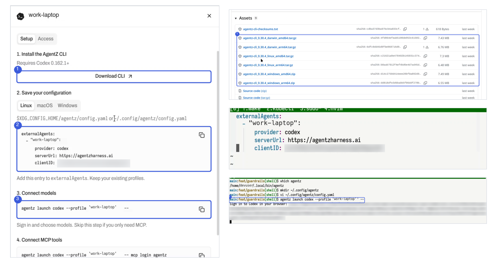
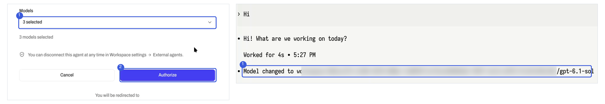

# Secure Coding Agents With Agent Identities

Coding agents such as Claude Code and Codex run on a developer's machine with that developer's own login. Their calls look like the developer's calls, and nothing limits or records them.

An agent identity gives each agent its own name, a list of approved models, a trace of its activity and its own access that you can revoke. Claude Code and Codex are supported today. The screens below show Codex.

<video controls preload="none" width="100%" poster="../images/agent-identities/AccuKnox_Agent_Identities_Walkthrough.jpg">
  <source src="../videos/AccuKnox_Agent_Identities_Walkthrough.mp4" type="video/mp4">
  Your browser does not support embedded video. <a href="../videos/AccuKnox_Agent_Identities_Walkthrough.mp4">Download the Agent Identities walkthrough video</a> instead.
</video>

## Each Identity Closes a Gap in Shared Logins

| Gap | Control | Where you see it |
|---|---|---|
| No attribution | Each agent has its own name, such as `work-laptop` | **Workspace settings > External agents** |
| No boundary | You approve the models the agent may use when it signs in | **Approved access** column |
| No audit trail | The agent's activity is written to traces | **Lens > Traces** |

An authorized agent keeps access until you disconnect it.

## Prerequisites

- An AgentZ workspace where you can open **Workspace settings**.
- Claude Code or Codex on the machine you want to connect. Codex must be version 0.162.1 or later.

## Add an Agent in Five Steps

### 1. Open External Agents

Go to **Workspace settings > External agents** and click **Add agent**.

### 2. Pick the Agent and Name It

1. Select **Claude Code** or **Codex** in the **Agent** list.
2. Enter a **Name** that identifies the machine, such as `work-laptop`.
3. Click **Add agent**.

A setup panel opens with the steps for that agent.



### 3. Install the AgentZ CLI



1. In the **Setup** tab, click **Download CLI**. It opens the latest AgentZ release on GitHub.
2. Under **Assets**, download the archive for your system: macOS, Linux or Windows, in amd64 or arm64.
3. Unpack it and put the `agentz` binary on your `PATH`.
4. Confirm the binary is found:

    ```bash
    which agentz
    ```

### 4. Save the Configuration

The **Setup** tab shows a config block and the file path for your system. On Linux the path is `~/.config/agentz/config.yaml`.

1. Create the folder and open the file:

    ```bash
    mkdir -p ~/.config/agentz
    vi ~/.config/agentz/config.yaml
    ```

2. Copy the config block from the panel and paste it into the file.
3. Save the file.

The entry looks like this. If the file already has an `externalAgents` list, add the entry to it.

```yaml
externalAgents:
  - "<agent-name>":
      provider: codex
      serverUrl: https://agentzharness.ai
      clientID: <client-id>
```

### 5. Sign In and Choose Models

1. Copy the launch command from the **Setup** tab and run it. For Codex:

    ```bash
    agentz launch codex --profile '<agent-name>' --
    ```

    For Claude Code, run the command in its **Setup** tab.

2. Open the sign-in link the terminal prints.
3. In the **Models** list, tick the models this agent may use.
4. Click **Authorize**.

The page lists what the agent can read: your name, profile image and email. The agent then starts in your terminal.

To use an approved model in Codex, type `/model` and pick one.



## Connect MCP Tools (Optional)

Setup step 4 connects MCP tools. Run the command it shows, then choose the tools, prompts and resources in the browser. For Codex:

```bash
agentz launch codex --profile '<agent-name>' -- mcp login agentz
```

## See the Agent's Activity

1. Go to **Lens > Traces**.
2. Open the dropdown and select the external agent.

## Revoke an Agent's Access

Go to **Workspace settings > External agents** and open the agent. The **Access** tab shows what it can use. Disconnect any agent you no longer use.
