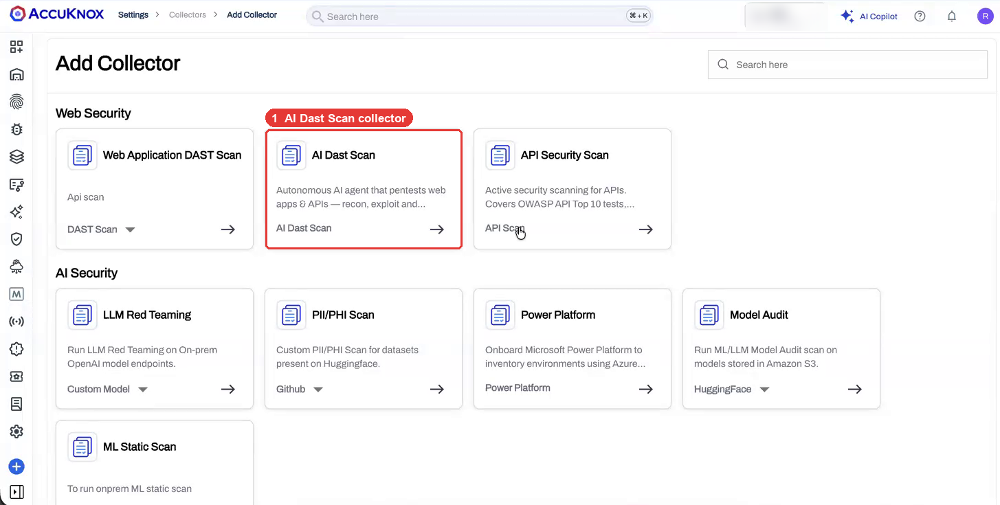
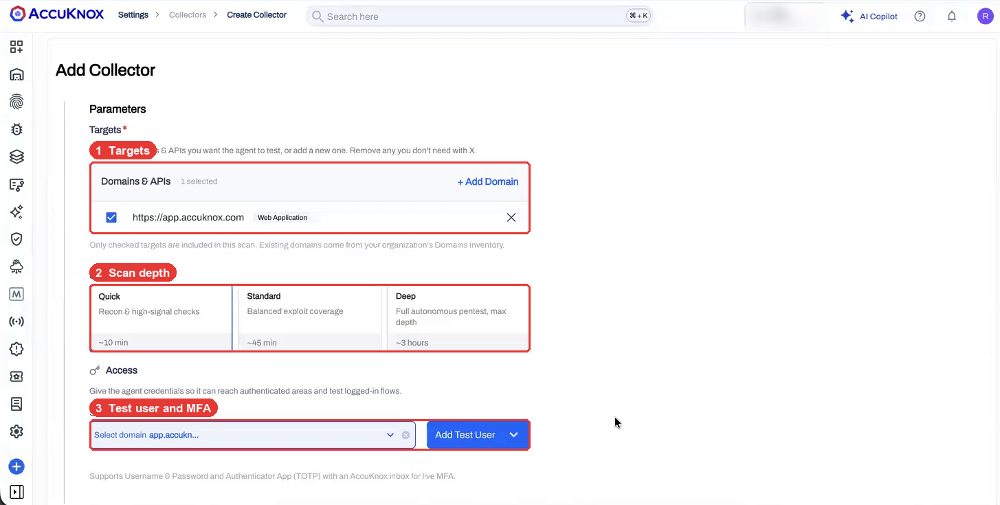
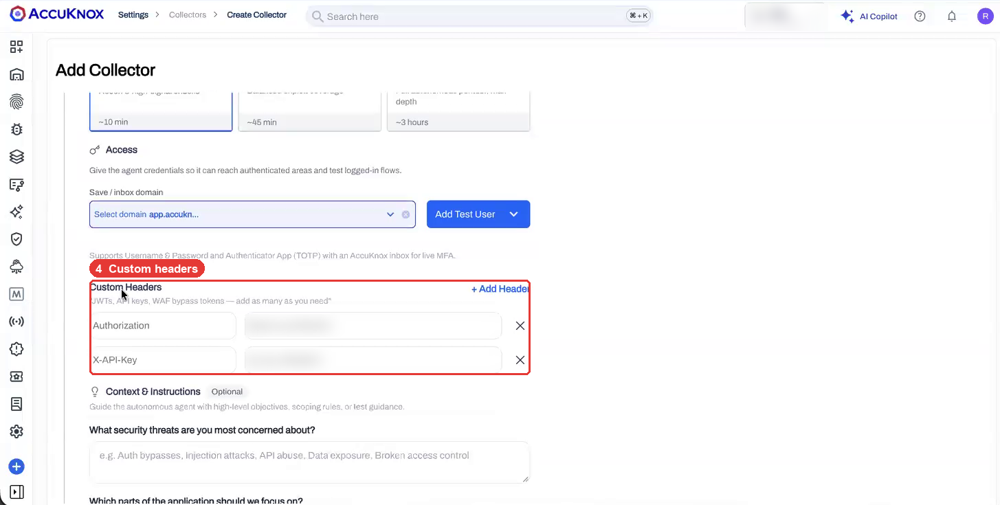
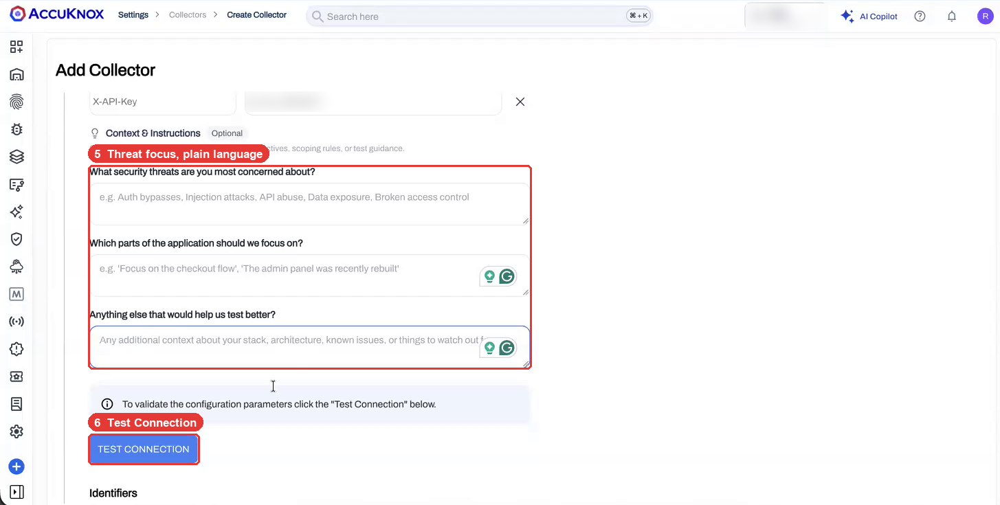
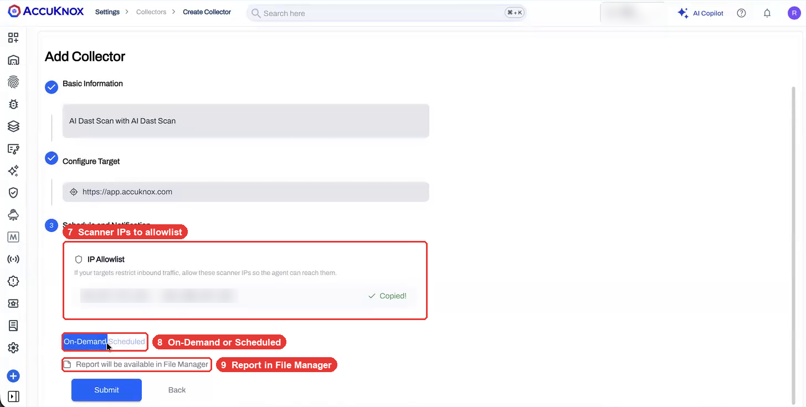
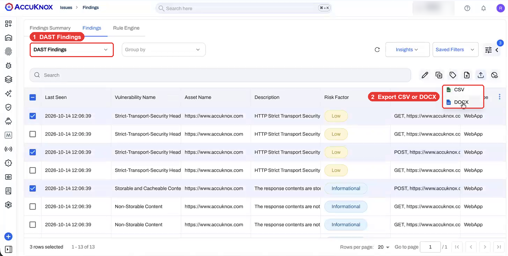
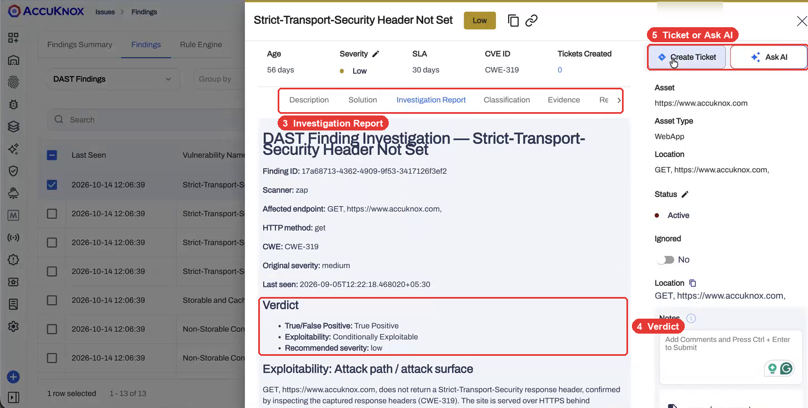
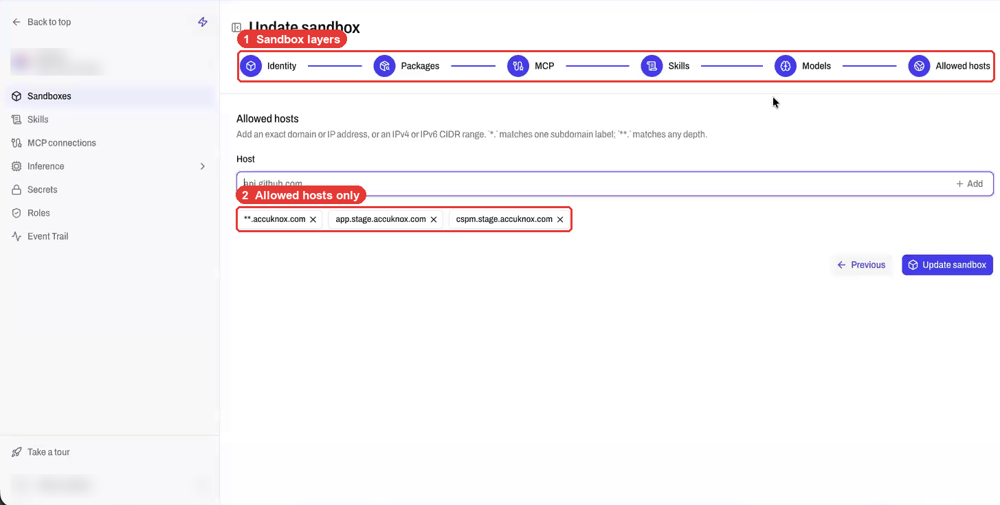
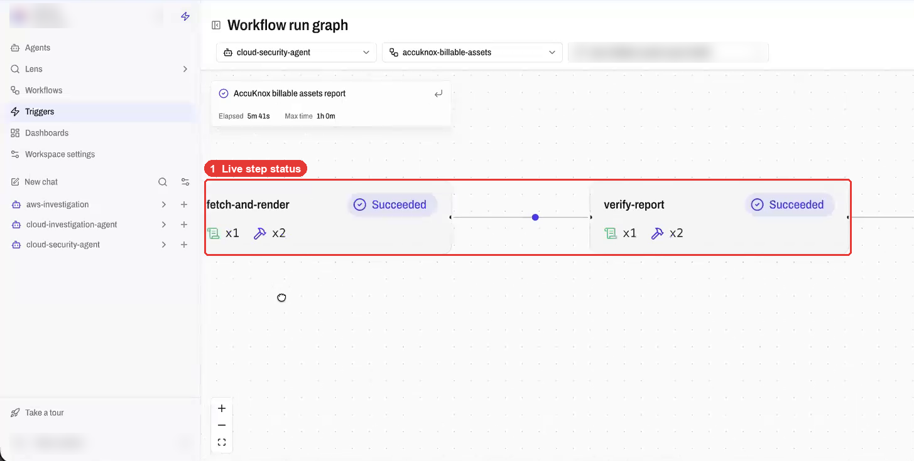
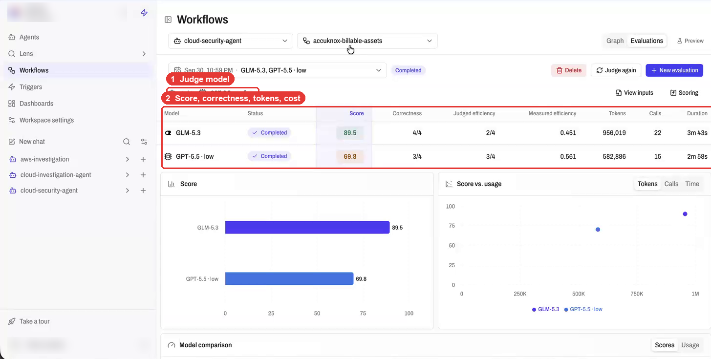

# AI Pentesting (Beta)

!!! info "Beta"
    AI Pentesting is in beta. Screens and options can change before general availability. Contact your AccuKnox team to turn it on for your tenant.

AI Pentesting runs an autonomous AI agent against the web apps and APIs you name. The agent crawls, finds endpoints, and tries attacks such as broken access control, injection and data exposure. Every result lands in **Issues > Findings** next to your other DAST findings.

You give the agent exact targets. It does not discover or scan anything outside that list.

[AgentZ](../agentz/index.md) powers the agent. Each pentest runs in an AgentZ sandbox that can reach only the hosts you allow.

## AI Pentest and Standard DAST Do Different Jobs

| | Web Application DAST Scan | AI Dast Scan |
|---|---|---|
| How it tests | Deterministic crawl and rule set | Agentic workflow that plans, crawls and attacks |
| What you control | Include and exclude paths | Targets, scan depth, threat focus in plain language |
| Best for | Repeatable baseline scans | Logic flaws, access control, multi-step flows |

Run both. The standard [DAST scan](dast-scan-types.md) gives you a repeatable baseline, and the AI pentest goes after flaws a rule set misses.

## Create an AI Pentest in Five Steps

### 1. Pick the AI Dast Scan Collector

Go to **Settings > Collectors > Add Collector**. Under **Web Security**, select **AI Dast Scan**.

Enter a name and an optional description under **Basic Information**.

### 2. Set Targets, Scan Depth and Login

1. **Targets.** Check each domain or API to test. Click **+ Add Domain** to add one that is not in your Domains inventory. Set its type to web application, API endpoint or general attack surface.
2. **Scan depth.** Pick one of three depths.

    | Depth | What it does | Typical time |
    |---|---|---|
    | Quick | Recon and high-signal checks | About 10 min |
    | Standard | Balanced exploit coverage | About 45 min |
    | Deep | Full autonomous pentest, maximum depth | About 3 hours |

3. **Access.** Click **Add Test User** to give the agent a login for each domain. It supports username and password, and an authenticator app (TOTP) with an AccuKnox inbox for live MFA.

### 3. Add Headers and Tell the Agent What to Test

Add **Custom Headers** when the app needs a JWT, an API key or a WAF bypass token. The agent sends these headers on every request.

**Context & Instructions** is optional. Write it in plain language, and the agent uses it to plan the test.

- **Threats.** For example, "IDOR, privilege escalation, broken access control".
- **Focus areas.** For example, "the checkout flow" or "the admin panel, rebuilt last month".
- **Anything else.** Your stack, known issues, pages to avoid, or details about the code behind the endpoint.

If you leave these fields empty, the agent picks its tests from the scan depth.

Click **Test Connection**. AccuKnox checks that each target is reachable. Then add an optional label and tags under **Identifiers** to group the results.

### 4. Allowlist the Scanner IPs

The **Schedule and Notification** step lists the scanner IPs under **IP Allowlist**. Copy them and allow them on your WAF or firewall. If you skip this, your WAF can block the agent and the scan returns little or nothing.

### 5. Run Now or on a Schedule

- Pick **On-Demand** to run once, or **Scheduled** to run on a cadence such as monthly or overnight.
- Check **Report will be available in File Manager** to get a PDF or HTML report of each run.
- Click **Submit**.

## Results Land in DAST Findings

Go to **Issues > Findings** and pick **DAST Findings** from the findings type list.

Open a finding to see the evidence. The drawer shows the request and response, the business impact, and the fix.

- **Investigation Report** gives a verdict: true or false positive, exploitability, and a recommended severity.
- **Status, severity and notes** let you track each finding. AccuKnox calculates an SLA per finding.
- **Severity changes stick.** Change a finding's severity, and the next scan gives the same finding the same severity.
- **Create Ticket** or **Ask AI** acts on one finding.
- **Export** the list as CSV for raw data or DOCX for a readable report with full request and response detail.
- **Rule Engine** acts on new findings for you. It can create a ticket for every critical finding, send a Slack alert, forward to your SIEM or call a webhook. See [Automated ticket creation](../use-cases/rules-engine-ticket-creation.md).
- **Compliance.** Findings map to the 40+ compliance benchmarks in AccuKnox.

## AgentZ Runs Every Pentest in a Sandbox

AgentZ is the AccuKnox runtime for AI agents. The AI pentest agent runs inside it, so the agent works under the same controls as any AgentZ agent. The views below are available to your team on request.

=== "Sandbox"

    A sandbox sets what the agent can reach: packages, MCP tools, skills, models and allowed hosts. The agent cannot reach a host, IP or CIDR range outside the list. Your org defines sandboxes, and workspaces inherit them. A pentester cannot change the sandbox or the model.

    

=== "Workflow run graph"

    The run graph shows each step of a running workflow: done, running or pending. You see where a pentest is while it runs. Runtime telemetry records every process, file, network and MCP call, and logs each blocked network attempt.

    

=== "Model evaluations"

    Run the same workflow on several models at once. A judge model scores each one on correctness, efficiency and token use. Correctness weighs most by default, and you can change the weights. Use this to check that an on-prem model matches a frontier model before you switch.

    

AgentZ works with your own inference providers, including Ollama, vLLM, NVIDIA Triton, Dynamo and any OpenAI-compatible endpoint. Read more on the [AgentZ page](../agentz/index.md).

## Check These Before Your First Scan

!!! warning "Allowlist the scanner IPs first"
    A WAF or firewall that blocks the scanner IPs stops the agent at the edge. Copy the IPs from the **IP Allowlist** step, not from an old scan, because the list can change.

!!! warning "Test production with care"
    The sandbox limits the agent to your targets. It still sends real requests that can create or change data. Start with **Quick** depth on staging, then move to production.

!!! tip "Tell the agent what not to touch"
    The AI Dast Scan collector has no include or exclude path fields. Name the paths to avoid in **Anything else that would help us test better?**, and limit reachable hosts with the AgentZ sandbox. For strict path rules, use the [standard DAST scan](dast-scan-types.md).

!!! tip "Only checked targets are scanned"
    A domain in your inventory is not scanned unless you check it on the **Targets** list. Remove a target with **X** to leave it out.

!!! tip "Complex logins need a recorded flow"
    Create a dedicated test user in the target environment for the agent. For a login with MFA, add the TOTP secret. For flows beyond that, record the login once with the browser plugin recorder from the [DAST authenticated scan](dast-authenticated-scans.md) guide.

!!! tip "Apps behind your firewall"
    The SaaS scanner reaches only internet-facing targets. To test an internal app, contact your AccuKnox team to set up proxy access or an [on-prem install](../getting-started/on-prem-overview.md).

!!! note "What the beta does not do"
    The agent does not write proof-of-concept exploit code for a finding. Use the **Investigation Report** verdict and the request and response evidence to confirm a finding.
