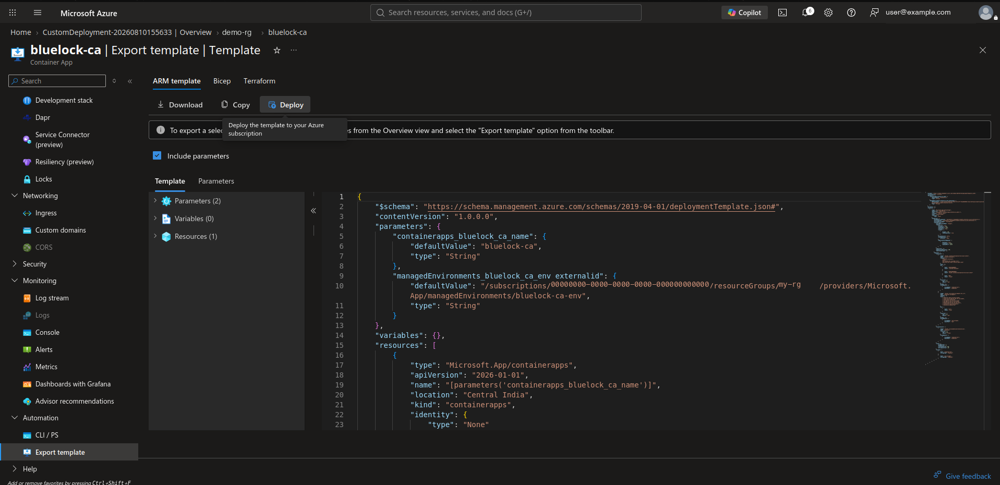
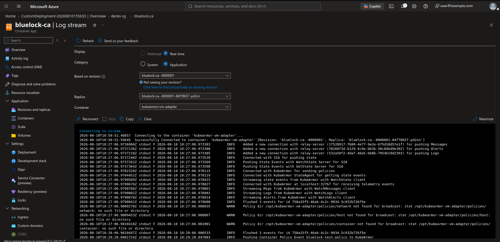
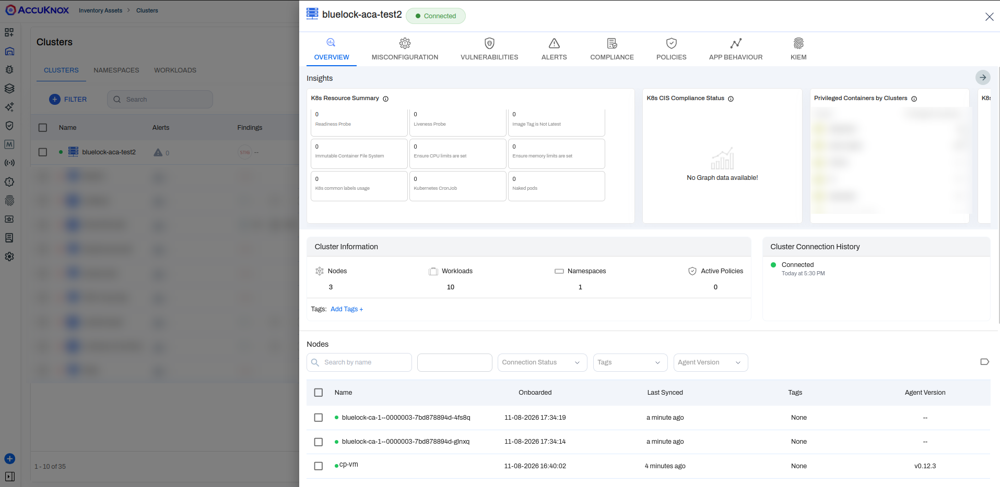
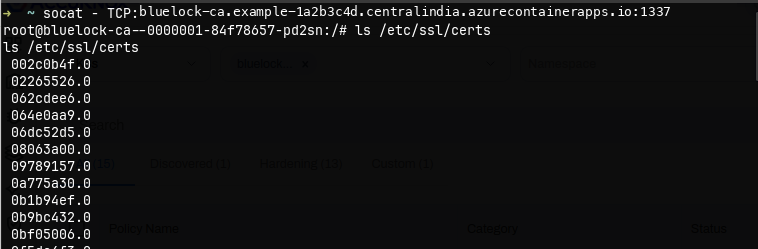
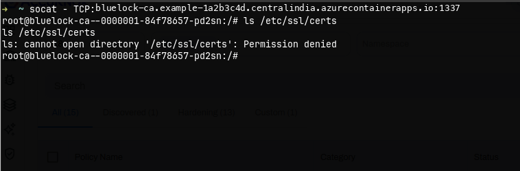
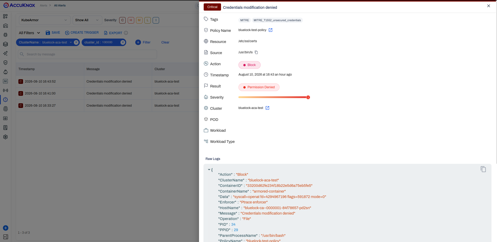

# Deploy BlueLock on Azure Container Apps

!!! info "Overview"
    Build an Azure Container Apps test environment with Terraform, onboard it to AccuKnox as a VM cluster and block a command in a running replica.

## Workflow at a Glance

<div class="bl-dia" role="img" aria-label="Six steps for Azure Container Apps: get a join token, sign in to AWS and ECR, create the base infrastructure in 1-infra, create the container app in 2-app, confirm the nodes in AccuKnox, then test the block policy." data-bl="aca-flow">
<svg viewBox="0 0 760 128" xmlns="http://www.w3.org/2000/svg">
  <defs>
    <marker id="bl-aca-flow" viewBox="0 0 8 8" refX="7" refY="4" markerWidth="7" markerHeight="7" orient="auto">
      <path class="head" d="M0 0 L8 4 L0 8 z"/>
    </marker>
  </defs>
  <path class="rail" d="M63 16 H697"/>
  <rect class="navy" x="27" y="3" width="72" height="26" rx="13"/>
  <text class="num" x="63" y="20" text-anchor="middle">Step 1</text>
  <text class="b" x="63" y="56" text-anchor="middle">Get a join</text>
  <text class="b" x="63" y="74" text-anchor="middle">token</text>
  <text class="ms" x="63" y="100" text-anchor="middle">AccuKnox</text>
  <rect class="navy" x="154" y="3" width="72" height="26" rx="13"/>
  <text class="num" x="190" y="20" text-anchor="middle">Step 2</text>
  <text class="b" x="190" y="56" text-anchor="middle">Sign in to</text>
  <text class="b" x="190" y="74" text-anchor="middle">AWS and ECR</text>
  <text class="ms" x="190" y="100" text-anchor="middle">aws configure</text>
  <rect class="navy" x="280" y="3" width="72" height="26" rx="13"/>
  <text class="num" x="317" y="20" text-anchor="middle">Step 3</text>
  <text class="b" x="317" y="56" text-anchor="middle">Create base</text>
  <text class="b" x="317" y="74" text-anchor="middle">infrastructure</text>
  <text class="ms" x="317" y="100" text-anchor="middle">1-infra</text>
  <rect class="navy" x="407" y="3" width="72" height="26" rx="13"/>
  <text class="num" x="443" y="20" text-anchor="middle">Step 4</text>
  <text class="b" x="443" y="56" text-anchor="middle">Create the</text>
  <text class="b" x="443" y="74" text-anchor="middle">container app</text>
  <text class="ms" x="443" y="100" text-anchor="middle">2-app</text>
  <rect class="navy" x="534" y="3" width="72" height="26" rx="13"/>
  <text class="num" x="570" y="20" text-anchor="middle">Step 5</text>
  <text class="b" x="570" y="56" text-anchor="middle">Confirm the</text>
  <text class="b" x="570" y="74" text-anchor="middle">nodes</text>
  <text class="ms" x="570" y="100" text-anchor="middle">AccuKnox</text>
  <rect class="navy" x="660" y="3" width="72" height="26" rx="13"/>
  <text class="num" x="697" y="20" text-anchor="middle">Step 6</text>
  <text class="b" x="697" y="56" text-anchor="middle">Test the</text>
  <text class="b" x="697" y="74" text-anchor="middle">block policy</text>
  <text class="ms" x="697" y="100" text-anchor="middle">socat</text>
</svg>
</div>

## How the Deployment Fits Together

Azure hides the Kubernetes API server of Container Apps, so you cannot onboard it as a Kubernetes cluster. BlueLock uses a VM cluster: the control plane runs on a VM and the replicas act as worker nodes.

<div class="bl-dia" role="img" aria-label="Azure Container Apps architecture. In one virtual network, subnet 1 holds a control plane VM that runs the AccuKnox agents and reaches AccuKnox SaaS. Subnet 2 holds a Container Apps environment with one container app and two replicas. Each replica runs bluelock, armored-container and kubearmor-vm-adapter. The adapters connect to the control plane on ports 32768 to 32771. A test client reaches the app on TCP port 1337." data-bl="aca">
<svg viewBox="0 0 760 490" xmlns="http://www.w3.org/2000/svg">
  <defs>
    <marker id="bl-aca" viewBox="0 0 8 8" refX="7" refY="4" markerWidth="7" markerHeight="7" orient="auto">
      <path class="head" d="M0 0 L8 4 L0 8 z"/>
    </marker>
  </defs>
  <rect class="navy" x="250" y="0" width="260" height="64" rx="10"/>
  <g class="ic-w" transform="translate(270 20) scale(1.0)"><path d="M7 18h10a4 4 0 0 0 .6-7.95A6 6 0 0 0 6 9.6 4.2 4.2 0 0 0 7 18z"/></g>
  <text class="wh" x="304" y="30">AccuKnox SaaS</text>
  <text class="ws" x="304" y="49">Policies and alerts</text>
  <rect class="panel" x="0" y="110" width="760" height="300" rx="10"/>
  <text class="h" x="16" y="138">Virtual network</text>
  <rect class="card" x="16" y="156" width="204" height="234" rx="10"/>
  <text class="s" x="32" y="178">Subnet 1</text>
  <rect class="row" x="32" y="194" width="172" height="130" rx="8"/>
  <g class="ic" transform="translate(46 208) scale(1.0)"><rect x="3" y="4" width="18" height="7" rx="2"/><rect x="3" y="13" width="18" height="7" rx="2"/><circle class="dot" cx="7" cy="7.5" r=".9"/><circle class="dot" cx="7" cy="16.5" r=".9"/></g>
  <text class="b" x="78" y="226">Control plane VM</text>
  <rect class="navy" x="44" y="252" width="148" height="48" rx="8"/>
  <g class="ic-w" transform="translate(54 264) scale(0.9)"><path d="M12 3l8 3v6c0 4.5-3.2 8-8 9-4.8-1-8-4.5-8-9V6l8-3z"/></g>
  <text class="wb" x="80" y="281">AccuKnox agents</text>
  <text class="s" x="32" y="350">Adapter ports</text>
  <text class="s" x="32" y="366">32768-32771</text>
  <rect class="card" x="250" y="156" width="494" height="234" rx="10"/>
  <text class="s" x="266" y="178">Subnet 2, delegated to Microsoft.App/environments</text>
  <rect class="panel" x="266" y="190" width="462" height="186" rx="8"/>
  <text class="h" x="282" y="214">Container Apps environment</text>
  <rect class="card" x="282" y="226" width="430" height="138" rx="8"/>
  <text class="b" x="298" y="250">Container app</text>
  <text class="s" x="696" y="250" text-anchor="end">2 replicas</text>
  <rect class="row" x="298" y="260" width="194" height="96" rx="8"/>
  <text class="s" x="310" y="278">Replica 1</text>
  <text class="m" x="310" y="300">bluelock (init)</text>
  <text class="m" x="310" y="322">armored-container</text>
  <text class="m" x="310" y="344">kubearmor-vm-adapter</text>
  <rect class="row" x="506" y="260" width="194" height="96" rx="8"/>
  <text class="s" x="518" y="278">Replica 2</text>
  <text class="m" x="518" y="300">bluelock (init)</text>
  <text class="m" x="518" y="322">armored-container</text>
  <text class="m" x="518" y="344">kubearmor-vm-adapter</text>
  <path class="ln" d="M250 273 H224" marker-end="url(#bl-aca)"/>
  <path class="ln" d="M190 156 V32 H246" marker-end="url(#bl-aca)"/>
  <text class="s" x="202" y="100">outbound</text>
  <rect class="card" x="470" y="450" width="250" height="34" rx="8"/>
  <text class="m" x="595" y="472" text-anchor="middle">socat - TCP:APP_URL:1337</text>
  <path class="ln" d="M595 450 V414" marker-end="url(#bl-aca)"/>
  <text class="s" x="607" y="436">TCP ingress 1337</text>
</svg>
</div>

| Azure term | What it is |
|---|---|
| Container Apps environment | A resource boundary for CPU, memory and networking |
| Container app | Like a ReplicaSet. A replica is a pod with one or more containers |

## Prerequisites

| Requirement | Used for |
|---|---|
| Azure access | Creating the resource group, virtual network, VM and Container Apps environment |
| AWS CLI, configured | The login to public ECR in Step 2 |
| Terraform | Running both scripts |
| Docker | The `docker login` command in Step 2 |
| `git` | Cloning the BlueLock repository |
| `socat` | Connecting to the container app in Step 6 |
| AccuKnox account | Getting a join token and viewing the results |

## Step 1. Get a Join Token From AccuKnox

In AccuKnox, open Settings, then Manage Cluster, then Onboard. Select the cluster type VM, enter a name and copy the join token from the `knoxctl onboard vm cp-node` command. Terraform runs that command on the control plane VM, so you only need the token.

## Step 2. Sign in to AWS and Public ECR

Enter your Access Key ID and Secret Access Key.

```bash
aws configure
```

Log in to public ECR.

```bash
aws ecr-public get-login-password --region us-east-1 | docker login --username AWS --password-stdin public.ecr.aws/k9v9d5v2
```

## Step 3. Create the Base Infrastructure

Clone the repository and open `azure-container-apps`.

```bash
git clone https://github.com/accuknox/bluelock.git
cd bluelock/terraform/azure-container-apps
```

Create the base infrastructure. This takes about 5 minutes.

```bash
cd 1-infra
terraform init
terraform apply -var="vm_token=YOUR_JOIN_TOKEN"
```

The script creates the resource group, virtual network, control plane VM and Container Apps environment. It then installs Docker and `knoxctl` on the VM and onboards it as the control plane with your token.

??? info "Variables you can change"
    Override a default with `-var`, for example `-var="location=<REGION>"`.

    | Variable | Default | Notes |
    |---|---|---|
    | `location` | `Central India` | Azure region |
    | `resource_group_name` | `rg-azure-test` | Resource group that holds everything |
    | `name_prefix` | `bluelock-aca` | Prefix for resource names |
    | `vm_username` | `testuser` | Login name on the control plane VM |
    | `vm_password` | Has a default | Set your own value with `-var` |
    | `vm_token` | None | Required. Your AccuKnox join token |

    The script prints these outputs: `resource_group_name`, `vnet_name`, `vm_public_ip`, `vm_private_ip`, `container_app_environment_id` and `container_app_environment_name`.

## Step 4. Create the Container App

Create the container app. The command reads the VM public IP from Step 3.

```bash
cd ../2-app
terraform init
terraform apply \
    -var="vm_public_ip=$(cd ../1-infra && terraform output -raw vm_public_ip)"
```

Terraform creates a container app with 2 replicas. Each runs the `bluelock` init container, `armored-container` and `kubearmor-vm-adapter`.

??? info "Variables you can change"
    | Variable | Default | Notes |
    |---|---|---|
    | `resource_group_name` | `rg-azure-test` | Use the same value as in `1-infra` |
    | `container_app_environment` | `bluelock-aca-container-app-env` | Environment to deploy into |
    | `container_app_name` | `bluelock-container-app` | Name of the container app |
    | `vm_public_ip` | None | Required. Public IP of the control plane VM |

??? note "Set up manually instead of using Terraform"
    Replaces Steps 3 and 4. Create these Azure resources in order.

    **1. Virtual network**

    1. Create a virtual network with 2 subnets. Make one a normal subnet and delegate the other to `Microsoft.App/environments`, because the Container Apps environment joins this network. See the [Azure networking guide](https://learn.microsoft.com/en-us/azure/container-apps/networking#environment-selection) for the subnet size.
    2. For example, create `default` with size /24 and `aca-subnet` with size /20.

    **2. Virtual machine**

    1. Create an Ubuntu machine in the normal subnet of the virtual network.
    2. Open inbound access to all ports from everywhere, for every protocol, in the VM's network security group. Do this for testing only. Do not do this in production. Open only the ports that the agents need.
    3. Install Docker.
    4. Onboard the VM as the control plane of a VM cluster in AccuKnox.

    **3. Container app**

    1. Create a container app.
    2. When it asks for a Container Apps environment, create a new one. In the Network tab, integrate it with the delegated subnet that you created.
    3. In Containers, select Docker registry and enter the image `delusionaloptimist/ka-socat:latest`.
    4. In Monitoring, select stream logs without storing.
    5. In Ingress, enable ingress. Allow TCP from everywhere on port 1337 with target port 1337. Leave the other settings unchanged.
    6. Create the container app.

    **4. Configure the container app**

    1. In the left panel, open Export template under Automation and choose Deploy.

        

    2. Choose Edit template. Replace the `template` object in the JSON with the following. Replace `<CONTROL_PLANE_IP>` in the VM adapter arguments with the public IP of the VM.

        ```json
        "template": {
            "containers": [
                {
                    "image": "public.ecr.aws/k9v9d5v2/accuknox-bluelock/ka-socat-demo:latest",
                    "name": "armored-container",
                    "command": [
                        "/kubearmor/bluelock",
                        "socat",
                        "TCP-LISTEN:1337,reuseaddr,fork",
                        "EXEC:bash,pty,stderr,setsid,sigint,sane"
                    ],
                    "args": [],
                    "env": [
                        {
                            "name": "CONTAINERNAME",
                            "value": "armored-container"
                        },
                        {
                            "name": "CONTAINERIMAGE",
                            "value": "public.ecr.aws/k9v9d5v2/accuknox-bluelock/ka-socat-demo:latest"
                        },
                        {
                            "name": "K8S",
                            "value": "false"
                        }
                    ],
                    "resources": {
                        "cpu": 0.5,
                        "memory": "1Gi"
                    },
                    "probes": [],
                    "volumeMounts": [
                        {
                            "volumeName": "kubearmor-dir",
                            "mountPath": "/kubearmor"
                        }
                    ]
                },
                {
                    "image": "docker.io/accuknox/vm-adapter:v0.1.29",
                    "name": "kubearmor-vm-adapter",
                    "command": [],
                    "args": [
                        "--kubearmor-addr=localhost:32767",
                        "--relay-server-addr=<CONTROL_PLANE_IP>:32768",
                        "--node-state-refresh=4",
                        "--policy-list-enable=true",
                        "--policy-list-relay-frequency=5m0s",
                        "--sia-addr=<CONTROL_PLANE_IP>:32769",
                        "--pea-addr=<CONTROL_PLANE_IP>:32770",
                        "--harden-addr=<CONTROL_PLANE_IP>:32771",
                        "--annotation-topic=annotation",
                        "--annotation-enable=true"
                    ],
                    "env": [
                        {
                            "name": "test",
                            "value": "true"
                        }
                    ],
                    "resources": {
                        "cpu": 0.5,
                        "memory": "1Gi"
                    },
                    "probes": [],
                    "volumeMounts": [
                        {
                            "volumeName": "opt-storage",
                            "mountPath": "/opt"
                        }
                    ]
                }
            ],
            "initContainers": [
                {
                    "image": "public.ecr.aws/k9v9d5v2/accuknox-bluelock:v1.0.0",
                    "name": "bluelock",
                    "resources": {
                        "cpu": 0.25,
                        "memory": "0.5Gi"
                    },
                    "volumeMounts": [
                        {
                            "volumeName": "kubearmor-dir",
                            "mountPath": "/kubearmor"
                        }
                    ]
                }
            ],
            "scale": {
                "minReplicas": 2,
                "maxReplicas": 2,
                "cooldownPeriod": 300,
                "pollingInterval": 30
            },
            "volumes": [
                {
                    "name": "kubearmor-dir",
                    "storageType": "EmptyDir"
                },
                {
                    "name": "opt-storage",
                    "storageType": "EmptyDir"
                }
            ]
        }
        ```

    3. Save and deploy this revision.
    4. After the deployment finishes, open Log stream in the left panel. It shows the logs of both the `armored-container` and the `kubearmor-vm-adapter`. Check that neither shows errors.

        

## Step 5. Confirm the Nodes Appear in AccuKnox

In AccuKnox, the replicas appear as nodes next to the control plane VM.



## Step 6. Test Enforcement With a Block Policy

1. In the Azure portal, copy the container app's application URL. It looks like `<container-app-name>.<hostname>.<region>.azurecontainerapps.io`.

2. Connect to the container app.

    ```bash
    socat - TCP:<address>:1337
    ```

    !!! note "You cannot choose the replica"
        The app has one URL and Azure's load balancing picks the replica. You cannot choose which replica you reach.

3. Run this. It succeeds because no policy exists yet.

    ```bash
    ls /etc/ssl/certs
    ```

    

4. In AccuKnox, open Runtime Protection, then Policies, and create this policy. [`ksp-block-file-dir-recursive.yaml`](https://raw.githubusercontent.com/accuknox/bluelock/refs/heads/master/terraform/ksp-block-file-dir-recursive.yaml) holds the same rules. Activate it after you save.

    ```yaml
    apiVersion: security.kubearmor.com/v1
    kind: KubeArmorPolicy
    metadata:
      name: bluelock-test-policy
      namespace: container_namespace
    spec:
      action: Block
      file:
        matchDirectories:
        - dir: /etc/ssl/
          recursive: true
        - dir: /etc/pki/
          recursive: true
        - dir: /usr/local/share/ca-certificates/
          recursive: true
      message: Credentials modification denied
      selector:
        matchLabels:
          kubearmor.io/container.name: armored-container
      severity: 1
      tags:
      - MITRE
      - MITRE_T1552_unsecured_credentials
    ```

5. Run the command again. It now fails.

    ```bash
    ls /etc/ssl/certs
    ```

    

6. Open the alert in AccuKnox.

    

## Step 7. Destroy the Test Environment When You Finish

Destroy the container app first, then the base infrastructure. Both folders need the same variables that you passed to `terraform apply`.

```bash
cd bluelock/terraform/azure-container-apps/2-app
terraform destroy \
    -var="vm_public_ip=$(cd ../1-infra && terraform output -raw vm_public_ip)"
cd ../1-infra
terraform destroy -var="vm_token=YOUR_JOIN_TOKEN"
```
