# Deploy BlueLock on ECS Fargate

!!! info "Overview"
    This guide builds an ECS Fargate test environment with Terraform, onboards it to AccuKnox as a VM cluster and blocks a command in a running task. Terraform creates the AWS resources and a control plane node, then starts two Fargate tasks that run BlueLock. Read [BlueLock Runtime Security for Serverless Containers](bluelock.md) first if you want the background.

## Workflow at a Glance

<div class="ak-dia" role="img" aria-label="Six-step workflow for ECS Fargate. Step 1, get a join token from the AccuKnox console. Step 2, sign in to AWS and public ECR. Step 3, create the base infrastructure with Terraform. Step 4, deploy the sample service with Terraform. Step 5, confirm the control plane and two Fargate tasks appear in AccuKnox. Step 6, apply a block policy and confirm the command is denied and an alert appears.">
<svg viewBox="0 0 640 292" xmlns="http://www.w3.org/2000/svg">
  <defs>
    <marker id="mecf" viewBox="0 0 8 8" refX="7" refY="4" markerWidth="7" markerHeight="7" orient="auto">
      <path class="head" d="M0 0 L8 4 L0 8 z"/>
    </marker>
    <marker id="mecfa" viewBox="0 0 8 8" refX="7" refY="4" markerWidth="7" markerHeight="7" orient="auto">
      <path class="head-acc" d="M0 0 L8 4 L0 8 z"/>
    </marker>
  </defs>
  <rect class="acc" x="8" y="8" width="200" height="126" rx="8"/>
  <circle class="step" cx="32" cy="32" r="12"/>
  <text class="t-step" x="32" y="36" text-anchor="middle">1</text>
  <text class="t-s" x="54" y="36">Step 1</text>
  <text class="t-h" x="24" y="70">Get a join</text>
  <text class="t-h" x="24" y="87">token</text>
  <text class="t-s" x="24" y="109">Settings, Manage</text>
  <text class="t-s" x="24" y="124">Cluster, Onboard</text>
  <path class="ln" d="M209 71 H227" marker-end="url(#mecf)"/>
  <rect class="p" x="228" y="8" width="200" height="126" rx="8"/>
  <circle class="step" cx="252" cy="32" r="12"/>
  <text class="t-step" x="252" y="36" text-anchor="middle">2</text>
  <text class="t-s" x="274" y="36">Step 2</text>
  <text class="t-h" x="244" y="70">Sign in to AWS</text>
  <text class="t-h" x="244" y="87">and public ECR</text>
  <text class="t-s" x="244" y="109">aws configure and</text>
  <text class="t-s" x="244" y="124">docker login</text>
  <path class="ln" d="M429 71 H447" marker-end="url(#mecf)"/>
  <rect class="p" x="448" y="8" width="200" height="126" rx="8"/>
  <circle class="step" cx="472" cy="32" r="12"/>
  <text class="t-step" x="472" y="36" text-anchor="middle">3</text>
  <text class="t-s" x="494" y="36">Step 3</text>
  <text class="t-h" x="464" y="70">Create the base</text>
  <text class="t-h" x="464" y="87">infrastructure</text>
  <text class="t-s" x="464" y="109">terraform apply in</text>
  <text class="t-s" x="464" y="124">base-infra</text>
  <rect class="p" x="8" y="162" width="200" height="126" rx="8"/>
  <circle class="step" cx="32" cy="186" r="12"/>
  <text class="t-step" x="32" y="190" text-anchor="middle">4</text>
  <text class="t-s" x="54" y="190">Step 4</text>
  <text class="t-h" x="24" y="224">Deploy the</text>
  <text class="t-h" x="24" y="241">sample service</text>
  <text class="t-s" x="24" y="263">terraform apply in</text>
  <text class="t-s" x="24" y="278">test-task</text>
  <path class="ln" d="M209 225 H227" marker-end="url(#mecf)"/>
  <rect class="acc" x="228" y="162" width="200" height="126" rx="8"/>
  <circle class="step" cx="252" cy="186" r="12"/>
  <text class="t-step" x="252" y="190" text-anchor="middle">5</text>
  <text class="t-s" x="274" y="190">Step 5</text>
  <text class="t-h" x="244" y="224">Confirm the</text>
  <text class="t-h" x="244" y="241">nodes</text>
  <text class="t-s" x="244" y="263">Control plane and</text>
  <text class="t-s" x="244" y="278">2 Fargate tasks</text>
  <path class="ln" d="M429 225 H447" marker-end="url(#mecf)"/>
  <rect class="good" x="448" y="162" width="200" height="126" rx="8"/>
  <circle class="step" cx="472" cy="186" r="12"/>
  <text class="t-step" x="472" y="190" text-anchor="middle">6</text>
  <text class="t-s" x="494" y="190">Step 6</text>
  <text class="t-h" x="464" y="224">Test the block</text>
  <text class="t-h" x="464" y="241">policy</text>
  <text class="t-s" x="464" y="263">ls is denied and</text>
  <text class="t-s" x="464" y="278">an alert appears</text>
  <path class="ln" d="M548 135 V148 H108 V161" marker-end="url(#mecf)"/>
</svg>
</div>

## How the Deployment Fits Together

The control plane runs on an EC2 instance, or on any VM with a public IP, and `knoxctl` onboards it. Each Fargate task runs three containers, the same way the Docker Compose file does for a VM cluster. The `kubearmor-vm-adapter` container connects each task to the control plane.

<div class="ak-dia" role="img" aria-label="ECS Fargate architecture. A control plane node, an EC2 instance or any VM with a public IP, runs the AccuKnox agents and reaches AccuKnox SaaS outbound. An ECS cluster on Fargate runs two tasks. Each task holds three containers in start order: bluelock, armored-container and kubearmor-vm-adapter. The adapters connect to the control plane on ports 32768 to 32771. A test client reaches a task on port 1337 with socat.">
<svg viewBox="0 0 920 450" xmlns="http://www.w3.org/2000/svg">
  <defs>
    <marker id="mecs" viewBox="0 0 8 8" refX="7" refY="4" markerWidth="7" markerHeight="7" orient="auto">
      <path class="head" d="M0 0 L8 4 L0 8 z"/>
    </marker>
    <marker id="mecsa" viewBox="0 0 8 8" refX="7" refY="4" markerWidth="7" markerHeight="7" orient="auto">
      <path class="head-acc" d="M0 0 L8 4 L0 8 z"/>
    </marker>
  </defs>
  <rect class="plane" x="330" y="10" width="260" height="58" rx="8"/>
  <text class="t-plane" x="460" y="36" text-anchor="middle">AccuKnox SaaS</text>
  <text class="t-pill" x="460" y="54" text-anchor="middle">Policies, alerts, inventory</text>
  <rect class="p2" x="10" y="130" width="250" height="196" rx="8"/>
  <text class="t-h" x="26" y="156">Control plane node</text>
  <text class="t-s" x="26" y="174">EC2 instance or any VM with a public IP</text>
  <rect class="acc" x="30" y="196" width="210" height="100" rx="8"/>
  <text class="t-h" x="44" y="224">AccuKnox agents</text>
  <text class="t-s" x="44" y="246">Onboarded with</text>
  <text class="t-mono" x="44" y="264">knoxctl onboard vm cp-node</text>
  <rect class="p2" x="350" y="104" width="560" height="276" rx="8"/>
  <text class="t-h" x="366" y="130">Amazon ECS cluster on Fargate</text>
  <rect class="p" x="370" y="146" width="250" height="218" rx="8"/>
  <text class="t-h" x="384" y="170">Fargate task 1</text>
  <rect class="hollow" x="384" y="184" width="222" height="46" rx="6"/>
  <circle class="step" cx="404" cy="207" r="12"/>
  <text class="t-step" x="404" y="211" text-anchor="middle">1</text>
  <text class="t-h" x="426" y="204">bluelock</text>
  <text class="t-s" x="426" y="220">Init step. Copies the binary.</text>
  <rect class="hollow" x="384" y="240" width="222" height="46" rx="6"/>
  <circle class="step" cx="404" cy="263" r="12"/>
  <text class="t-step" x="404" y="267" text-anchor="middle">2</text>
  <text class="t-h" x="426" y="260">armored-container</text>
  <text class="t-s" x="426" y="276">Your app, started by bluelock.</text>
  <rect class="acc" x="384" y="296" width="222" height="46" rx="6"/>
  <circle class="step" cx="404" cy="319" r="12"/>
  <text class="t-step" x="404" y="323" text-anchor="middle">3</text>
  <text class="t-h" x="426" y="316">kubearmor-vm-adapter</text>
  <text class="t-s" x="426" y="332">Sends events, gets policies.</text>
  <rect class="p" x="640" y="146" width="250" height="218" rx="8"/>
  <text class="t-h" x="654" y="170">Fargate task 2</text>
  <rect class="hollow" x="654" y="184" width="222" height="46" rx="6"/>
  <circle class="step" cx="674" cy="207" r="12"/>
  <text class="t-step" x="674" y="211" text-anchor="middle">1</text>
  <text class="t-h" x="696" y="204">bluelock</text>
  <text class="t-s" x="696" y="220">Init step. Copies the binary.</text>
  <rect class="hollow" x="654" y="240" width="222" height="46" rx="6"/>
  <circle class="step" cx="674" cy="263" r="12"/>
  <text class="t-step" x="674" y="267" text-anchor="middle">2</text>
  <text class="t-h" x="696" y="260">armored-container</text>
  <text class="t-s" x="696" y="276">Your app, started by bluelock.</text>
  <rect class="acc" x="654" y="296" width="222" height="46" rx="6"/>
  <circle class="step" cx="674" cy="319" r="12"/>
  <text class="t-step" x="674" y="323" text-anchor="middle">3</text>
  <text class="t-h" x="696" y="316">kubearmor-vm-adapter</text>
  <text class="t-s" x="696" y="332">Sends events, gets policies.</text>
  <path class="ln-acc" d="M350 262 H262" marker-end="url(#mecsa)"/>
  <text class="t-s" x="268" y="246">adapter ports</text>
  <text class="t-s" x="268" y="258">32768 to 32771</text>
  <path class="ln-acc" d="M135 130 V39 H330" marker-end="url(#mecsa)"/>
  <text class="t-s" x="146" y="96">outbound to SaaS</text>
  <rect class="p" x="600" y="402" width="310" height="38" rx="8"/>
  <text class="t-mono" x="755" y="426" text-anchor="middle">socat - TCP:TASK_IP:1337</text>
  <path class="ln" d="M755 402 V382" marker-end="url(#mecs)"/>
  <text class="t-s" x="770" y="396">your test client</text>
</svg>
</div>

| Container | Role in the task |
|---|---|
| `bluelock` | Copies the `bluelock` binary into a shared volume, then exits |
| `armored-container` | Runs your application behind `/kubearmor/bluelock`. The sample runs `socat` on port 1337 |
| `kubearmor-vm-adapter` | Sends events to the control plane and receives policies from it |

## Prerequisites

| Requirement | Used for |
|---|---|
| AWS admin access | Creating the VPC, EC2 instance, IAM role, CloudWatch log group, ECS cluster and service |
| AWS CLI, configured | Terraform and the ECR login use your credentials |
| Terraform | Running both scripts |
| Docker | The `docker login` command in Step 2 |
| `git` | Cloning the BlueLock repository |
| `socat` | Connecting to the sample task in Step 6 |
| An EC2 key pair in `us-east-1` | The SSH key prompt in Step 3 |
| AccuKnox account | Getting a join token and viewing the results |

## Step 1. Get a Join Token From AccuKnox

In the AccuKnox console, open Settings, then Manage Cluster, then Onboard. Select the cluster type VM and enter a cluster name. Copy the join token from the `knoxctl onboard vm cp-node` command.

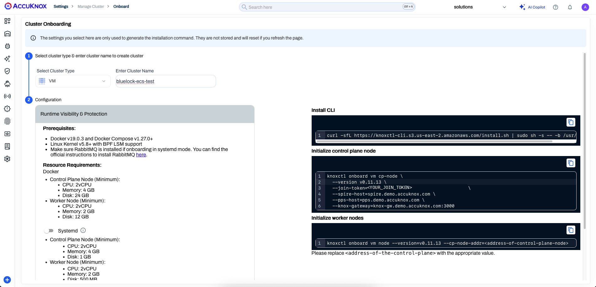

Terraform runs that command for you on the new EC2 instance, so you only need the token. Keep the console page open to watch the cluster appear.

## Step 2. Sign in to AWS and Public ECR

Enter your Access Key ID and Secret Access Key when `aws configure` asks for them.

```bash
aws configure
```

Log in to public ECR.

```bash
aws ecr-public get-login-password --region us-east-1 | docker login --username AWS --password-stdin public.ecr.aws/k9v9d5v2
```

## Step 3. Create the Base Infrastructure

Clone the BlueLock repository and open the `base-infra` folder.

```bash
git clone https://github.com/accuknox/bluelock.git
cd bluelock/terraform/ecs-fargate/base-infra
```

Run Terraform.

```bash
terraform init
terraform apply
```

`terraform apply` asks for two values:

- `join_token`: the token from Step 1.
- `ssh_key_name`: the name of an existing EC2 key pair in `us-east-1`.

You can also pass both values on the command line with `-var="join_token=<JOIN_TOKEN>"` and `-var="ssh_key_name=<KEY_PAIR_NAME>"`.

The script creates these resources in `us-east-1`:

| Resource | Details |
|---|---|
| Network | VPC `bluelock-vpc` (`10.0.0.0/16`), subnet `bluelock-subnet` (`10.0.1.0/24`), an internet gateway and a route table |
| Security group | `bluelock-sg` allows all inbound and outbound traffic |
| Control plane node | EC2 instance `cp-node`, Ubuntu 24.04 on `t3.medium` with a 20 GB `gp3` volume. It installs Docker and `knoxctl`, then runs `knoxctl onboard vm cp-node` with your token |
| Logging | CloudWatch log group `/ecs/armored-container` with 7-day retention |
| IAM | Role `ecsTaskExecutionRolePolicy` with the `AmazonECSTaskExecutionRolePolicy` policy |
| ECS | Cluster `bluelock-test` and task definition `worker-node` (256 CPU, 512 MB, X86_64 Linux) with the three containers |

!!! warning "The security group is open to the internet"
    `bluelock-sg` allows all inbound traffic from anywhere. Use it for testing only. In production, open only the ports that the agents need.

The script onboards the control plane against `spire.demo.accuknox.com`, `pps.demo.accuknox.com` and `knox-gw.demo.accuknox.com:3000`. Change these values in `base-infra/main.tf` to onboard against a different environment.

## Step 4. Deploy the Sample Service

Open the `test-task` folder and run Terraform.

```bash
cd ../test-task
terraform init
terraform apply
```

Terraform creates the service `worker-test-service` on the `bluelock-test` cluster. The service runs 2 Fargate tasks in `bluelock-subnet` with `bluelock-sg` and assigns each task a public IP.

??? note "Set up manually instead of using Terraform"
    Use this path when you cannot run the Terraform scripts. It replaces Steps 3 and 4. Create a VPC and a VM with a public IP first.

    **Control plane**

    1. Install Docker on the VM.
    2. Create a VM cluster on this VM, with only the control plane node, and onboard it to AccuKnox with the commands from Step 1.

        

    3. Confirm that the cluster onboarded.

        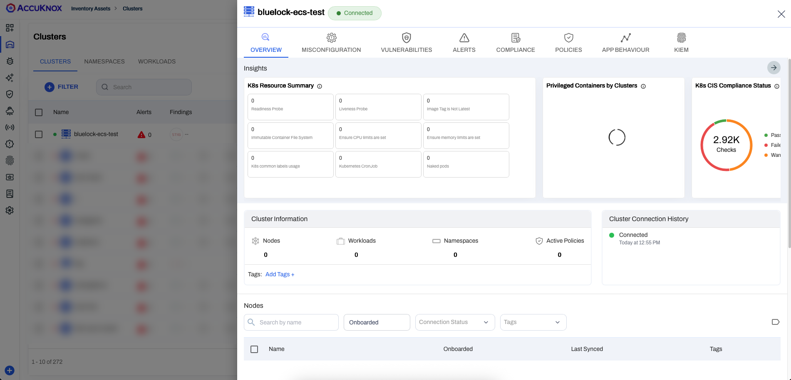

    **IAM role**

    1. In AWS IAM, create a role for the ECS task. Under Service, select `Elastic Container Service`. Under Use case, select `Elastic Container Service Task` and choose Next.

        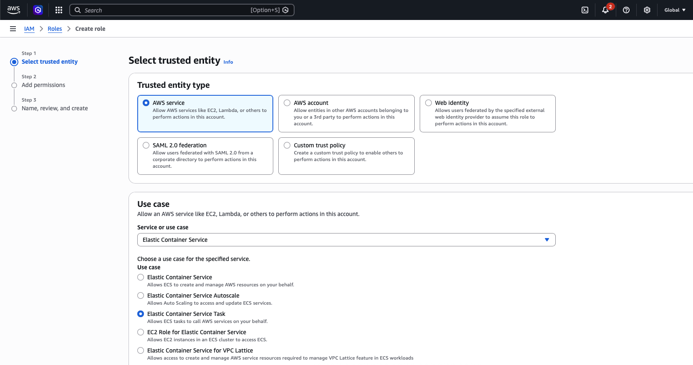

    2. Select `AmazonECSTaskExecutionRolePolicy` and choose Next.

        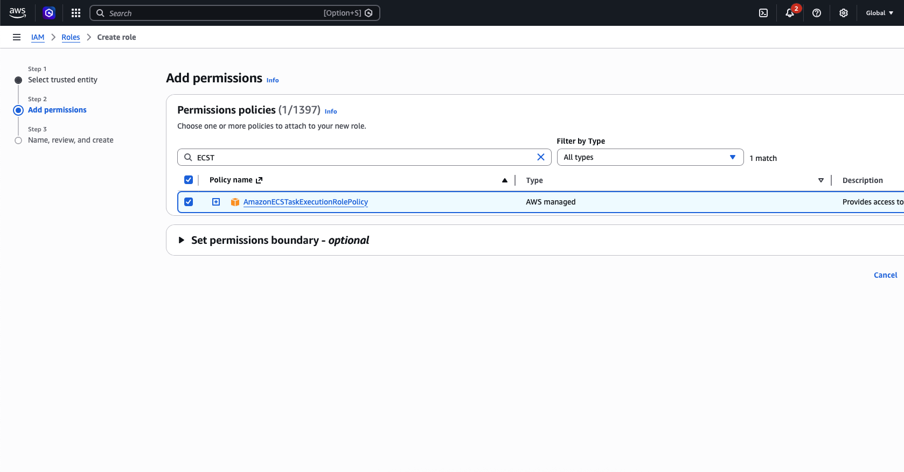

    3. Name the role and save it.

        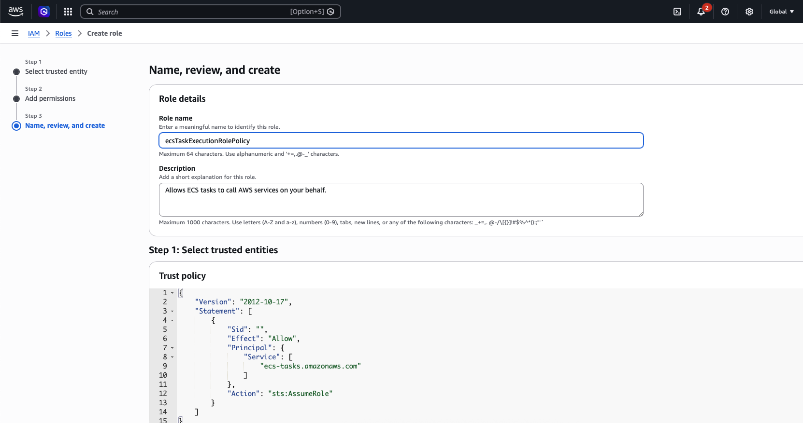

    **CloudWatch log group**

    Open CloudWatch, then Log management, and create a log group named `/ecs/armored-container`.

    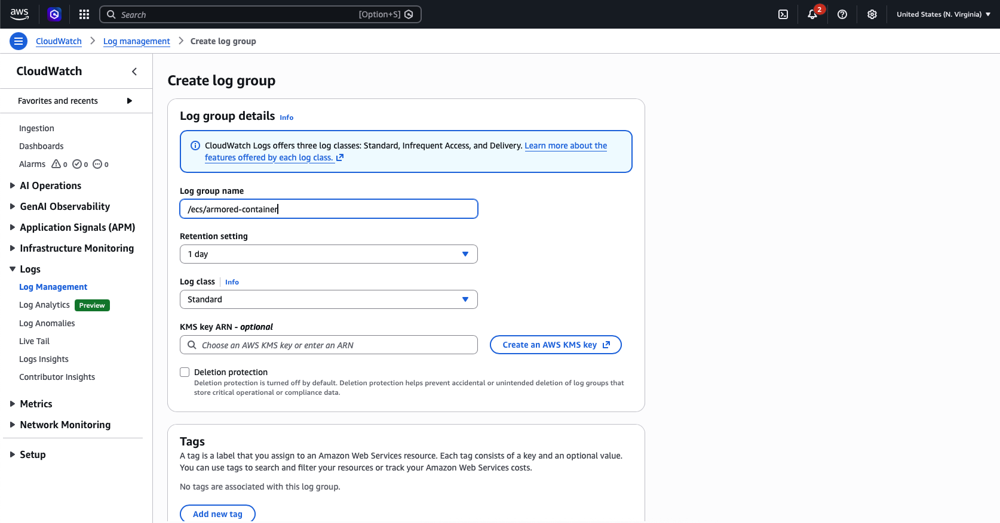

    **ECS cluster**

    Create an ECS cluster with the Fargate only option and the default settings.

    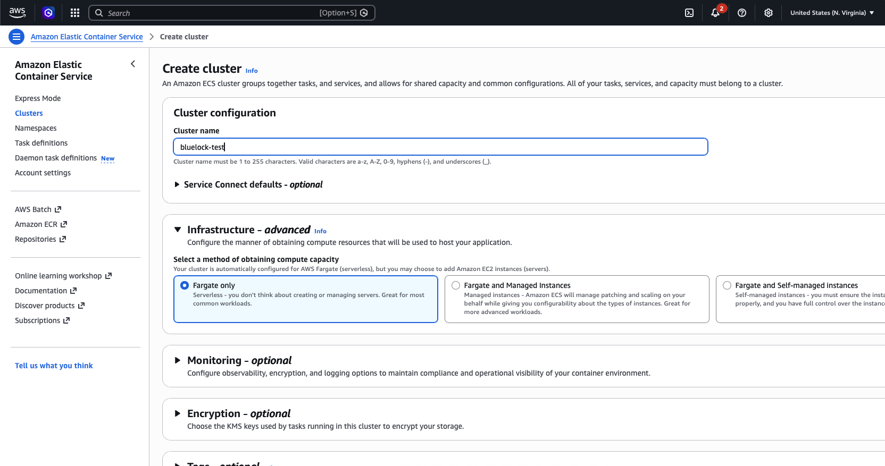

    **Task definition**

    Create a task definition from the following JSON. Set `awslogs-region` to the region where you created the log group. In the `kubearmor-vm-adapter` commands, replace `<CONTROL-PLANE-IP>` with the IP address of the control plane node.

    ```json
    {
        "family": "worker-node",
        "containerDefinitions": [
            {
                "name": "armored-container",
                "image": "public.ecr.aws/k9v9d5v2/accuknox-bluelock/ka-socat-demo:latest",
                "cpu": 0,
                "portMappings": [
                    {
                        "containerPort": 1337,
                        "hostPort": 1337,
                        "protocol": "tcp",
                        "name": "armored-container-1337-tcp",
                        "appProtocol": "http"
                    }
                ],
                "essential": true,
                "command": [
                    "/kubearmor/bluelock",
                    "socat",
                    "TCP-LISTEN:1337,reuseaddr,fork",
                    "EXEC:bash,pty,stderr,setsid,sigint,sane"
                ],
                "environment": [
                    {
                        "name": "CONTAINERNAME",
                        "value": "armored-container"
                    },
                    {
                        "name": "K8S",
                        "value": "false"
                    }
                ],
                "mountPoints": [
                    {
                        "sourceVolume": "kubearmor-dir",
                        "containerPath": "/kubearmor",
                        "readOnly": true
                    }
                ],
                "volumesFrom": [],
                "dependsOn": [
                    {
                        "containerName": "bluelock",
                        "condition": "SUCCESS"
                    }
                ],
                "logConfiguration": {
                    "logDriver": "awslogs",
                    "options": {
                        "awslogs-group": "/ecs/armored-container",
                        "awslogs-region": "us-east-1",
                        "awslogs-stream-prefix": "ecs"
                    }
                },
                "systemControls": []
            },
            {
                "name": "bluelock",
                "image": "public.ecr.aws/k9v9d5v2/accuknox-bluelock:v1.0.0",
                "cpu": 0,
                "portMappings": [],
                "essential": false,
                "environment": [],
                "mountPoints": [
                    {
                        "sourceVolume": "kubearmor-dir",
                        "containerPath": "/kubearmor",
                        "readOnly": false
                    }
                ],
                "volumesFrom": [],
                "logConfiguration": {
                    "logDriver": "awslogs",
                    "options": {
                        "awslogs-group": "/ecs/armored-container",
                        "awslogs-region": "us-east-1",
                        "awslogs-stream-prefix": "ecs"
                    }
                },
                "systemControls": []
            },
            {
                "name": "kubearmor-vm-adapter",
                "image": "docker.io/accuknox/vm-adapter:v0.1.29",
                "cpu": 0,
                "portMappings": [],
                "essential": true,
                "command": [
                    "--kubearmor-addr=localhost:32767",
                    "--relay-server-addr=<CONTROL-PLANE-IP>:32768",
                    "--node-state-refresh=4",
                    "--policy-list-enable=true",
                    "--policy-list-relay-frequency=5m0s",
                    "--sia-addr=<CONTROL-PLANE-IP>:32769",
                    "--pea-addr=<CONTROL-PLANE-IP>:32770",
                    "--harden-addr=<CONTROL-PLANE-IP>:32771",
                    "--annotation-topic=annotation",
                    "--annotation-enable=true"
                ],
                "environment": [
                    {
                        "name": "test",
                        "value": "true"
                    }
                ],
                "mountPoints": [
                    {
                        "sourceVolume": "opt-storage",
                        "containerPath": "/opt",
                        "readOnly": false
                    }
                ],
                "volumesFrom": [],
                "dependsOn": [
                    {
                        "containerName": "armored-container",
                        "condition": "START"
                    }
                ],
                "logConfiguration": {
                    "logDriver": "awslogs",
                    "options": {
                        "awslogs-group": "/ecs/armored-container",
                        "awslogs-region": "us-east-1",
                        "awslogs-stream-prefix": "adapter"
                    }
                },
                "systemControls": []
            }
        ],
        "taskRoleArn": "arn:aws:iam::<ACCOUNT_ID>:role/<ROLE_NAME>",
        "executionRoleArn": "arn:aws:iam::<ACCOUNT_ID>:role/<ROLE_NAME>",
        "networkMode": "awsvpc",
        "volumes": [
            {
                "name": "kubearmor-dir",
                "host": {}
            },
            {
                "name": "opt-storage",
                "host": {}
            }
        ],
        "placementConstraints": [],
        "requiresCompatibilities": [
            "FARGATE"
        ],
        "cpu": "256",
        "memory": "512",
        "runtimePlatform": {
            "cpuArchitecture": "X86_64",
            "operatingSystemFamily": "LINUX"
        }
    }
    ```

    **Run the task**

    Run a new task from this task definition. In Networking, select the correct VPC and turn on `Public IP`. In Task overrides, select the task role and the task execution role that you created.

    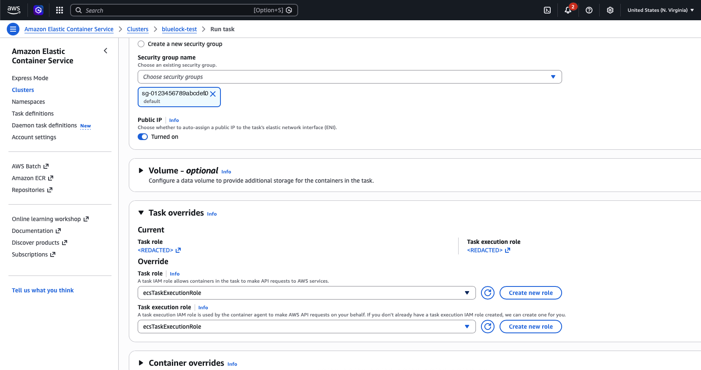

    The security group of the task must allow all inbound traffic from anywhere. Use this for testing only.

## Step 5. Confirm the Nodes Appear in AccuKnox

Check the task logs in CloudWatch first. The `armored-container` stream shows BlueLock starting `socat`.

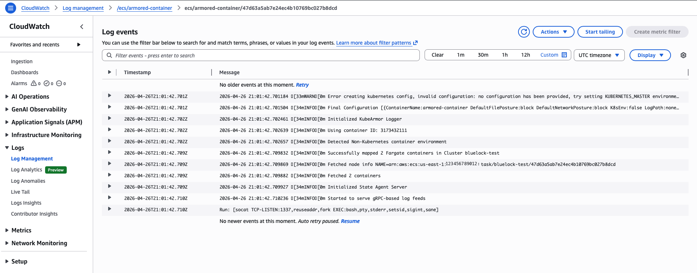

The `kubearmor-vm-adapter` stream shows the adapter connecting to the control plane.

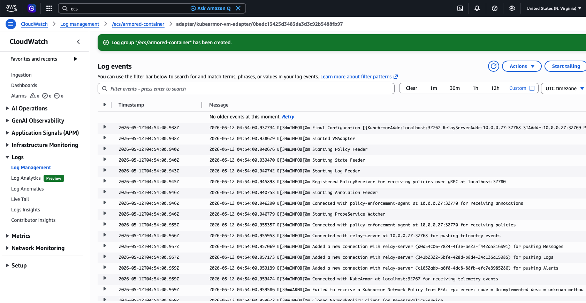

Open the cluster in AccuKnox and wait a few minutes. The cluster shows its nodes, workloads and namespaces.

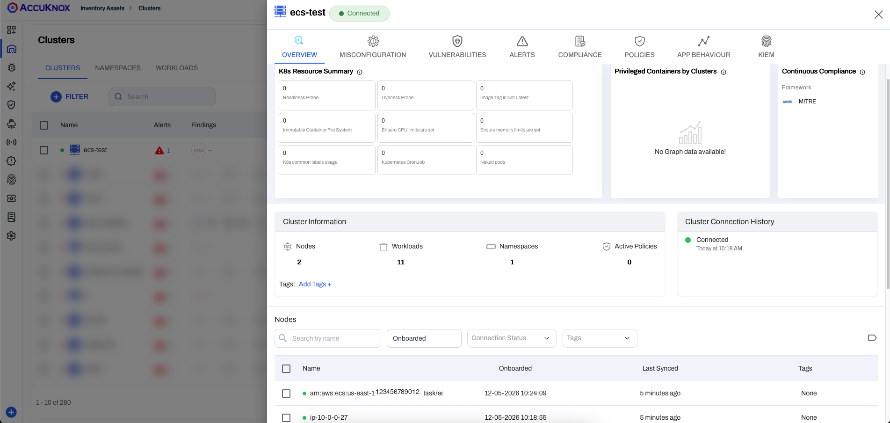

## Step 6. Test Enforcement With a Block Policy

1. Open the ECS console, select the `bluelock-test` cluster and the `worker-test-service` service, and copy the public IP of a task.

2. Connect to the task.

    ```bash
    socat - TCP:<task-ip>:1337
    ```

3. Run the following command. It succeeds, because no policy exists yet.

    ```bash
    ls /etc/ssl/certs
    ```

    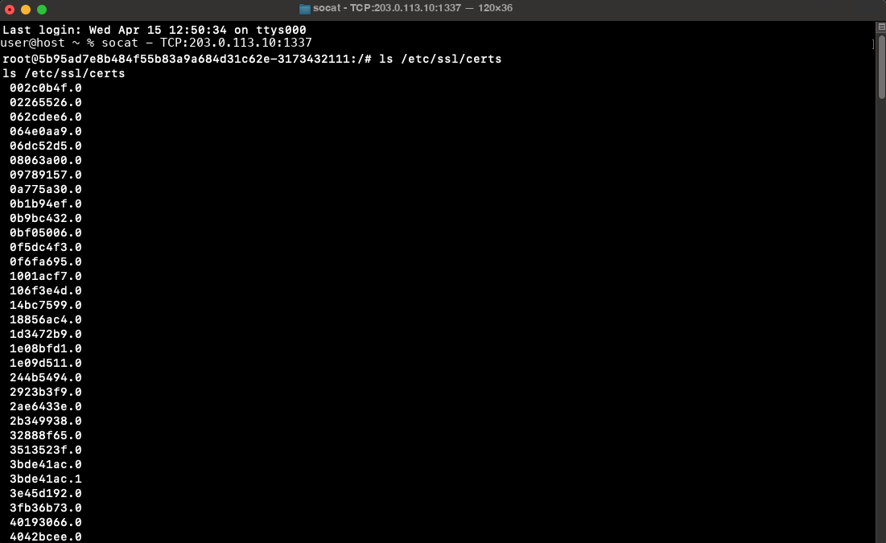

4. In the AccuKnox console, open Runtime Protection, then Policies, and create the following policy. The file [`ksp-block-file-dir-recursive.yaml`](https://raw.githubusercontent.com/accuknox/bluelock/refs/heads/master/terraform/ksp-block-file-dir-recursive.yaml) in the BlueLock repository holds the same rules.

    ```yaml
    apiVersion: security.kubearmor.com/v1
    kind: KubeArmorPolicy
    metadata:
      name: bluelock-test-policy
      namespace: container_namespace
    spec:
      action: Block
      file:
        matchDirectories:
        - dir: /etc/ssl/
          recursive: true
        - dir: /etc/pki/
          recursive: true
        - dir: /usr/local/share/ca-certificates/
          recursive: true
      message: Credentials modification denied
      selector:
        matchLabels:
          kubearmor.io/container.name: armored-container
      severity: 1
      tags:
      - MITRE
      - MITRE_T1552_unsecured_credentials
    ```

5. Select the policy and choose Activate.

    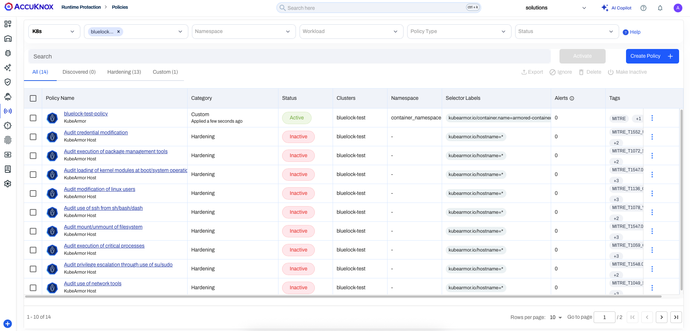

6. Check the CloudWatch logs. The `armored-container` stream reports that BlueLock detected the policy.

    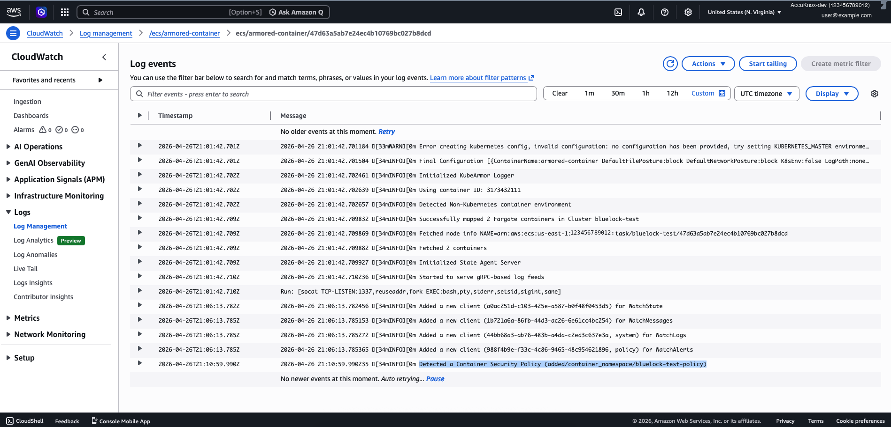

7. Run the same command in the `socat` session. It now fails.

    ```bash
    ls /etc/ssl/certs
    ```

    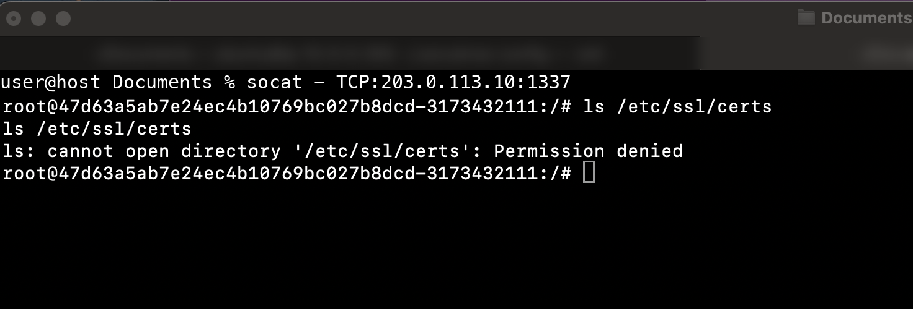

8. Open the alert in AccuKnox. The alert records the blocked `ls` call against `/etc/ssl/certs`.

    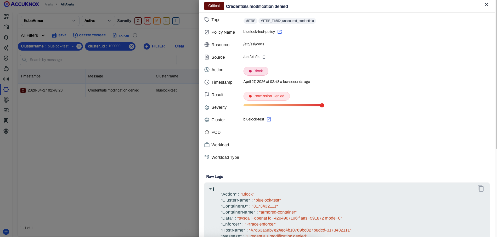

??? example "Raw alert"
    ```json
    {
      "Action":"Block",
      "ClusterName":"bluelock-test",
      "ContainerID":"3173432111",
      "ContainerName":"armored-container",
      "Data":"syscall=openat fd=4294967196 flags=591872 mode=0",
      "Enforcer":"Ptrace enforcer",
      "HostName":"47d63a5ab7e24ec4b10769bc027b8dcd-3173432111",
      "Message":"Credentials modification denied",
      "Operation":"File",
      "PID":22,
      "PPID":18,
      "ParentProcessName":"/usr/bin/bash",
      "PolicyName":"bluelock-test-policy",
      "ProcessName":"/usr/bin/ls",
      "Resource":"/etc/ssl/certs",
      "Result":"Permission denied",
      "Severity":"1",
      "Source":"/usr/bin/ls",
      "Suppressed":false,
      "Tags":"MITRE,MITRE_T1552_unsecured_credentials",
      "Timestamp":1777238300,
      "Type":"MatchedPolicy",
      "UID":0,
      "_id":"<ALERT_ID>",
      "cluster_id":"<CLUSTER_ID>",
      "component_name":"kubearmor",
      "instanceGroup":"0",
      "instanceID":"0",
      "tenant_id":"<TENANT_ID>",
      "workload":"1"
    }
    ```

## What This Test Proves

- A policy you apply in AccuKnox reaches the Fargate tasks and enforces on them.
- The block raises an alert that you can read in AccuKnox.

## Step 7. Destroy the Test Environment When You Finish

Destroy the service first, then the base infrastructure. `base-infra` prompts for the join token and SSH key name again.

```bash
cd bluelock/terraform/ecs-fargate/test-task
terraform destroy
cd ../base-infra
terraform destroy
```
