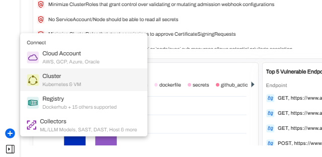
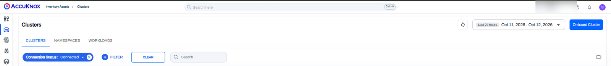
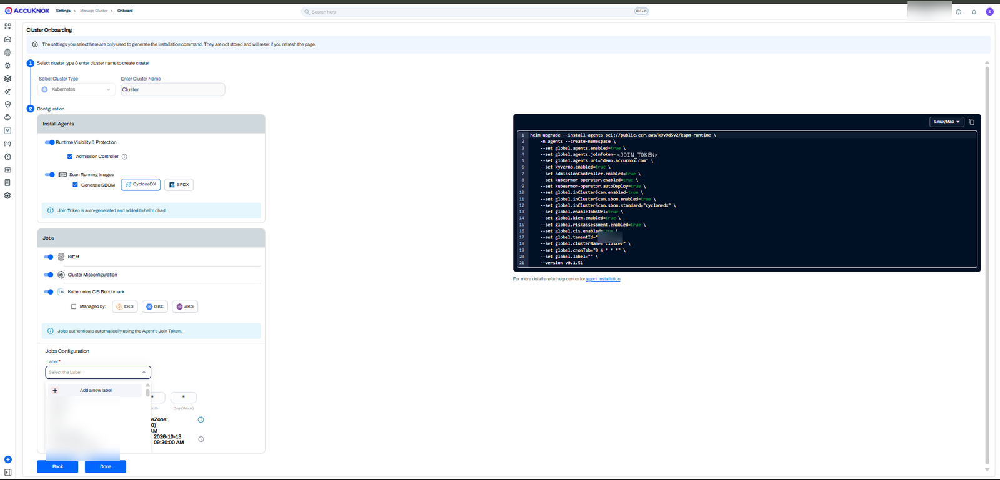
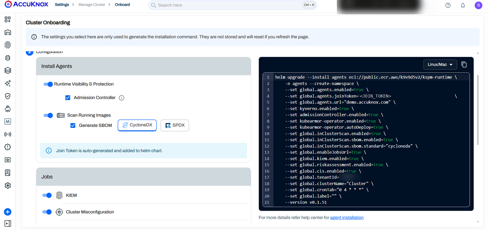

# OpenShift Cluster Onboarding for CWPP and KSPM

Onboard a Red Hat OpenShift cluster to AccuKnox Cloud Workload Protection Platform (CWPP) and Kubernetes Security Posture Management (KSPM) with one Helm release. The release installs the AccuKnox agents, KubeArmor and the KSPM jobs into the `agents` namespace, and pulls every image from your own registry.

OpenShift blocks the agents by default through Security Context Constraints (SCC). This guide creates a KubeArmor SCC, grants the existing SCCs to each agent service account, and only then runs the Helm install.

!!! info "Which OpenShift guide to use"
    - Use this guide to install from a private registry with the `kspm-runtime-0.2.0-patch` chart.
    - Use [Runtime Security Onboarding](cluster-onboarding.md) to install straight from the public AccuKnox registry with the command the console generates.
    - Use [Runtime Security Deployment for OpenShift](../getting-started/security-on-openshift.md) to install KubeArmor from OperatorHub and send alerts to Elasticsearch.

## Prerequisites

- No Helm release with AccuKnox agents in any namespace of the cluster. Remove an earlier install with [Cluster Offboarding](cluster-offboarding.md) first.
- The `oc` and `helm` CLIs, logged in as a user who can create projects and SCCs and run `oc adm policy`.
- A private container registry that the cluster can pull from, with its URL, username, password and image pull secret.
- The artifact store link from [AccuKnox support](mailto:support@accuknox.com), and `wget` on a machine that can reach it.
- Access to the AccuKnox console to copy the Join Token and pick a Label.

## Step 1. Allow the AccuKnox NAT Gateway IP Addresses

Add these four NAT gateway IP addresses to your firewall allowlist:

| NAT gateway IP address |
| --- |
| `18.116.172.112` |
| `3.138.65.220` |
| `18.116.150.26` |
| `3.147.227.45` |

## Step 2. Download the Helm Chart

!!! info "Get the artifact store link from AccuKnox support"
    The download URLs in Step 2 and Step 3 are masked. Email [support@accuknox.com](mailto:support@accuknox.com) for the artifact store link, then replace `accukno-xxxx-xxxx.xxxx` with the host they send you.

```bash
wget https://accukno-xxxx-xxxx.xxxx.your-objectstorage.com/kspm/kspm-runtime-0.2.0-patch.tar
```

You run the Helm install in Step 6 from the directory that holds this chart.

## Step 3. Mirror the Images to Your Registry

The Helm release pulls 29 images from your registry. Download every image archive. Set `BASE` from the artifact store link that AccuKnox support sends you:

```bash
BASE=https://accukno-xxxx-xxxx.xxxx.your-objectstorage.com/releases/accuknox-images
for img in \
  agents-operator:v0.5.7 \
  discovery-engine-sumengine:v0.3.29 \
  rabbitmq:3.12.2-management \
  feeder-service:v0.10.11 \
  policy-enforcement-agent:v0.9.11 \
  policy-enforcement-agent:v0.9.12 \
  shared-informer-agent:v0.8.17 \
  knoxguard:v0.2.4 \
  kubearmor-snitch:latest \
  kubearmor:stable \
  kubearmor-init:stable \
  kubearmor-relay-server:latest \
  kubearmor-controller:latest \
  kubesheild:v0.5.1 \
  aquasec_trivy:2 \
  aquasecurity_trivy-db:2 \
  aquasecurity_trivy-java-db:1 \
  kyvernopre:v1.18.1 \
  kyverno:v1.18.1 \
  background-controller:v1.18.1 \
  cleanup-controller:v1.18.1 \
  reports-controller:v1.18.1 \
  knoxjobs:v0.1.11 \
  kube-bench:v0.15.5 \
  k8s-risk-assessment:v0.3.11 \
  kiem:latest \
  readiness-checker:latest \
  kyverno-cli:v1.18.1 \
  kubectl:latest
do
  wget "${BASE}/public.ecr.aws_k9v9d5v2_${img}.tar"
done
```

Load each archive with `docker load` or `podman load`, then push the image to the registry that you pass as `global.registry.url` in Step 6.

!!! note "Two policy-enforcement-agent versions"
    `policy-enforcement-agent:v0.9.12` is new in this release. Push it alongside `v0.9.11`. Do not replace `v0.9.11`.

## Step 4. Prepare the Agents Project and Its SCCs

### Create the KubeArmor SCC File

Save this configuration as `kubearmor-scc.yaml`. It lets the KubeArmor service accounts in the `agents` namespace use host paths, the host PID namespace and the capabilities KubeArmor needs, without running as privileged containers.

```yaml
allowHostDirVolumePlugin: true
allowHostIPC: false
allowHostNetwork: true
allowHostPID: true
allowHostPorts: true
allowPrivilegeEscalation: false
allowPrivilegedContainer: false
allowedCapabilities:
- SETUID
- SETGID
- SETPCAP
- SYS_ADMIN
- SYS_PTRACE
- MAC_ADMIN
- SYS_RESOURCE
- IPC_LOCK
- CAP_DAC_OVERRIDE
- CAP_DAC_READ_SEARCH
- NET_ADMIN
apiVersion: security.openshift.io/v1
defaultAddCapabilities: null
fsGroup:
  type: RunAsAny
groups: []
kind: SecurityContextConstraints
metadata:
  annotations:
    kubernetes.io/description: kubearmor scc allows users to run with any non-root
      UID and access hostPath with some additional capabilities required for kubearmor.
  name: kubearmor-scc
priority: null
readOnlyRootFilesystem: false
requiredDropCapabilities: null
runAsUser:
  type: RunAsAny
seLinuxContext:
  type: RunAsAny
seccompProfiles:
- '*'
supplementalGroups:
  type: RunAsAny
users:
- system:serviceaccount:agents:kubearmor-controller
- system:serviceaccount:agents:kubearmor
- system:serviceaccount:agents:kubearmor-snitch
volumes:
- configMap
- downwardAPI
- emptyDir
- hostPath
- projected
- secret
```

### Create the Project and Set Pod Security to Privileged

```bash
oc new-project agents
oc label namespace agents pod-security.kubernetes.io/enforce=privileged --overwrite
oc label namespace agents pod-security.kubernetes.io/warn=privileged --overwrite
oc label namespace agents pod-security.kubernetes.io/audit=privileged --overwrite
```

### Apply the SCC and Grant SCCs to the Agent Service Accounts

```bash
oc create -f kubearmor-scc.yaml -n agents
oc adm policy add-scc-to-user anyuid -z agents-operator -n agents
oc adm policy add-scc-to-user privileged -z cis-service-account -n agents
oc adm policy add-scc-to-user hostmount-anyuid -z kubeshield-controller-manager -n agents
oc adm policy add-scc-to-user privileged -z kubeshield-controller-manager -n agents
oc adm policy add-scc-to-user anyuid -z kubeshield-agent -n agents
oc adm policy add-scc-to-user nonroot-v2 -z kyverno-chart-admission-controller -n agents
oc adm policy add-scc-to-user nonroot-v2 -z kyverno-chart-background-controller -n agents
oc adm policy add-scc-to-user nonroot-v2 -z kyverno-chart-cleanup-controller -n agents
oc adm policy add-scc-to-user nonroot-v2 -z kyverno-chart-reports-controller -n agents
```

| Service account | SCC |
| --- | --- |
| `kubearmor`, `kubearmor-controller`, `kubearmor-snitch` | `kubearmor-scc` |
| `agents-operator` | `anyuid` |
| `cis-service-account` | `privileged` |
| `kubeshield-controller-manager` | `hostmount-anyuid` and `privileged` |
| `kubeshield-agent` | `anyuid` |
| `kyverno-chart-admission-controller`, `kyverno-chart-background-controller`, `kyverno-chart-cleanup-controller`, `kyverno-chart-reports-controller` | `nonroot-v2` |

!!! note "Some commands can fail"
    A command fails when the namespace already has that rule. Read the error. If it says the resource or the binding already exists, move to the next command.

## Step 5. Copy the Join Token and Label From the Console

You need two values from the console: the **Join Token** and the **Label**.

1. On the **Dashboard**, click **+** at the bottom left and select **Connect > Cluster**.

    

    You can also go to **Inventory Assets > Clusters** and click **Onboard Cluster**.

    

2. On the **Cluster Onboarding** page, select the cluster type and enter the cluster name. Under **Jobs Configuration**, select the **Label**.

    

3. Copy the Join Token from the `global.agents.joinToken` value in the generated command. The console creates the token for you.

    

!!! warning "Do not run the console command"
    The console command installs from the public registry and leaves out the OpenShift settings. Copy only the Join Token and the Label from it, then use the command in Step 6.

| Value from the console | Parameter in the Step 6 command |
| --- | --- |
| Join Token | `global.agents.joinToken` |
| Label | `global.label` |

## Step 6. Install Agents, KubeArmor and KSPM Jobs

Run this command from the directory that holds the chart from Step 2. It deploys the KSPM jobs, the AccuKnox agents and KubeArmor into the `agents` namespace.

```bash
helm upgrade --install agents kspm-runtime-0.2.0-patch \
    -n agents --create-namespace \
    --set global.agents.enabled=true \
    --set global.agents.joinToken="<JOIN_TOKEN>" \
    --set global.agents.url="<AGENTS_URL>" \
    --set kyverno.enabled=true \
    --set admissionController.enabled=true \
    --set kubearmor-operator.enabled=true \
    --set kubearmor-operator.autoDeploy=true \
    --set kubearmor-operator.imagePinning=true \
    --set kubearmor-operator.registry.secretName="<REGISTRY_SECRET_NAME>" \
    --set kubeshield-chart.scan.trivyConfig.dbSecretName="<TRIVY_DB_SECRET_NAME>" \
    --set kubearmor-operator.kubearmor.repo="<KUBEARMOR_REPO>" \
    --set global.inClusterScan.enabled=true \
    --set global.enableJobsUrl=true \
    --set global.kiem.enabled=true \
    --set global.riskassessment.enabled=true \
    --set global.cis.enabled=true \
    --set global.tenantId="<TENANT_ID>" \
    --set global.registry.url="<REGISTRY_URL>" \
    --set global.registry.secretName="<REGISTRY_SECRET_NAME>" \
    --set global.registry.username="<REGISTRY_USERNAME>" \
    --set global.registry.password="<REGISTRY_PASSWORD>" \
    --set global.registry.preserveUpstream=false \
    --set global.clusterName="<CLUSTER_NAME>" \
    --set global.cronTab="0 4 * * *" \
    --set global.label="<LABEL>" \
    --set kubearmor-operator.kubearmorOperator.env[0].name=REDHAT_CERTIFIED_OP \
    --set kubearmor-operator.kubearmorOperator.env[0].value=yes
```

| Placeholder | What to enter |
| --- | --- |
| `<JOIN_TOKEN>` | The Join Token from Step 5 |
| `<LABEL>` | The Label from Step 5 |
| `<AGENTS_URL>` | The `global.agents.url` value from the console command, such as `demo.accuknox.com` |
| `<TENANT_ID>` | Your AccuKnox tenant ID. The console command shows it as `global.tenantId` |
| `<CLUSTER_NAME>` | The cluster name you entered in Step 5 |
| `<REGISTRY_URL>` | The private registry that holds the images from Step 3 |
| `<REGISTRY_USERNAME>`, `<REGISTRY_PASSWORD>` | The credentials for that registry |
| `<REGISTRY_SECRET_NAME>` | The image pull secret for that registry |
| `<TRIVY_DB_SECRET_NAME>` | The secret for the Trivy vulnerability databases you mirrored in Step 3 |
| `<KUBEARMOR_REPO>` | The KubeArmor image repository in your registry |

The `REDHAT_CERTIFIED_OP` setting marks the KubeArmor Operator as a Red Hat certified operator, so the OpenShift SCCs admit its pod. The `global.cronTab` value runs the KSPM jobs every day at 04:00.

### Add Proxy Settings When the Cluster Uses an HTTP Proxy

If the cluster reaches the internet through a proxy, add these three flags to the end of the Step 6 command:

```bash
    --set 'global.extraEnv.https_proxy=http://<PROXY_HOST>:<PROXY_PORT>' \
    --set 'global.extraEnv.http_proxy=http://<PROXY_HOST>:<PROXY_PORT>' \
    --set 'global.extraEnv.no_proxy=localhost\,127.0.0.1\,10.43.0.1\,10.43.0.0/16\,10.42.0.0/16\,10.122.0.0/20\,.svc\,.cluster.local'
```

The `no_proxy` CIDRs are examples. Replace them with your cluster's service and pod CIDRs, and keep the backslash before each comma, because Helm reads an unescaped comma as a separator.

## Confirm the Cluster Is Connected

1. Check that the pods in the `agents` namespace start:

    ```bash
    oc get pods -n agents
    ```

2. In the AccuKnox console, go to **Inventory Assets > Clusters**. The cluster shows as connected under the **Clusters** tab.

If a KubeArmor Operator pod stays in `CrashLoopBackOff` or reports `unable to validate against any security context constraint`, check the SCC grants in Step 4 and the `REDHAT_CERTIFIED_OP` flags in Step 6. See the [Runtime Security FAQ](../faqs/runtime-security.md) for more checks.
