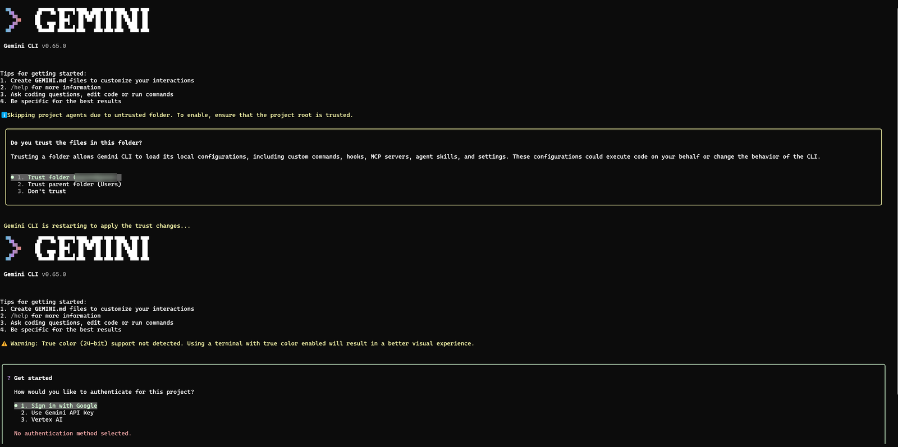
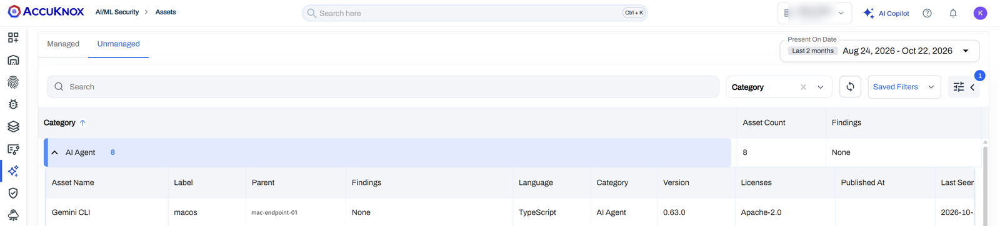
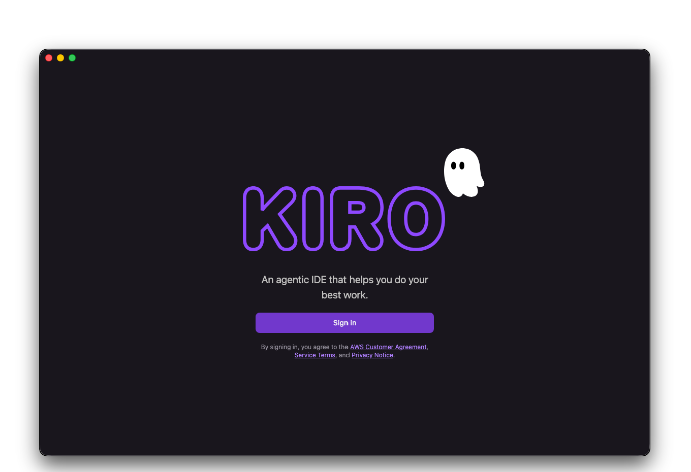
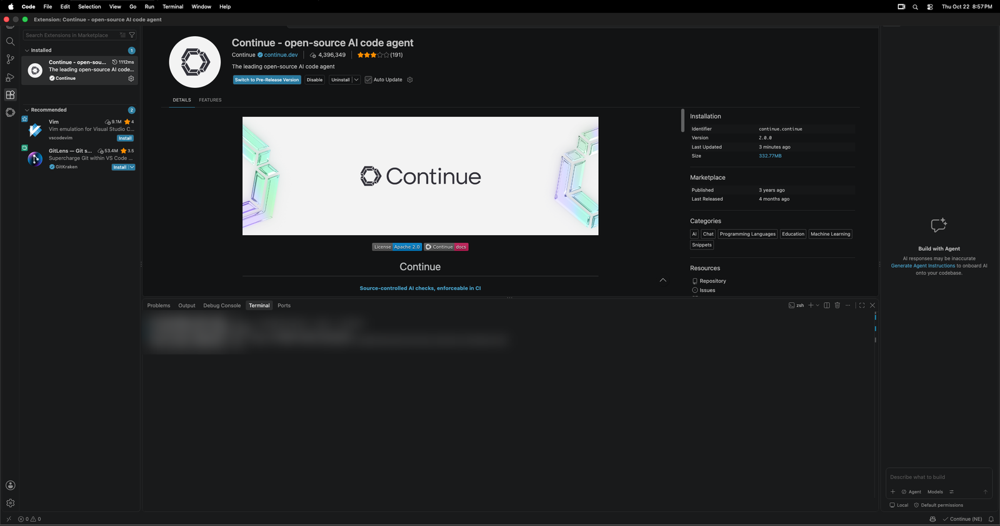
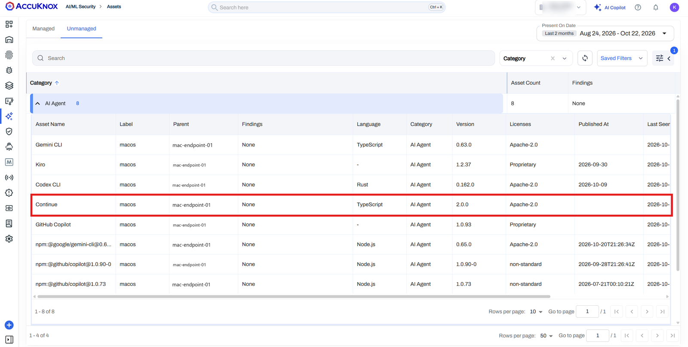

# Agent-Based Scanning for macOS

Install the AccuKnox Omni agent on a Mac to scan it for installed AI tools and send the results to AccuKnox. Discovered tools appear under **AI/ML Security → Assets → Unmanaged**, mapped to the Mac and its artifact label.

!!! info "This flow enables Shadow AI Discovery"
    Omni finds supported AI tools from their installation evidence on disk, so a CLI agent, desktop app or IDE extension shows up even when nobody has opened it. See [Shadow AI Discovery](../../../use-cases/shadow-ai-discovery.md) for the categories and the validated use cases.

## Prerequisites

- Administrator access to the Mac.
- `curl` on the Mac.
- Network access to download the installer and its databases.
- An AccuKnox Artifact API token. Generate one under **Settings > Tokens**.
- Your AccuKnox artifact endpoint and tenant ID.
- An artifact label to identify the Mac. Create one under **Settings > Labels**.
- Disk space and system resources for Omni and its databases.

## Install Omni

Open Terminal and run the command below. Before you run it, make these replacements:

- Replace `<REDACTED>` with your Artifact API token.
- Update the endpoint URL to match your environment.
- Replace `000` with your tenant ID.
- Replace `CHANGEME` with your artifact label.

```bash
curl -fL "https://accuknox-omni.s3.us-east-1.amazonaws.com/latest/agent-install.sh" |
  OMNI_ARTIFACT_API_TOKEN="<REDACTED>" \
  bash -s -- \
    --artifact-endpoint="https://cspm.accuknox.com/api/v1/artifact/" \
    --tenant-id=000 \
    --artifact-label=CHANGEME
```

| Parameter | What it sets |
| --- | --- |
| `OMNI_ARTIFACT_API_TOKEN` | The token Omni uses to authenticate when it uploads results |
| `--artifact-endpoint` | The AccuKnox artifact endpoint for your environment |
| `--tenant-id` | The tenant ID for your environment |
| `--artifact-label` | The label that identifies this Mac or a group of endpoints |

The installer places the binary at `/usr/local/bin/omni` and stores its data under `/var/lib/accuknox-omni/`. It registers a daily `launchd` job named `com.accuknox.omni` and starts the first scan after installation.

## Verify the Scan Ran

### Check the launchd Job

Print the job status:

```bash
sudo launchctl print system/com.accuknox.omni
```

To show only the state, run count, last exit code and process ID:

```bash
sudo launchctl print system/com.accuknox.omni 2>/dev/null |
  grep -E 'state =|runs =|last exit code|pid ='
```

A registered job does not prove that a scan finished or that results uploaded. Check the log as well.

### Read the Scan Log

Show the last 100 log lines:

```bash
sudo tail -n 100 /var/lib/accuknox-omni/omni.log
```

Follow the log while a scan runs:

```bash
sudo tail -n 100 -f /var/lib/accuknox-omni/omni.log
```

Look for scan errors, database download failures and upload failures.

### Find the Results in the Console

1. Sign in to the AccuKnox console.
2. Go to **AI/ML Security → Assets → Unmanaged**.
3. Confirm that the discovered AI tools list this Mac as the parent endpoint and show your artifact label.

## AI Tools Validated on macOS

AccuKnox validated discovery on macOS with one tool of each type. Each tab shows the tool installed on the Mac, then the same tool under **AI/ML Security → Assets → Unmanaged** after one Omni scan. Hostnames and the tenant name are redacted.

=== ":material-console: CLI agent: Gemini CLI"

    

    

    *Gemini CLI appears as an AI Agent. Nobody had signed in to it when the scan ran.*

=== ":material-application-outline: Desktop app: Kiro"

    

    

    *Kiro was installed and left on its sign-in screen. Omni still found it, because discovery reads the installation, not activity.*

=== ":material-puzzle-outline: IDE extension: Continue"

    

    

    *The Continue extension appears as an AI Agent with the same version that Visual Studio Code reports, 2.0.0.*

To repeat the test, install one of these tools, install Omni, wait for the first scan to finish, and look for the tool on the **Unmanaged** tab.

## What This Guide Does Not Cover

- This guide covers online installation. Air-gapped installation steps for macOS are not documented. Contact AccuKnox support for an offline Mac.
- Omni needs to reach the AccuKnox artifact endpoint to upload results. Without that path, results do not appear in the console.
- Discovery depends on the AI discovery features in the Omni release you install.
