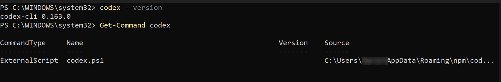
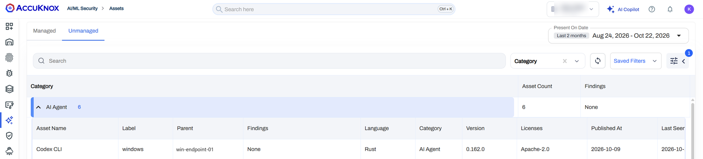
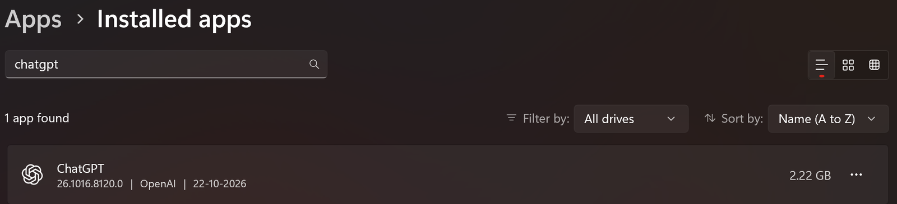
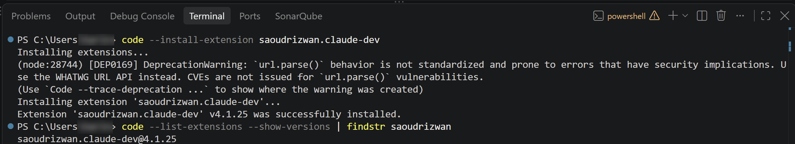
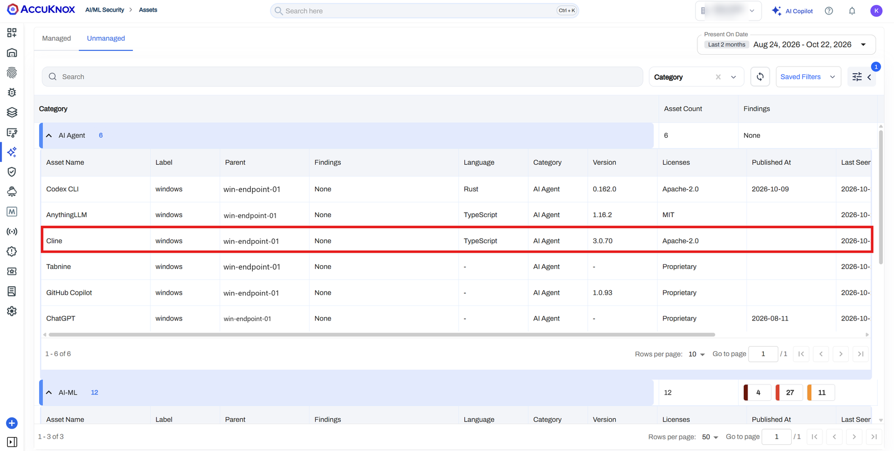

# Agent-Based VM Scanning for Windows

This guide provides step-by-step instructions to onboard Windows Virtual Machines (VMs) for agent-based vulnerability and malware scanning using the AccuKnox VM Scan Solution agent.

!!! info "This flow also enables Shadow AI Discovery"
    The same onboarding flow powers [Shadow AI Discovery](../../../use-cases/shadow-ai-discovery.md) on the host. The agent performs package-level discovery, so AI frameworks, agent frameworks, SDKs, and model runtimes installed on the VM are classified and reported under the **Unmanaged** tab, alongside their vulnerability data.

    This includes agentic AI runtimes such as OpenClaw. AccuKnox scans VMs for OpenClaw instances and reports each one as an unmanaged asset, mapped to its parent host.

## Prerequisites

- Administrator access to the Windows VM or endpoint.
- PowerShell on the endpoint.
- Outbound internet connectivity to AccuKnox SaaS.
- A valid AccuKnox Tenant ID and API Token.
- An artifact label to identify the endpoint.

## Installation

### 1. Download the Installer Script

Open a PowerShell terminal as Administrator and run the following command to download the agent installation script:

```powershell
Invoke-WebRequest -Uri 'https://accuknox-omni.s3.us-east-1.amazonaws.com/latest/agent-install.ps1' -OutFile .\agent-install.ps1
```

### 2. Run the Installation Script

Execute the script to install and configure the agent. Replace `<REDACTED>` with your actual Artifact API Token and `CHANGEME` with your desired label.

```powershell
.\agent-install.ps1 `
    -ArtifactEndpoint https://cspm.accuknox.com/api/v1/artifact/ `
    -TenantId 000 `
    -ArtifactLabel CHANGEME `
    -ArtifactApiToken "<REDACTED>" `
    -SkipMalwareScan $true
```

!!! note "Configuration Details"
    - **Artifact API Token**: Generate this under **Settings > Tokens** in the AccuKnox dashboard.
    - **Artifact Label**: Create a label under **Settings > Labels** to identify this VM.
    - **SkipMalwareScan**: Set to `$false` if you want to enable malware scanning immediately (requires ClamAV).

The installation script creates a Windows scheduled task to run the agent periodically.

## Verify the Scan Ran

### 1. Check the Scheduled Task

```powershell
Get-ScheduledTaskInfo -TaskName 'AccuKnox Omni Vuln Scan'
```

Review the last run time and the last task result. A task that exists does not prove that the scan finished or that results uploaded.

### 2. Read the Scan Log

```powershell
Get-Content 'C:\ProgramData\Accuknox\Omni\logs\omni-vuln-scan.log' -Tail 100
```

Look for scan errors, database download failures and upload failures.

### 3. Find the Results in the Console

Go to **AI/ML Security → Assets → Unmanaged** in the AccuKnox console. Confirm that the discovered AI tools list this endpoint as the parent and show your artifact label.

### 4. Compare With the AI Tools Validated on Windows

AccuKnox validated Shadow AI Discovery on Windows with three tool types. Each tab shows the tool installed on the endpoint, then the same tool on the **Unmanaged** tab after one Omni scan. Hostnames and the tenant name are redacted.

=== ":material-console: CLI agent: Codex CLI"

    

    

    *Codex CLI was installed through npm and appears as an AI Agent with its language, version and license.*

=== ":material-application-outline: Desktop app: ChatGPT"

    

    

    *The ChatGPT desktop app appears as an AI Agent next to the CLI agents and IDE extensions on the same endpoint.*

=== ":material-puzzle-outline: IDE extension: Cline"

    

    

    *Cline was installed with `code --install-extension saoudrizwan.claude-dev` and appears as an AI Agent, even though it lives inside Visual Studio Code.*

## Air-Gapped Installation

For environments without direct internet access, follow these steps:

### 1. Download & Extract the Bundle

On a machine with internet access, download the all-in-one bundle:

```powershell
Invoke-WebRequest `
    -Uri "https://accuknox-omni.s3.us-east-1.amazonaws.com/latest/all-in-one.zip" `
    -OutFile all-in-one.zip `
    -UseBasicParsing

Expand-Archive -Path ".\all-in-one.zip" -DestinationPath .\ -Force
cd .\all-in-one\
```

### 2. Setup ClamAV Database

Create the directory and move the ClamAV database files:

```powershell
New-Item -ItemType Directory -Path "C:\Program Files\ClamAV" -Force
Move-Item -Path .\database\clamav\ -Destination "C:\Program Files\ClamAV\database" -Force
```

### 3. Setup the Vulnerability and AI Agent Databases

Create the directory and move the MSRC, `db`, `java-db` and `aiagent` databases from the bundle:

```powershell
New-Item -ItemType Directory -Path "C:\ProgramData\Accuknox\Omni" -Force
Move-Item -Path .\database\msrc\ -Destination "C:\ProgramData\Accuknox\Omni" -Force
Move-Item ".\database\db" -Destination "C:\ProgramData\Accuknox\Omni" -Force
Move-Item ".\database\java-db" -Destination "C:\ProgramData\Accuknox\Omni" -Force
Move-Item ".\database\aiagent" -Destination "C:\ProgramData\Accuknox\Omni" -Force
```

### 4. Install VM Scan Solution Agent

Move the VM Scan Solution executable to the installation directory:

```powershell
New-Item -ItemType Directory -Path "C:\Program Files\AccuKnox\Omni\" -Force
Move-Item -Path .\omni.exe -Destination "C:\Program Files\AccuKnox\Omni\" -Force
```

### 5. Run the Installation Script (Air-gapped)

Run the installation script with the `-SkipOmniDownload` and `-SkipDatabaseDownload` flags, so the installer uses the binary and databases you placed. Make sure `clamav.msi` sits at the path you pass to `-ClamavMSIInstallerFile`.

```powershell
.\agent-install.ps1 `
    -ArtifactEndpoint https://cspm.accuknox.com/api/v1/artifact/ `
    -TenantId 000 `
    -ArtifactLabel CHANGEME `
    -ArtifactApiToken "<REDACTED>" `
    -ClamavMSIInstallerFile "clamav.msi" `
    -SkipOmniDownload $true `
    -SkipDatabaseDownload $true
```

### 6. Verify Offline Scanning and Reporting

1. Confirm that the scheduled task exists, as shown in [Verify the Scan Ran](#verify-the-scan-ran).
2. Check the scan log for errors and confirm that the databases loaded.
3. Confirm that the scan finished and produced a local report.

!!! warning "Air-gapped scanning and central reporting are separate"
    An endpoint that cannot reach the AccuKnox artifact endpoint cannot upload its results. Omni still scans locally, but the results do not appear in the console until you move them through an approved transfer process.
