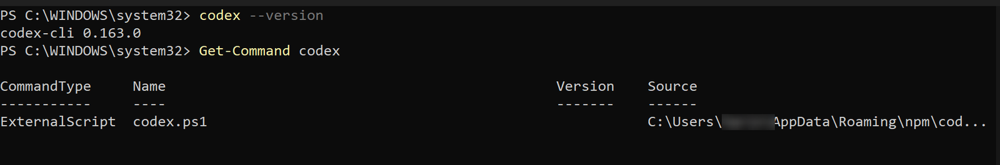
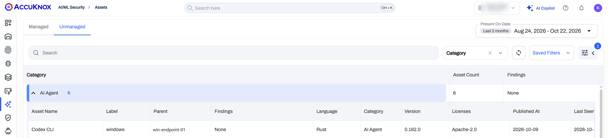
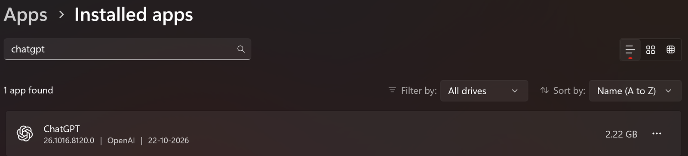
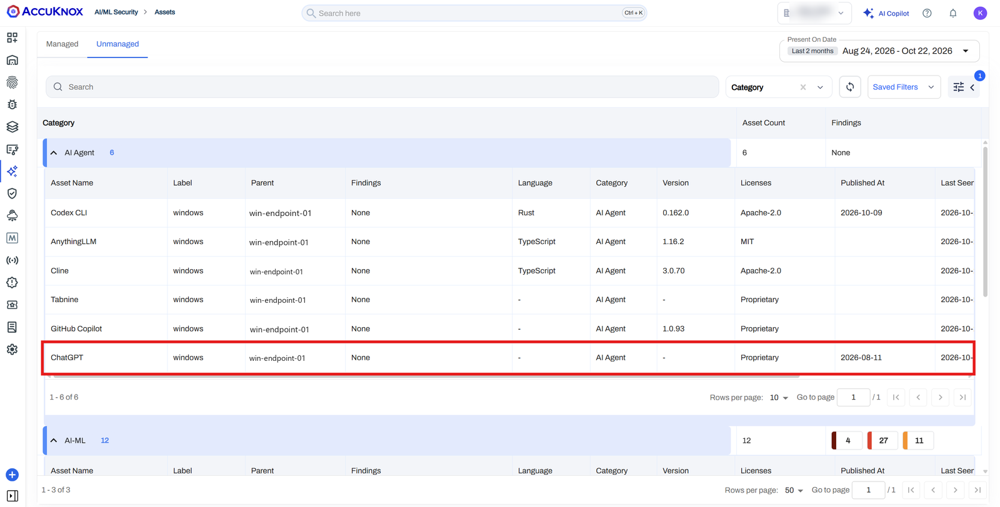
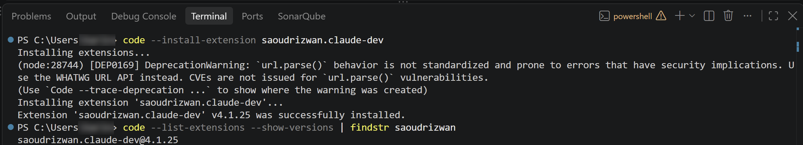
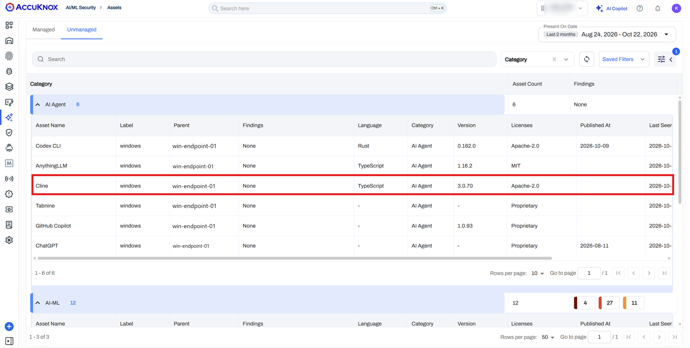

# Agent-Based VM Scanning for Windows

This guide provides step-by-step instructions to onboard Windows Virtual Machines (VMs) for agent-based vulnerability and malware scanning using the AccuKnox VM Scan Solution agent.

!!! info "This flow also enables Shadow AI Discovery"
    The same onboarding flow powers [Shadow AI Discovery](../../../use-cases/shadow-ai-discovery.md) on the host. The agent performs package-level discovery, so AI frameworks, agent frameworks, SDKs, and model runtimes installed on the VM are classified and reported under the **Unmanaged** tab, alongside their vulnerability data.

    This includes agentic AI runtimes such as OpenClaw. AccuKnox scans VMs for OpenClaw instances and reports each one as an unmanaged asset, mapped to its parent host.

## Prerequisites

- Administrator access to the Windows VM or endpoint.
- PowerShell on the endpoint.
- Outbound internet connectivity to AccuKnox SaaS.
- A valid AccuKnox Tenant ID and API Token.
- An artifact label to identify the endpoint.

## Installation

### 1. Download the Installer Script

Open a PowerShell terminal as Administrator and run the following command to download the agent installation script:

```powershell
Invoke-WebRequest -Uri 'https://accuknox-omni.s3.us-east-1.amazonaws.com/latest/agent-install.ps1' -OutFile .\agent-install.ps1
```

### 2. Run the Installation Script

Execute the script to install and configure the agent. Replace `<REDACTED>` with your actual Artifact API Token and `CHANGEME` with your desired label.

```powershell
.\agent-install.ps1 `
    -ArtifactEndpoint https://cspm.accuknox.com/api/v1/artifact/ `
    -TenantId 000 `
    -ArtifactLabel CHANGEME `
    -ArtifactApiToken "<REDACTED>" `
    -SkipMalwareScan $true
```

!!! note "Configuration Details"
    - **Artifact API Token**: Generate this under **Settings > Tokens** in the AccuKnox dashboard.
    - **Artifact Label**: Create a label under **Settings > Labels** to identify this VM.
    - **SkipMalwareScan**: Set to `$false` if you want to enable malware scanning immediately (requires ClamAV).

The installation script creates a Windows scheduled task to run the agent periodically.

!!! info "Use an Omni release with the combined Windows report"
    The report described below needs an Omni release that contains the combined Windows report and AI agent discovery. Older binaries may not produce it.

### What One Scan Sends

Each successful live vulnerability scan publishes one Trivy rootfs artifact for the VM. That artifact combines three sources:

- MSRC Windows update findings.
- Trivy application dependency findings from every fixed local drive.
- Windows host inventory.

If the MSRC scan or any fixed-drive scan fails, the agent sends no partial vulnerability artifact. Omni skips network drives and drives that Windows classifies as removable.

The installer downloads and updates four databases: MSRC, the Trivy vulnerability database, the Trivy Java database and the AI agent catalog. When the catalog is available, the rootfs artifact includes a top-level `AIAgentDetections` array with catalog matches for installed AI tools. An empty array means Omni found no matches.

An offline Windows disk or registry scan is a different mode. It still publishes a WINVM report, and that report does not include AI agent detections.

## Verify the Scan Ran

### 1. Check the Scheduled Task

```powershell
Get-ScheduledTaskInfo -TaskName 'AccuKnox Omni Vuln Scan'
```

Review the last run time and the last task result. A task that exists does not prove that the scan finished or that results uploaded.

### 2. Read the Scan Log

```powershell
Get-Content 'C:\ProgramData\Accuknox\Omni\logs\omni-vuln-scan.log' -Tail 100
```

Look for scan errors, database download failures and upload failures.

### 3. Find the Results in the Console

Go to **AI/ML Security → Assets → Unmanaged** in the AccuKnox console. Confirm that the discovered AI tools list this endpoint as the parent and show your artifact label.

### 4. Compare With the AI Tools Validated on Windows

AccuKnox validated Shadow AI Discovery on Windows with three tool types. Each tab shows the tool installed on the endpoint, then the same tool on the **Unmanaged** tab after one Omni scan. Hostnames and the tenant name are redacted.

=== ":material-console: CLI agent: Codex CLI"

    

    

    *Codex CLI was installed through npm and appears as an AI Agent with its language, version and license.*

=== ":material-application-outline: Desktop app: ChatGPT"

    

    

    *The ChatGPT desktop app appears as an AI Agent next to the CLI agents and IDE extensions on the same endpoint.*

=== ":material-puzzle-outline: IDE extension: Cline"

    

    

    *Cline was installed with `code --install-extension saoudrizwan.claude-dev` and appears as an AI Agent, even though it lives inside Visual Studio Code.*

## Air-Gapped Installation

Air-gapped installation copies the agent and its databases to the Windows machine you want to scan, so that machine downloads nothing. The agent still runs a **live** scan of that machine. AI agent detection works in this mode when the AI catalog is present. An offline Windows disk or registry scan is a different mode and does not produce AI agent detections.

The steps below turn on vulnerability and AI agent scanning and skip malware scanning. Prepare the bundle on a connected Windows machine, then move it to the isolated machine through your approved transfer process. Run the commands on the isolated machine in an Administrator PowerShell session.

### 1. Prepare the Bundle on a Connected Machine

Download and extract `all-in-one.zip`:

```powershell
Invoke-WebRequest `
    -Uri "https://accuknox-omni.s3.us-east-1.amazonaws.com/latest/all-in-one.zip" `
    -OutFile all-in-one.zip `
    -UseBasicParsing
Expand-Archive -Path ".\all-in-one.zip" -DestinationPath .\ -Force
cd .\all-in-one\
```

Before you transfer the bundle, check that it contains three things:

- An Omni binary with combined Windows scanning and AI agent discovery.
- A matching `agent-install.ps1`. Copy it from the same release if the bundle lacks it.
- The database files below. The AI catalog is required for the `AIAgentDetections` field in the combined report.

```powershell
$requiredFiles = @(
    '.\omni.exe',
    '.\agent-install.ps1',
    '.\database\msrc\db.sqlite3',
    '.\database\db\trivy.db',
    '.\database\db\metadata.json',
    '.\database\java-db\trivy-java.db',
    '.\database\java-db\metadata.json',
    '.\database\aiagent\aiagentscan.json'
)
$requiredFiles | ForEach-Object { if (-not (Test-Path $_)) { throw "Missing $_" } }
```

If a database is missing or out of date, run this command **on the connected machine**, then run the check again:

```powershell
.\omni.exe db download msrc vuln java aiagent --destination .\database --force
```

### 2. Install the Files on the Isolated Machine

Move the databases and the binary to the paths the agent expects:

```powershell
New-Item -ItemType Directory -Path "C:\ProgramData\Accuknox\Omni" -Force
Move-Item -Path .\database\msrc\ -Destination "C:\ProgramData\Accuknox\Omni" -Force
Move-Item -Path .\database\db\ -Destination "C:\ProgramData\Accuknox\Omni" -Force
Move-Item -Path .\database\java-db\ -Destination "C:\ProgramData\Accuknox\Omni" -Force
Move-Item -Path .\database\aiagent\ -Destination "C:\ProgramData\Accuknox\Omni" -Force
New-Item -ItemType Directory -Path "C:\Program Files\AccuKnox\Omni\" -Force
Move-Item -Path .\omni.exe -Destination "C:\Program Files\AccuKnox\Omni\" -Force
```

### 3. Choose How to Deliver the Report

Pick the path that matches the machine's network access.

=== "The machine can reach CSPM"

    Run the installer to create scheduled scans. `-SkipDatabaseDownload` stops the installer from contacting the database registries. Replace the endpoint, tenant, label and token with values from the same CSPM environment.

    ```powershell
    .\agent-install.ps1 `
        -ArtifactEndpoint https://cspm.accuknox.com/api/v1/artifact/ `
        -TenantId 000 `
        -ArtifactLabel CHANGEME `
        -ArtifactApiToken "<REDACTED>" `
        -SkipMalwareScan $true `
        -SkipOmniDownload $true `
        -SkipDatabaseDownload $true
    ```

    Then confirm the scan ran, as shown in [Verify the Scan Ran](#verify-the-scan-ran).

=== "The machine has no route to CSPM"

    Run a local scan instead. It writes one combined TR JSON artifact to the `reports` directory and uploads nothing. Move the artifact out through your approved transfer process.

    ```powershell
    & 'C:\Program Files\AccuKnox\Omni\omni.exe' agent scan `
        --skip-malware-scan `
        --vuln-db-directory 'C:\ProgramData\Accuknox\Omni' `
        --local-publisher `
        --local-publisher-store-path 'C:\ProgramData\Accuknox\Omni\reports'
    Get-ChildItem 'C:\ProgramData\Accuknox\Omni\reports\*-TR.json'
    ```

    The local scan does not install a scheduled task or update the copied databases. To refresh them, download them again on a connected machine and transfer them.

### Enable Malware Scanning (Optional)

Malware scanning needs a separate ClamAV Windows MSI and current signature files. The bundle builder includes them only when both are supplied. Without them, keep `-SkipMalwareScan $true`.

To turn on malware scanning in the installer:

1. Place the bundled signatures under `C:\Program Files\ClamAV\database`.
2. Pass `-ClamavMSIInstallerFile .\clamav.msi` to `agent-install.ps1`.
3. Remove `-SkipMalwareScan $true` from the command.

ClamAV signature updates need their own network access or a manual transfer.
