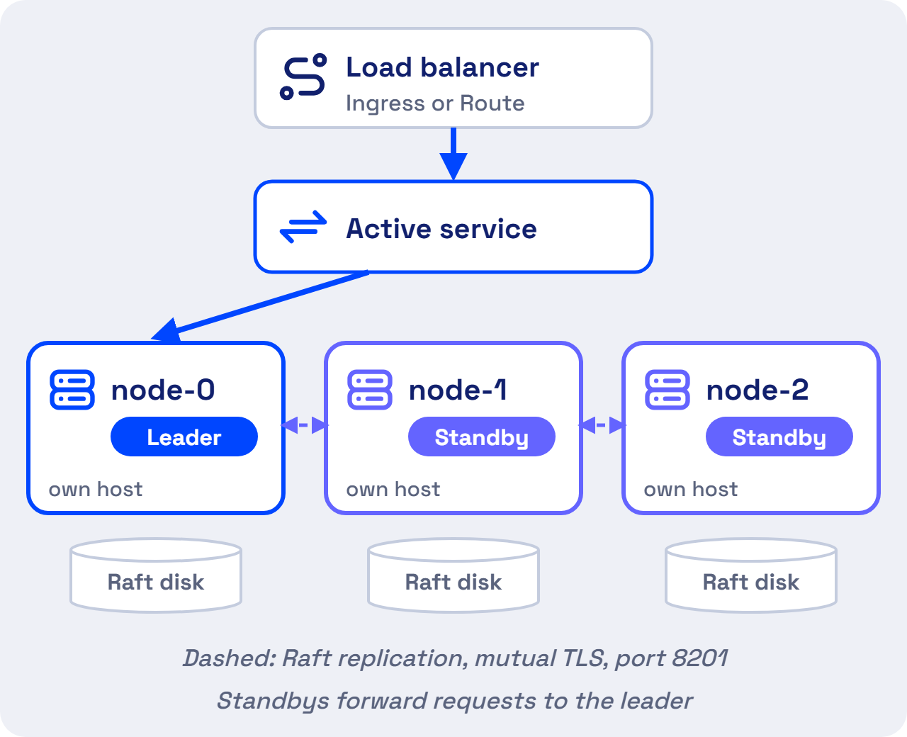
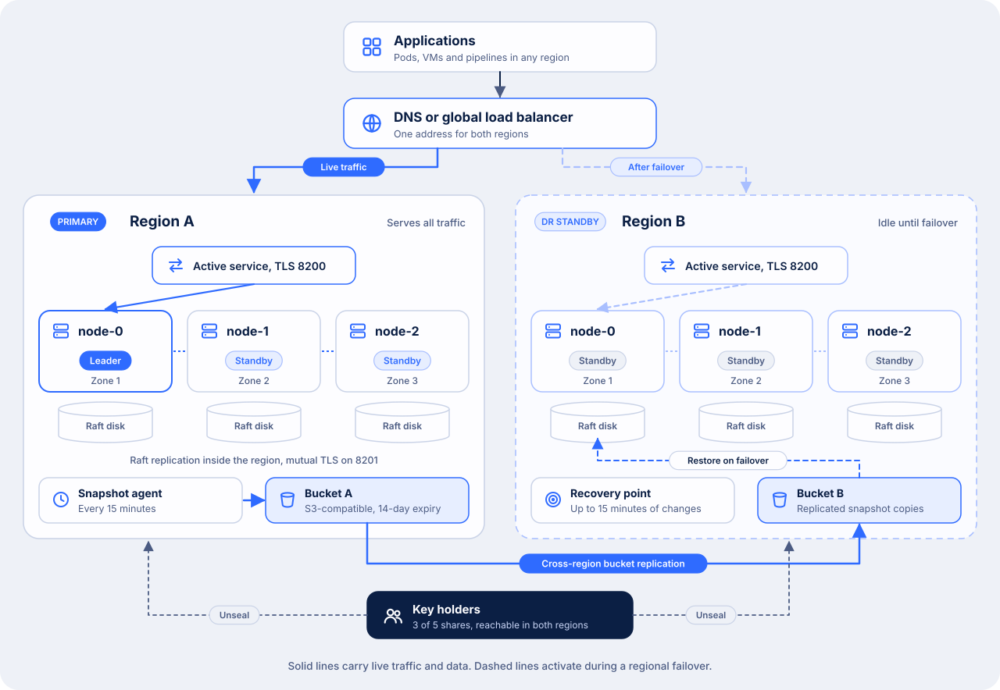

# High Availability, Backup and Day 2 Operations

Three Secrets Manager nodes keep serving secrets when any one of them fails. A snapshot agent copies the data to object storage every 15 minutes, so you can rebuild the cluster from a known point. Both features ship in the Helm chart and are off by default.

## Three Nodes Survive One Failure



- **One leader writes.** Standby nodes forward requests to the leader over mutual TLS, on the cluster port 8201.
- **A majority keeps the cluster up.** Three nodes survive the loss of one. Five nodes survive the loss of two.
- **Leader election is automatic.** When the leader fails, a standby takes over.
- **Applications keep working through a short outage.** A Kubernetes secret synced by the External Secrets Operator stays in place, and an SDK application keeps the value it already read. New logins wait until a leader is back.

!!! warning "A restarted node comes back sealed"
    A node that restarts rejoins only after you unseal it with 3 of the 5 unseal keys. Keep the key holders reachable. Without 3 keys the data cannot be recovered.

High availability protects against outages. It does not add throughput, because every write goes through the leader.

## Enable HA Mode With Three Replicas

Install the chart with HA and Raft storage turned on.

```bash
helm upgrade --install vault . -n accuknox \
  --set server.ha.enabled=true \
  --set server.ha.raft.enabled=true \
  --set server.ha.replicas=3
```

Bring the cluster up in three steps.

1. Initialize and unseal the first node, `vault-accuknoxsecretmanager-0`, as the [Deployment Guide](deployment.md) shows.
2. Join each other node to the first one. A joining node must be uninitialized, and the join uses the API address of the leader.

    ```bash
    kubectl exec vault-accuknoxsecretmanager-1 -n accuknox -- \
      vault operator raft join http://vault-accuknoxsecretmanager-0.vault-accuknoxsecretmanager-internal:8200
    ```

3. Unseal each joined node with 3 of the same 5 key shares. The join completes only after the unseal, and then the node receives a copy of the data.

    ```bash
    kubectl exec vault-accuknoxsecretmanager-1 -n accuknox -- vault operator unseal <unseal-key-1>
    ```

Repeat steps 2 and 3 for `vault-accuknoxsecretmanager-2`. With auto-unseal, a joined node unseals itself. A node joins one cluster only, and it cannot move to a different cluster later.

Run each pod on its own host. The chart leaves `server.affinity` empty, so set a pod anti-affinity rule on the hostname. The PodDisruptionBudget, on by default in HA mode, stops node maintenance from taking down a majority.

## Snapshots Save the Cluster Every 15 Minutes

The snapshot agent is a CronJob. It logs in with the Kubernetes auth method, takes a Raft snapshot from the leader, and uploads it to an S3-compatible bucket, which can run on-premises.

| Setting in `values.yaml` | Default | Meaning |
| --- | --- | --- |
| `snapshotAgent.enabled` | `false` | Turns the agent on |
| `snapshotAgent.schedule` | `*/15 * * * *` | Runs every 15 minutes |
| `snapshotAgent.config.s3ExpireDays` | `14` | Deletes snapshots after 14 days |
| `snapshotAgent.config.baoRole` | `snapshot` | The role the agent logs in with |
| `snapshotAgent.s3CredentialsSecret` | `my-s3-credentials` | The Kubernetes secret holding `AWS_ACCESS_KEY_ID` and `AWS_SECRET_ACCESS_KEY` |

Set `s3Host`, `s3Bucket` and `s3Uri` under `snapshotAgent.config` to point at your bucket. With the default schedule, a restore loses at most 15 minutes of secret changes.

## Restore From a Snapshot

Load the snapshot into a running cluster, then unseal it with the original unseal keys.

```bash
kubectl exec vault-accuknoxsecretmanager-0 -n accuknox -- vault operator raft snapshot restore <snapshot-file>
```

A snapshot holds encrypted data. The file alone exposes no secrets, and a restore needs the unseal keys.

Add `-force` when the target cluster was initialized with different unseal keys from the snapshot, such as a new cluster in a DR region. The flag skips the check that the keys match the snapshot. After the restore, the cluster uses the keys from the snapshot.

```bash
kubectl exec vault-accuknoxsecretmanager-0 -n accuknox -- vault operator raft snapshot restore -force <snapshot-file>
```

## A Second Region Recovers From the Loss of the First

Run one three-node cluster in each region. The primary region serves all traffic. The disaster recovery (DR) region holds a standby cluster and a copy of every snapshot, and it takes over when the primary region fails.



| Failure | What keeps Secrets Manager up | Data loss |
| --- | --- | --- |
| One pod or one host | The other two nodes elect a leader | None |
| One availability zone | One node per zone leaves two nodes running | None |
| The whole primary region | The DR region restores the latest snapshot | Up to 15 minutes, with the default snapshot schedule |

Your recovery time is the time your runbook takes to restore, unseal and switch DNS. Rehearse the runbook to learn that number for your environment.

### Spread One Cluster Across Zones, Never Across Regions

Place the three nodes of a cluster in three availability zones of one region. Add a topology spread constraint on `topology.kubernetes.io/zone` next to the pod anti-affinity rule on the hostname.

Never stretch one Raft cluster across two regions. Every write waits for a majority of nodes, so a cross-region node adds the network round trip to each write. With two regions, one region holds two of the three nodes, and losing that region loses the majority.

Snapshots carry the data between regions. Raft replication runs inside one cluster only, so each region runs its own cluster.

### Prepare the DR Region Before You Need It

1. Install the chart in the DR region with HA turned on, as [Enable HA Mode With Three Replicas](#enable-ha-mode-with-three-replicas) shows.
2. Replicate the snapshot bucket to the DR region with your object storage, such as S3 cross-region replication or MinIO site replication.
3. Place at least 3 of the 5 key holders where they can reach the DR region during an outage.
4. Point applications at one DNS name or global load balancer address, never at a regional address.
5. Rehearse the failover once each quarter, and record the time it takes.

### Fail Over to the DR Region

1. Confirm that the primary region cannot serve requests.
2. Initialize and unseal the DR cluster, if it is not already running.
3. Restore the latest snapshot from the replicated bucket. Use `-force`, because the DR cluster was initialized with its own keys.

    ```bash
    kubectl exec vault-accuknoxsecretmanager-0 -n accuknox -- vault operator raft snapshot restore -force <snapshot-file>
    ```

4. Unseal each DR node with 3 of the 5 original unseal key shares. The restore brings back the original keys.
5. Check the cluster with `vault status` and `vault operator raft list-peers`.
6. Switch the DNS record or the global load balancer to the DR region.

Secrets changed after the last snapshot are lost. Applications that cached a value keep working during the switch, and new logins wait until the DR region serves traffic.

### Fail Back to the Primary Region

1. Rebuild the cluster in the primary region.
2. Take a fresh snapshot from the DR cluster.
3. Restore that snapshot into the primary cluster, then unseal each node with the original key shares.
4. Switch the DNS record or the global load balancer back to the primary region.
5. Return the DR cluster to standby.

!!! warning "Do not run both regions at once"
    Two clusters that both accept writes drift apart, and no tool merges them. Keep the DR cluster out of the DNS record until you fail over.

## Six Routine Jobs After Go-Live

| Job | What to do |
| --- | --- |
| Unseal after a restart | Any 3 of the 5 key holders unseal the node |
| Check backups | Confirm the snapshot CronJob succeeds and the bucket holds 14 days of files |
| Watch health | Turn on `serverTelemetry.serviceMonitor`, `prometheusRules` and `grafanaDashboard` for seal and HA status |
| Keep the audit log | Turn on `server.auditStorage`, then send the log to your SIEM with the `file`, `syslog`, `socket` or `http` audit device |
| Upgrade one pod at a time | The StatefulSet uses the `OnDelete` update strategy. Delete the standby pods first, then the leader |
| Keep access tight | Retire the root token after you create the first admin. Revoke a token under **Access → Tokens** |

Two Raft commands help with node problems. `vault operator raft list-peers` shows the cluster members, and `vault operator raft remove-peer <node-id>` drops a dead node.

- - -
[SCHEDULE DEMO](https://www.accuknox.com/contact-us){ .md-button .md-button--primary }
