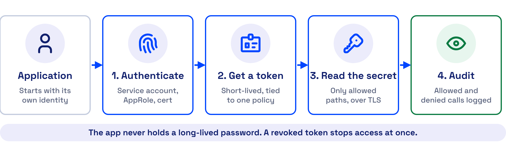

# REST API Reference

Every action in the Secrets Manager UI and CLI is an HTTPS call to the REST API. Send each call to `https://<secrets-manager-host>:8200/v1/<path>` with your token in the `X-Vault-Token` header. The API is compatible with the HashiCorp Vault HTTP API, so Vault client libraries and scripts work unchanged.



## Download the Full API Document From Your Server

Your own server is the full API reference. Secrets Manager generates an OpenAPI 3 document that lists every path mounted on it, with the mount names you chose. The document covers the paths your token can reach, so a scoped token returns a scoped document.

```bash
curl -s --header "X-Vault-Token: <token>" \
  "$VAULT_ADDR/v1/sys/internal/specs/openapi" -o secrets-manager-openapi.json
```

Load `secrets-manager-openapi.json` into Swagger UI, Postman or any OpenAPI tool to browse and try each endpoint. Three extensions mark special paths.

| Extension | Meaning |
| --- | --- |
| `x-vault-sudo` | The path needs `sudo` in the policy |
| `x-vault-unauthenticated` | The path needs no token |
| `x-vault-create-supported` | The path creates new items as well as updating them |

## Authenticate, Then Send the Token

A call without a token fails, except for the health, seal status and login endpoints. Log in with the auth method that fits the caller, then read `auth.client_token` from the response.

```bash
curl -s --request POST \
  --data '{"role_id": "<role-id>", "secret_id": "<secret-id>"}' \
  "$VAULT_ADDR/v1/auth/approle/login"
```

Send the token on every later call.

```bash
curl -s --header "X-Vault-Token: <client-token>" \
  "$VAULT_ADDR/v1/secret/data/demo/mysql"
```

The token expires after its time to live. Log in again, or renew the token, before it expires.

## The Endpoints You Will Use Most

Each path below starts with `/v1/`. A mount path such as `secret/` or `transit/` is the path you chose when you enabled the engine.

=== "Server status"

    | Method | Path | Does |
    | --- | --- | --- |
    | `GET` | `sys/health` | Returns the health of the node. Load balancers use it, and it needs no token |
    | `GET` | `sys/seal-status` | Shows whether the node is sealed and the unseal progress |
    | `POST` | `sys/unseal` | Submits one unseal key share |
    | `POST` | `sys/seal` | Seals the node. Needs root privileges |
    | `GET` | `sys/storage/raft/snapshot` | Downloads a Raft snapshot |

=== "Auth"

    | Method | Path | Does |
    | --- | --- | --- |
    | `POST` | `auth/approle/login` | Logs in a VM, job or script with a role ID and a secret ID |
    | `POST` | `auth/<kubernetes-mount>/login` | Logs in a pod with its service account token |
    | `POST` | `auth/userpass/login/<username>` | Logs in a person with a username and password |
    | `POST` | `auth/token/renew-self` | Renews the token in the header |
    | `POST` | `auth/token/revoke-self` | Revokes the token in the header |

=== "KV version 2"

    | Method | Path | Does |
    | --- | --- | --- |
    | `GET` | `secret/data/<path>` | Reads the latest version of a secret |
    | `GET` | `secret/data/<path>?version=<n>` | Reads one version |
    | `POST` | `secret/data/<path>` | Writes a new version |
    | `GET` | `secret/metadata/<path>` | Lists the versions and their dates |
    | `DELETE` | `secret/metadata/<path>` | Deletes the secret and every version |

=== "Transit"

    | Method | Path | Does |
    | --- | --- | --- |
    | `POST` | `transit/keys/<key-name>` | Creates an encryption key |
    | `POST` | `transit/encrypt/<key-name>` | Encrypts base64 plaintext and returns ciphertext |
    | `POST` | `transit/decrypt/<key-name>` | Decrypts ciphertext and returns base64 plaintext |

=== "TOTP"

    | Method | Path | Does |
    | --- | --- | --- |
    | `POST` | `totp/keys/<key-name>` | Creates a TOTP key |
    | `LIST` | `totp/keys` | Lists the TOTP keys |
    | `GET` | `totp/code/<key-name>` | Generates the current code |
    | `POST` | `totp/code/<key-name>` | Validates a code |

=== "Policies"

    | Method | Path | Does |
    | --- | --- | --- |
    | `LIST` | `sys/policies/acl` | Lists the ACL policies |
    | `GET` | `sys/policies/acl/<name>` | Reads a policy |
    | `POST` | `sys/policies/acl/<name>` | Creates or updates a policy |
    | `DELETE` | `sys/policies/acl/<name>` | Deletes a policy |

A `LIST` call also works as `GET` with `?list=true`, for clients that cannot send a custom method.

## Each Error Code Points to Its Fix

| Status | Meaning | Fix |
| --- | --- | --- |
| `400` | The request body is wrong | Check the JSON field names |
| `403` | The token is missing, expired, or its policy does not allow the path | Log in again, or add the path to the policy |
| `404` | Nothing exists at the path | Check the mount path with `GET /v1/sys/mounts` |
| `429` | The node hit a rate limit | Wait, then retry |
| `503` | The node is sealed | Unseal it with 3 of 5 key shares |

A managed shared instance has API request limits. A managed dedicated instance has none. See the [deployment models](https://accuknox.com/solutions/secrets-management) on accuknox.com.

## Use a Client Library Instead of Raw Calls

Any HashiCorp Vault client library works against Secrets Manager. See [Direct SDK and REST API](sdk-integration.md) for Python, Java, .NET and Node.js examples.

- - -
[SCHEDULE DEMO](https://www.accuknox.com/contact-us){ .md-button .md-button--primary }
