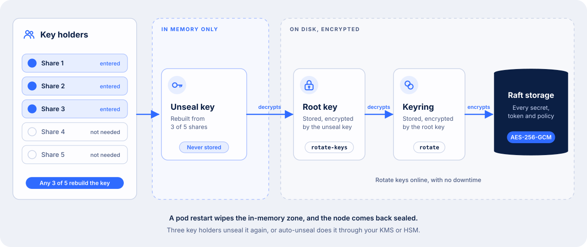

# Security and Encryption

AccuKnox Secrets Manager encrypts every secret with AES-256 in GCM mode before it writes the secret to disk. The server cannot decrypt anything until 3 of 5 key holders unseal it, and it never stores the key that unlocks the data.

<div class="grid cards" markdown>

-   :material-lock-outline:{ .lg .middle } **Encrypted at rest**

    ---

    AES-256-GCM with a random 96-bit nonce for every object. A changed byte fails the integrity check.

-   :material-key-chain-variant:{ .lg .middle } **Sealed by default**

    ---

    Shamir's Secret Sharing splits the unseal key into 5 shares. Any 3 rebuild it.

-   :material-swap-horizontal-bold:{ .lg .middle } **Encrypted in transit**

    ---

    TLS 1.2 or later for clients. Mutual TLS between cluster nodes.

-   :material-account-lock-outline:{ .lg .middle } **Every call checked and logged**

    ---

    A token on every request, a policy on every path, and an audit record before any secret leaves.

</div>

## Three Keys Stand Between the Disk and Your Data



Secrets Manager starts sealed. A sealed server can read its storage, but it cannot decrypt any of it. Each key in the chain unlocks the next one.

| Key | What it protects | Where it lives |
| --- | --- | --- |
| Unseal key | The root key | Nowhere. Secrets Manager splits it into 5 shares at `vault operator init` and shows each share one time only |
| Root key | The keyring | In storage, encrypted by the unseal key |
| Keyring | Every secret, token and policy | In storage, encrypted by the root key |

Three key holders unseal the server by each entering one share. Secrets Manager rebuilds the unseal key in memory, then decrypts the root key and the keyring. These keys live in memory only. A pod restart wipes them, so a restarted node comes back sealed.

!!! danger "Lose three shares and the data is gone"
    Nobody can decrypt a sealed server without 3 of the 5 shares, including AccuKnox support. Give each share to a different person, and keep the holders in more than one location.

## Shamir's Secret Sharing Needs Any 3 of 5 Shares

Secrets Manager splits the unseal key with Shamir's Secret Sharing, an algorithm Adi Shamir published in 1979 ([How to Share a Secret](https://dl.acm.org/doi/10.1145/359168.359176)). Any 3 of the 5 key holders can rebuild the key. Any 2 of them learn nothing about it.

The algorithm works with a curve.

1. Secrets Manager picks a random polynomial of degree 2, one less than the threshold of 3. The point where the curve crosses the y-axis is the unseal key.
2. It computes 5 points on that curve. Each point is one key share.
3. Any 3 points fix exactly one curve of degree 2, so 3 shares give back the unseal key.
4. Two points fit an endless number of curves, each crossing the y-axis somewhere else. So 2 shares reveal nothing.

Secrets Manager runs this arithmetic one byte at a time in the finite field GF(2^8). Every byte of a share is equally likely, so a share gives no hint about the key.

Three facts follow for your operations team.

- **No single person can unseal the server.** A stolen share, or one dishonest key holder, gets nothing.
- **The order does not matter.** Any 3 of the 5 holders can unseal, each from their own machine.
- **You choose the split.** Set it at install with `vault operator init -key-shares=5 -key-threshold=3`, and change it later with `vault operator rotate-keys`.

## Rotate Each Key Without Downtime

| What you rotate | Command | Who must take part | Effect |
| --- | --- | --- | --- |
| The keyring that encrypts data | `vault operator rotate` | One operator with the right policy | Adds a new key to the keyring. New data uses the new key, and old data still decrypts. Runs once per cluster |
| The unseal key shares | `vault operator rotate-keys -init -key-shares=<n> -key-threshold=<t>` | A threshold of the current share holders | Issues new shares, optionally with a new split. The old shares stop working |

Both rotations run while the server is unsealed and serving requests.

## Seal the Server in an Emergency

Sealing wipes the root key from memory, so every request to that node fails until 3 key holders unseal it again. Seal a node when you suspect an intrusion.

```bash
kubectl exec vault-accuknoxsecretmanager-0 -n accuknox -- vault operator seal
```

The command seals the node you run it on, and resets any unseal already in progress. In an HA cluster, run it on every node to seal the whole cluster.

## Auto-Unseal Hands the Unseal Key to a KMS or HSM

With auto-unseal, a key management service or a hardware security module (HSM) decrypts the root key at startup. A restarted pod then unseals itself, with no key holders.

| Seal type | Works offline |
| --- | --- |
| AWS KMS | No |
| Azure Key Vault | No |
| Google Cloud KMS | No |
| Oracle Cloud Infrastructure KMS | No |
| Alibaba Cloud KMS | No |
| A KMIP key server | Yes, when the key server runs inside your network |
| An HSM over PKCS#11 | Yes. Needs the HSM build of the server image |
| The Transit engine of a second Secrets Manager | Yes, when the second instance runs inside your network |

With auto-unseal, `vault operator init` returns recovery keys instead of unseal keys. Recovery keys authorize sensitive operations, such as generating a new root token. They cannot decrypt the root key.

!!! warning "The KMS key becomes the single point of recovery"
    If the KMS key or HSM key is unavailable, the server stays sealed. If someone deletes it, no backup can restore the data. Protect that key with the same controls as the data.

## Data on Disk Stays Encrypted

The security barrier encrypts every object before it leaves the server, with AES-256 in Galois Counter Mode (GCM) and a random 96-bit nonce for each object. On every read, Secrets Manager checks the GCM authentication tag, so a changed byte on disk fails the read instead of returning altered data.

| Data | Where it lives | Protection |
| --- | --- | --- |
| Secrets, tokens, policies, leases | The Raft storage volume on each pod, 10Gi by default | AES-256-GCM through the security barrier |
| Raft snapshots | Your S3-compatible bucket | The same encrypted data. A restore needs the unseal keys |
| Audit log | Its own volume, 10Gi by default | Secret values are stored as salted HMAC-SHA256 hashes, never as plaintext |

Data you encrypt for your own applications through the [Transit engine](transit.md) uses `aes256-gcm96` keys by default. Transit rotates a key without re-encrypting old data, and old ciphertext still decrypts.

Disk encryption from your StorageClass adds a second layer under Secrets Manager. It protects against a stolen disk, and Secrets Manager does not depend on it.

## TLS Protects Every Connection

| Connection | Protection |
| --- | --- |
| Application or person to Secrets Manager, port 8200 | TLS. The listener accepts TLS 1.2 or later by default |
| Node to node in an HA cluster, port 8201 | Mutual TLS. Nodes exchange certificates when they join, and the cluster rotates them on a schedule |
| Server to its Raft storage | Local disk. All data is encrypted before write |

Set `tls_cert_file`, `tls_key_file` and, if needed, `tls_min_version` in the listener block of the server configuration. The [Deployment Guide](deployment.md) uses `http://localhost:8200` through a `kubectl` port-forward, and that traffic stays inside the tunnel. Turn on TLS before an application in another pod, cluster or VM connects.

## Each Caller Reads Only Its Own Paths

Every request carries a token, except a login request. A pod logs in with its Kubernetes service account token, a VM or job with an AppRole or a TLS certificate, and a person with OIDC, LDAP, or a username and password.

Secrets Manager then issues a short-lived token tied to one or more policies. A token reads only the paths its policies allow. A token issued before a policy change keeps its old policies until the holder logs in again.

On a managed instance, each tenant gets its own namespace, with its own permissions, resources and configuration. A shared instance includes one namespace, and a dedicated instance supports several.

Retire the root token after you create the first admin user. See [Sharing Secrets in an Organisation](sharing-secrets.md) to write least-privilege policies.

## Every Request Lands in the Audit Log First

When an audit device is on, Secrets Manager writes the request and the response to the audit log before the client receives any secret. Turn on `server.auditStorage` to keep the log on its own volume.

Send the log to your SIEM through one of four audit devices.

| Audit device | Sends the log to |
| --- | --- |
| `file` | A file on the audit volume, for a log shipper to collect |
| `syslog` | The local syslog agent |
| `socket` | A TCP, UDP or Unix socket |
| `http` | An HTTP endpoint |

A managed dedicated instance has audit logs turned on, and it sends them straight to your AccuKnox SIEM and CDR subscription.

## KubeArmor Hardens the Pods

A secrets manager holds the credentials for many applications, so it is a high-value target. AccuKnox CWPP, built on KubeArmor, hardens every Secrets Manager pod at runtime. It limits what processes in the pods can read and run, which protects environment variables, secrets and volume mounts.

## What the Security Model Covers

| Covered | Outside the model |
| --- | --- |
| Eavesdropping on client, node-to-node and storage traffic | An attacker with full write control of the storage volume, who can delete or roll back data |
| Tampering with data at rest or in transit, which fails the integrity check | An attacker who can read the memory of a running server |
| Any request without a valid token and policy | Code execution on the host that runs Secrets Manager |
| Any request without an audit record, when an audit device is on | A compromised client that holds a valid token |
| Reading secrets from a stolen disk or snapshot without the unseal keys | Flaws in external systems, such as a database that a secret engine manages |

Three more limits come from where a secret goes after Secrets Manager hands it out.

- **A value the application already read.** A secret in application memory, or in a Kubernetes secret synced by the [External Secrets Operator](external-secrets.md), sits outside Secrets Manager. Turn on etcd encryption in your cluster to protect a synced Kubernetes secret.
- **A snapshot plus 3 unseal shares.** Together they decrypt every secret. Give the snapshot bucket and the key shares to separate owners.
- **A lost seal.** A lost KMS key, or 3 lost shares, makes the data unrecoverable. Backups do not help.

- - -
[SCHEDULE DEMO](https://www.accuknox.com/contact-us){ .md-button .md-button--primary }
