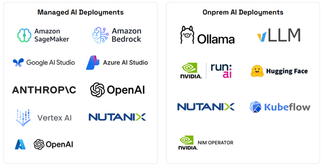
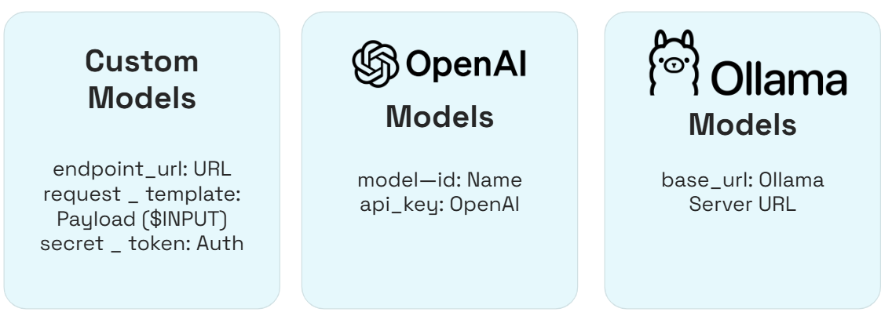
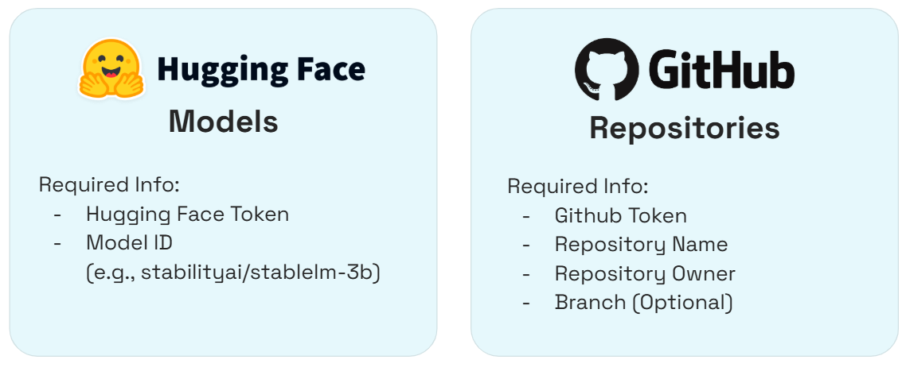
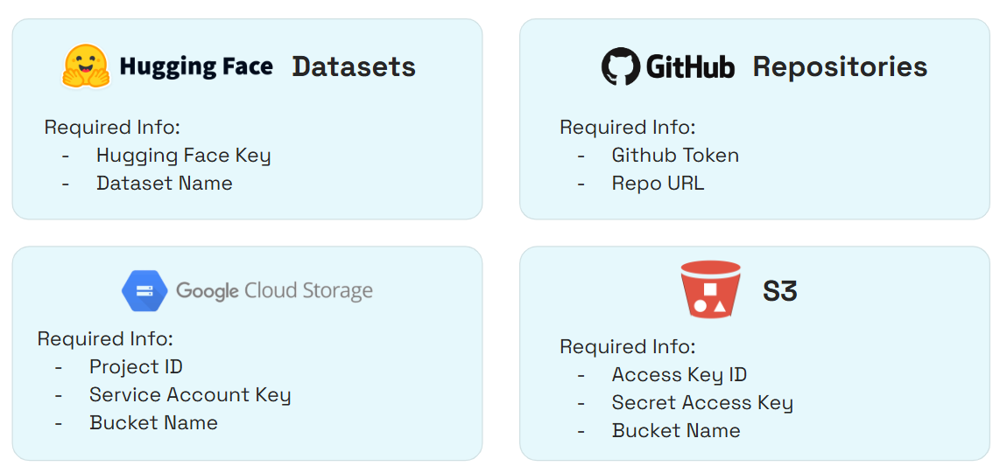

# AI/ML Security Support Matrix

Here is a list of AI/ML security features supported by AccuKnox. It outlines the AI/ML frameworks, libraries, and tools that work with AccuKnox, so you can secure your AI/ML workloads.

!!! note "Useful Links"
    - For onboarding refer to the [**AI/ML Onboarding Guide**](https://help.accuknox.com/how-to/aiml-overview/)
    - For use cases refer to the [**AI/ML Security Use Cases**](https://help.accuknox.com/use-cases/aiml-usecases/)
    - For the AI tools found on endpoints refer to [**Shadow AI Discovery**](#shadow-ai-discovery)

## On-Prem LLM Onboarding

## ML Static Scan / Model Scanning

## Model/Dataset Scan via Collectors

## Shadow AI Discovery

[Shadow AI Discovery](../use-cases/shadow-ai-discovery.md) supports the 50 AI tools below. All 50 tools are live, and each one appears under **AI/ML Security → Assets → Unmanaged** with its parent asset. Coverage depends on the operating system, the Omni version and the evidence the install leaves on disk.

--8<-- "docs/.snippets/shadow-ai-tools.html"
