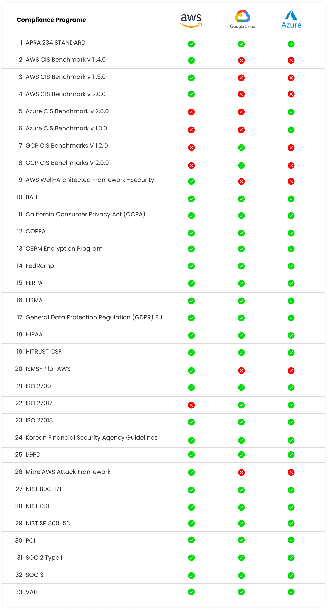

<!--  -->

=== "Cloud"

    <table>
    <tr>
        <th style="font-weight: bold; font-size: 24px;">Compliance</th>
        <th>
             AWS
        </th>
        <th>
             Azure
        </th>
        <th>
             GCP
        </th>
    </tr>
    <tr><td>APRA 234 STANDARD</td><td>✅</td><td>✅</td><td>✅</td></tr>
    <tr><td>AVID (AI-SPM)</td><td>✅</td><td>✅</td><td>✅</td></tr>
    <tr><td>AWS Architecture Guardrails - Security</td><td>✅</td><td>❌</td><td>❌</td></tr>
    <tr><td>AWS CIS Benchmark v1.4.0</td><td>✅</td><td>❌</td><td>❌</td></tr>
    <tr><td>AWS CIS Benchmark v1.5.0</td><td>✅</td><td>❌</td><td>❌</td></tr>
    <tr><td>AWS CIS Benchmark v2.0.0</td><td>✅</td><td>❌</td><td>❌</td></tr>
    <tr><td>AWS CIS Benchmark v4.0.1</td><td>✅</td><td>❌</td><td>❌</td></tr>
    <tr><td>AWS CIS Benchmark v7.0.0</td><td>✅</td><td>❌</td><td>❌</td></tr>
    <tr><td>AWS Well-Architected Framework - Security</td><td>✅</td><td>❌</td><td>❌</td></tr>
    <tr><td>Azure CIS Benchmarks v1.3.0</td><td>❌</td><td>✅</td><td>❌</td></tr>
    <tr><td>Azure CIS Benchmark v2.0.0</td><td>❌</td><td>✅</td><td>❌</td></tr>
    <tr><td>Azure CIS Benchmark v3.0</td><td>❌</td><td>✅</td><td>❌</td></tr>
    <tr><td>Azure CIS Benchmark v5.0.0</td><td>❌</td><td>✅</td><td>❌</td></tr>
    <tr><td>BAIT</td><td>✅</td><td>✅</td><td>✅</td></tr>
    <tr><td>CMMC - Cybersecurity Maturity Model Certification</td><td>✅</td><td>❌</td><td>❌</td></tr>
    <tr><td>COPPA</td><td>✅</td><td>✅</td><td>✅</td></tr>
    <tr><td>CSCRF SEBI</td><td>✅</td><td>✅</td><td>✅</td></tr>
    <tr><td>CSPM Encryption Program</td><td>✅</td><td>✅</td><td>✅</td></tr>
    <tr><td>California Consumer Privacy Act (CCPA)</td><td>✅</td><td>✅</td><td>✅</td></tr>
    <tr><td>Digital Personal Data Protection (DPDP) Act India</td><td>✅</td><td>✅</td><td>✅</td></tr>
    <tr><td>EU AI Act (Regulation (EU) 2024/1689)</td><td>✅</td><td>✅</td><td>✅</td></tr>
    <tr><td>FERPA</td><td>✅</td><td>✅</td><td>✅</td></tr>
    <tr><td>FISMA</td><td>✅</td><td>✅</td><td>✅</td></tr>
    <tr><td>FedRamp</td><td>✅</td><td>✅</td><td>✅</td></tr>
    <tr><td>GCP CIS Benchmarks v1.2.0</td><td>❌</td><td>❌</td><td>✅</td></tr>
    <tr><td>GCP CIS Benchmark v2.0.0</td><td>❌</td><td>❌</td><td>✅</td></tr>
    <tr><td>GCP CIS Benchmark v3.0</td><td>❌</td><td>❌</td><td>✅</td></tr>
    <tr><td>General Data Protection Regulation (GDPR) EU</td><td>✅</td><td>✅</td><td>✅</td></tr>
    <tr><td>HIPAA</td><td>✅</td><td>✅</td><td>✅</td></tr>
    <tr><td>HITRUST CSF</td><td>✅</td><td>✅</td><td>✅</td></tr>
    <tr><td>ISMS-P for AWS</td><td>✅</td><td>❌</td><td>❌</td></tr>
    <tr><td>ISO 27001</td><td>✅</td><td>✅</td><td>✅</td></tr>
    <tr><td>ISO 27001 - 2013</td><td>✅</td><td>✅</td><td>✅</td></tr>
    <tr><td>ISO 27001 - 2022</td><td>✅</td><td>✅</td><td>✅</td></tr>
    <tr><td>ISO 27017</td><td>❌</td><td>✅</td><td>✅</td></tr>
    <tr><td>ISO 27018</td><td>✅</td><td>✅</td><td>✅</td></tr>
    <tr><td>ISO/IEC 42001:2023 (AI Management System)</td><td>✅</td><td>✅</td><td>✅</td></tr>
    <tr><td>Korean Financial Security Agency Guidelines</td><td>✅</td><td>✅</td><td>✅</td></tr>
    <tr><td>LGPD</td><td>✅</td><td>✅</td><td>✅</td></tr>
    <tr><td>MITRE ATLAS</td><td>✅</td><td>✅</td><td>✅</td></tr>
    <tr><td>MITRE AWS Attack Framework</td><td>✅</td><td>❌</td><td>❌</td></tr>
    <tr><td>NIST 800-171</td><td>✅</td><td>✅</td><td>✅</td></tr>
    <tr><td>NIST AI Risk Management Framework</td><td>✅</td><td>✅</td><td>✅</td></tr>
    <tr><td>NIST CSF</td><td>✅</td><td>✅</td><td>✅</td></tr>
    <tr><td>NIST SP 800-53</td><td>✅</td><td>✅</td><td>✅</td></tr>
    <tr><td>OWASP API Security Top 10 (2023)</td><td>✅</td><td>✅</td><td>✅</td></tr>
    <tr><td>OWASP Top 10 for LLM Applications</td><td>✅</td><td>✅</td><td>✅</td></tr>
    <tr><td>OWASP Top 10 for LLM (AI-SPM) v2025</td><td>✅</td><td>✅</td><td>✅</td></tr>
    <tr><td>PCI</td><td>✅</td><td>✅</td><td>✅</td></tr>
    <tr><td>RBI CSF (Cyber Security Framework)</td><td>✅</td><td>❌</td><td>❌</td></tr>
    <tr><td>RBI IT Framework Master Direction</td><td>✅</td><td>❌</td><td>❌</td></tr>
    <tr><td>SAMA Cyber Security Framework</td><td>✅</td><td>❌</td><td>❌</td></tr>
    <tr><td>SOC 2 Type II</td><td>✅</td><td>✅</td><td>✅</td></tr>
    <tr><td>SOC 3</td><td>✅</td><td>✅</td><td>✅</td></tr>
    <tr><td>VAIT</td><td>✅</td><td>✅</td><td>✅</td></tr>
    </table>

    ## Oracle Cloud (OCI)

    <table>
    <tr><th>Compliance</th><th>Oracle Cloud (OCI)</th></tr>
    <tr><td>Oracle CIS v3.0</td><td>✅</td></tr>
    </table>

=== "VM"

    ### STIGs

    | Distribution/App | Supported |
    |---|---|
    | Ubuntu 18.04 (V2R15) | ✅ |
    | Ubuntu 20.04 (V1R9) | ✅ |
    | Ubuntu 22.04 (V2R8) | ✅ |
    | Ubuntu 24.04 (V1R5) | ✅ |
    | Linux Mint 19/20 (as Ubuntu 18.04/20.04) | ✅ |
    | Pop!_OS 18.04/20.04/22.04/24.04 (as Ubuntu equivalent) | ✅ |
    | RHEL 9 (V1R1) | ✅ |
    | Fedora 35-38 (as RHEL 9 V1R1) | ✅ |
    | CentOS 9 (as RHEL 9 V1R1) | ✅ |
    | Rocky Linux 9 (as RHEL 9 V1R1) | ✅ |
    | Windows 10 (V1R3) | ✅ |
    | Windows 11 (V2R7) | ✅ |
    | Windows Server 2019 (V3R8) | ✅ |
    | Windows Server 2022 (V2R8) | ✅ |
    | Windows Server 2025 (V1R1) | ✅ |
    | Kubernetes (V1R10) | ✅ |

    ### CIS

    | Distribution/App | Supported |
    |---|---|
    | Ubuntu 22.04 (v3.0.0) | ✅ |
    | Ubuntu 24.04 (v2.0.0) | ✅ |

- - -
[SCHEDULE DEMO](https://www.accuknox.com/contact-us){ .md-button .md-button--primary }