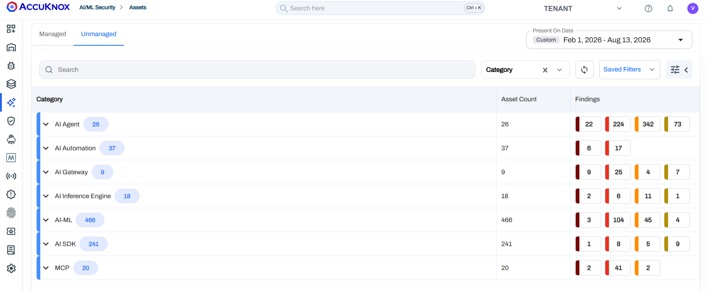
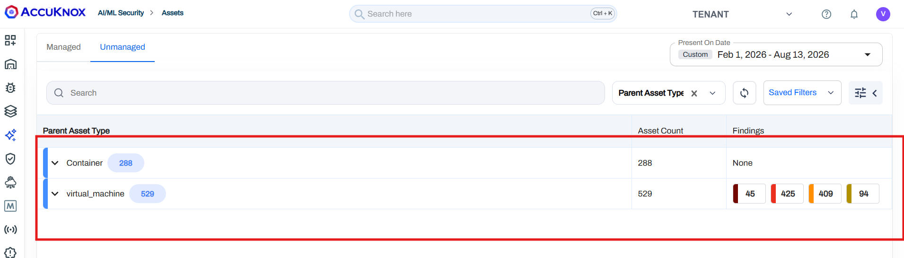
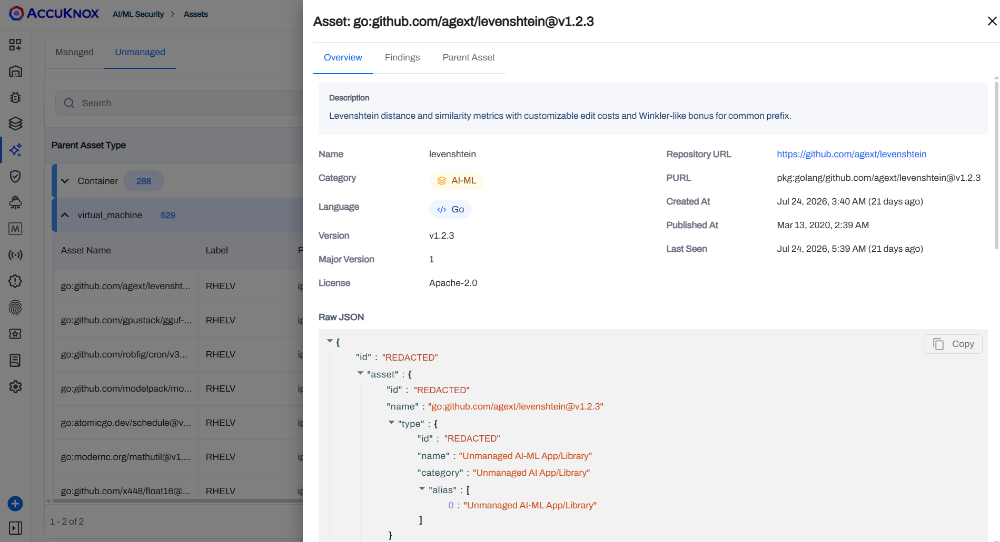
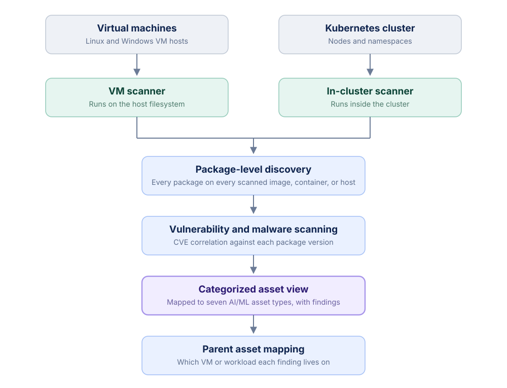
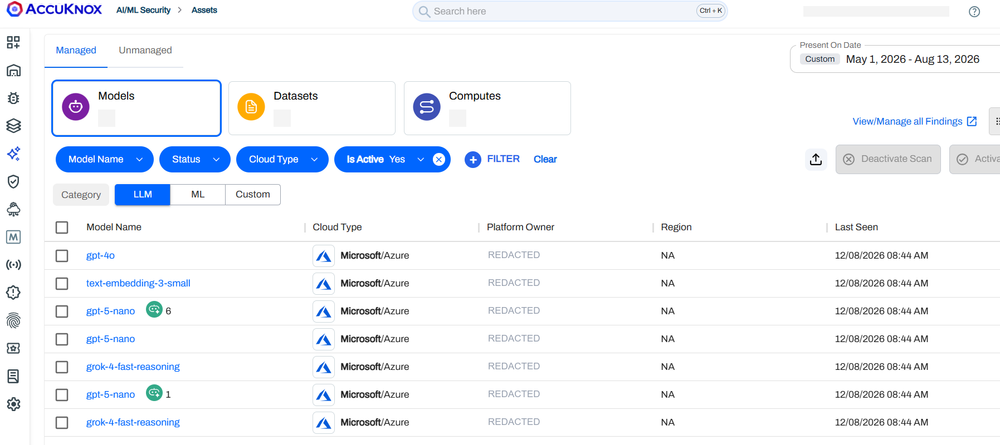
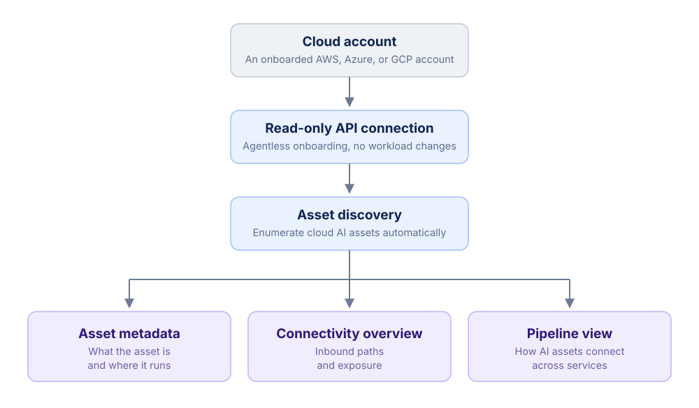
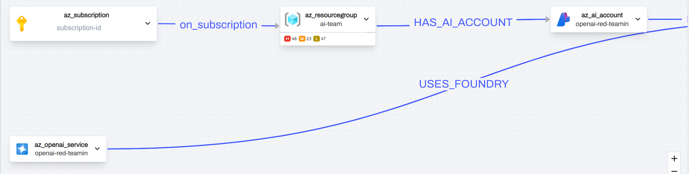
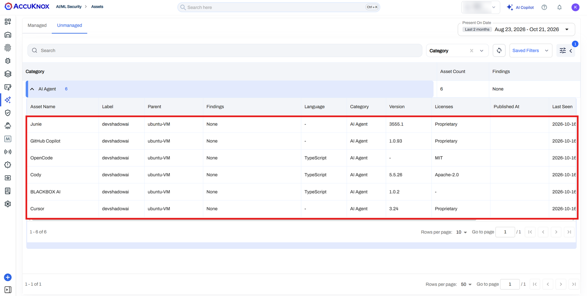
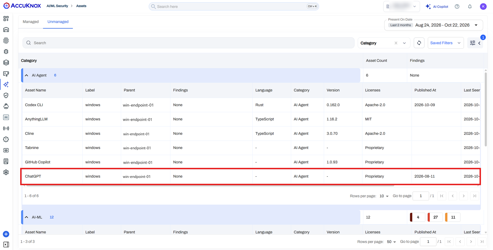
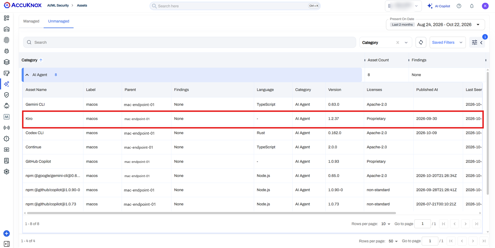

# Shadow AI Discovery

Shadow AI Discovery lists the AI software in your environment, including software that never went through an approval process. It finds AI tools, agents, SDKs and Model Context Protocol (MCP) components, and shows each one with its parent asset, version and findings.

Discovery confirms that a tool is installed. It does not confirm that anyone uses it. A supported AI agent appears even when it is not running and has never contacted an external AI service.

| Where AI runs | What finds it | Where you see the result |
| --- | --- | --- |
| :material-laptop:{ .sai-ic } [Endpoints and VMs](#endpoints-and-vms) | The Omni agent scans the disk on Linux, Windows and macOS | **Unmanaged** tab |
| :material-kubernetes:{ .sai-ic } [Kubernetes](#kubernetes) | The in-cluster scanner reads container images | **Unmanaged** tab |
| :material-cloud-outline:{ .sai-ic } [Cloud accounts](#cloud-accounts) | A read-only API connection reads the account | **Managed** tab |
| :material-web:{ .sai-ic } [Browser](#browser) | The AccuKnox browser plugin records access to GenAI services | User identity, timestamp and accessed domain |

??? info "Watch the two-minute tour"
    Watch AccuKnox find AI agents, SDKs and MCP servers on VMs and containers.

    <iframe width="560" height="315" src="https://www.youtube.com/embed/Rxs4fX6yKz0" title="AccuKnox Shadow AI Discovery product tour" frameborder="0" referrerpolicy="strict-origin-when-cross-origin" allowfullscreen></iframe>

## Supported AI Tools

All 50 tools are live. Each tool appears on the **Unmanaged** tab with its parent asset. [Package scanning](#endpoints-and-vms) also classifies AI software outside this list.

--8<-- "docs/.snippets/shadow-ai-tools.html"

## Where Results Appear

Open **AI/ML Security → Assets** in the AccuKnox console. The inventory has two tabs because AccuKnox finds cloud resources and installed software in different ways.

| Tab | What it lists | Source |
| --- | --- | --- |
| :material-cloud-check-outline:{ .sai-ic } **Managed** | AI resources in your cloud accounts, such as models, datasets, compute and managed agents | A read-only API connection to the onboarded cloud account |
| :material-laptop:{ .sai-ic } **Unmanaged** | AI software installed on endpoints, VMs and containers | The Omni agent on endpoints, and the in-cluster scanner in Kubernetes |

Shadow AI appears on the **Unmanaged** tab. That tab lists AI software outside centrally managed cloud AI resources and outside the approved software inventory.

### AI Categories

Each item on the **Unmanaged** tab belongs to one of seven categories. Detection rules decide the category, and not every category is detected on every operating system.

| Category | What it covers | Example packages |
| --- | --- | --- |
| :material-robot-outline:{ .sai-ic } AI Agent | AI assistants and agent frameworks installed on endpoints or workloads | LangChain agents, CrewAI, AutoGen |
| :material-sitemap-outline:{ .sai-ic } AI Automation | Tools that build or run AI workflows | Flowise, Langflow |
| :material-router-network:{ .sai-ic } AI Gateway | Components that route or control access to models | LiteLLM, Portkey |
| :material-chip:{ .sai-ic } AI Inference Engine | Runtimes that run or serve models | vLLM, TGI, Triton, llama.cpp, Ollama |
| :material-brain:{ .sai-ic } AI-ML | Machine learning frameworks and libraries | PyTorch, TensorFlow, scikit-learn, Transformers |
| :material-code-braces:{ .sai-ic } AI SDK | Kits that call AI models from an application | OpenAI, Anthropic, Cohere, Google GenAI |
| :material-connection:{ .sai-ic } MCP | Model Context Protocol servers and clients | MCP server and client packages |

??? example "See the seven categories on the Unmanaged tab"
    

    *Each category shows its asset count and its findings by severity.*

### Asset Details

Each asset can show its name, category, technology, version, license, parent VM or endpoint, artifact label and discovery timestamp. A field stays empty when the installation artifact does not record that value.

??? example "See the parent asset view and the asset detail view"
    

    *Group the Unmanaged tab by parent asset type to see how many AI components sit on VMs and on containers.*

    

    *The asset detail view shows the category, version, license and raw classification payload, plus Findings and Parent Asset tabs.*

## How Discovery Works

### Endpoints and VMs

The Omni agent scans the local filesystem for installation evidence. It finds CLI agents, desktop AI apps and IDE extensions whether or not anyone has opened them.

<ol class="sai-flow" markdown>
<li markdown="span">:material-download-outline:<strong>1. Onboard</strong>Install Omni on a Linux, Windows or macOS endpoint.</li>
<li markdown="span">:material-magnify-scan:<strong>2. Scan</strong>Omni reads the disk for AI installation artifacts and packages.</li>
<li markdown="span">:material-cloud-upload-outline:<strong>3. Report</strong>Omni uploads the results through the artifact API.</li>
<li markdown="span">:material-tag-outline:<strong>4. Classify</strong>AccuKnox assigns each component an AI/ML category.</li>
<li markdown="span">:material-table-eye:<strong>5. Review</strong>Each tool appears on the Unmanaged tab with its endpoint.</li>
</ol>

The AI tool needs no network access to be discovered, but Omni needs a path to upload results to AccuKnox. On an air-gapped endpoint, Omni can still scan. The results reach the console only through an approved transfer process.

**Package scanning.** Omni does not search for a fixed list of AI product names. It inventories every package on the scanned host, image or container, across language ecosystems and OS package managers. For each package it records the name, version, known vulnerabilities and location.

AccuKnox then compares those packages against its AI/ML classification rules, so AI inside a custom application still appears. A workload that bundles a model-serving runtime is an **AI Inference Engine**, even inside a custom wrapper. A workload that bundles a vendor model client is an **AI SDK**.

**Agentic runtimes.** Agentic AI runtimes install like any other package, so the same scan finds them. AccuKnox scans VMs for OpenClaw instances and reports each one on the **Unmanaged** tab with its parent host, version and vulnerability data.

### Kubernetes

The in-cluster scanner does the same job as Omni. It walks nodes and namespaces, reads container images and the workloads scheduled on them, and maps each AI component to its parent workload.

??? example "See the on-prem discovery flow"
    

### Cloud Accounts

After you onboard a cloud account, AccuKnox reads it through a read-only API. For each AI asset it records normalized metadata, inbound connectivity and exposure, and the services the asset connects to. The pipeline view traces those connections, so a model endpoint appears with its subscription, resource group and services.

The same path finds managed AI agents from Microsoft Copilot Studio, Microsoft 365 Agents, Azure AI Foundry, AWS Bedrock AgentCore and AWS Bedrock Agent. Each agent shows its source cloud, deployment status and finding counts. The detail pane shows memory configuration, IAM role and attached knowledge bases. See [AI App Inventory](../getting-started/3.5-release.md#ai-app-inventory-managed-agents-models-and-unmanaged-assets).

??? example "See the Managed tab, the discovery flow and the pipeline graph"
    

    *The Managed tab groups cloud-discovered assets into Models, Datasets, and Computes, filterable by category, cloud type, and scan status.*

    

    

    *The pipeline graph shows a model endpoint with the subscription, resource group, and services it is reachable through.*

### Browser

The AccuKnox browser plugin detects access to known GenAI services such as ChatGPT, Claude, Gemini and Copilot. It records the user identity, timestamp and accessed domain. You get audit evidence and policy violation detection for AI use that installs nothing on the endpoint.

## Onboarding

Each guide covers installation, verification and troubleshooting.

| Target | How the scan runs | Guide |
| --- | --- | --- |
| :material-linux:{ .sai-ic } Linux VM | Daily, through the `omni.timer` systemd timer. Supports air-gapped install. | [Agent-Based VM Scanning for Linux](../how-to/vm-security/agent-based/linux.md) |
| :material-microsoft-windows:{ .sai-ic } Windows endpoint | Through the `AccuKnox Omni Vuln Scan` scheduled task. Supports air-gapped install. | [Agent-Based VM Scanning for Windows](../how-to/vm-security/agent-based/windows.md) |
| :material-apple:{ .sai-ic } macOS endpoint | Daily, through the `com.accuknox.omni` launchd job. Online install only. | [Agent-Based Scanning for macOS](../how-to/vm-security/agent-based/macos.md) |
| :material-kubernetes:{ .sai-ic } Kubernetes | The in-cluster scanner reads container images and the workloads that run them. | [In-cluster container image scanning](../how-to/k8s-security-onboarding.md#in-cluster-container-image-scanning) |
| :material-cloud-outline:{ .sai-ic } Cloud accounts | A read-only API connection reads the onboarded account. | [AWS](../how-to/aiml-aws-onboard.md), [Azure](../how-to/aiml-azure-onboard.md), [GCP](../how-to/aiml-gcp-onboard.md) |

## Test Discovery

AccuKnox tested endpoint discovery on a Linux VM, a Windows endpoint and a Mac, with one Omni scan on each. Every tool appeared on the **Unmanaged** tab, mapped to the expected endpoint and artifact label.

| Endpoint | AI tools found in one scan |
| --- | --- |
| :material-linux:{ .sai-ic } Linux VM (Ubuntu) | JunieGitHub CopilotOpenCodeCodyBLACKBOX AICursor |
| :material-microsoft-windows:{ .sai-ic } Windows | Codex CLIChatGPT desktop appClineAnythingLLMTabnineGitHub Copilot |
| :material-apple:{ .sai-ic } macOS | Gemini CLIKiroContinueCodex CLIGitHub Copilotnpm: &#64;google/gemini-clinpm: &#64;github/copilot |

The tests cover the three ways a developer installs an AI tool on an endpoint:

- :material-console:{ .sai-ic } **CLI coding agents** run in a terminal with the developer's shell access. Tested with Codex CLI on Windows, Gemini CLI on macOS and OpenCode on Linux.
- :material-application-outline:{ .sai-ic } **Desktop AI apps** install as standalone applications. Tested with the ChatGPT desktop app on Windows and Kiro on macOS.
- :material-puzzle-outline:{ .sai-ic } **IDE extensions** install inside an editor. Tested with Cline and Continue in Visual Studio Code.

??? example "See the scan results on each operating system"
    === ":material-linux: Linux VM"

        

        *Six AI coding agents found on one Ubuntu VM, each with its version and license. None had to be running.*

    === ":material-microsoft-windows: Windows"

        

        *One Windows endpoint shows a CLI agent (Codex CLI), a desktop app (ChatGPT) and an IDE extension (Cline) in the same AI Agent list.*

    === ":material-apple: macOS"

        

        *One Mac shows Gemini CLI, the Kiro desktop app and the Continue extension, plus the npm packages behind Gemini CLI and GitHub Copilot.*

    Hostnames and the tenant name are redacted in every screenshot. The onboarding guides show each test in two shots: the tool installed on the endpoint, then the same tool on the **Unmanaged** tab.

??? tip "Repeat the test on your own endpoint"
    1. Install an AI tool on a test endpoint, such as Codex CLI, the ChatGPT desktop app or the Cline extension in Visual Studio Code.
    2. Confirm that the tool runs on the endpoint.
    3. Install Omni with your artifact endpoint, tenant ID, artifact label and Artifact API token. Use the guide for the operating system from [Onboarding](#onboarding).
    4. Let the first scan finish. Check the scan log for errors.
    5. Open **AI/ML Security → Assets → Unmanaged** in the AccuKnox console.
    6. Find the tool and confirm that it lists the expected endpoint and artifact label.

    You do not need to sign in to the AI tool or send it a prompt. An installed tool is enough for discovery.

## Limits

These limits apply to endpoint discovery.

- :material-eye-off-outline:{ .sai-ic } **Usage stays invisible.** Discovery confirms installation evidence. It does not record who ran a tool, when, or what data the tool sent.
- :material-filter-outline:{ .sai-ic } **Only supported tools appear.** Coverage depends on the operating system, the Omni version, the detection rules and the evidence the install leaves on disk.
- :material-lan-disconnect:{ .sai-ic } **Results need a reporting path.** An endpoint that cannot reach the AccuKnox artifact endpoint scans locally. Its results reach the console only through an approved transfer process.
