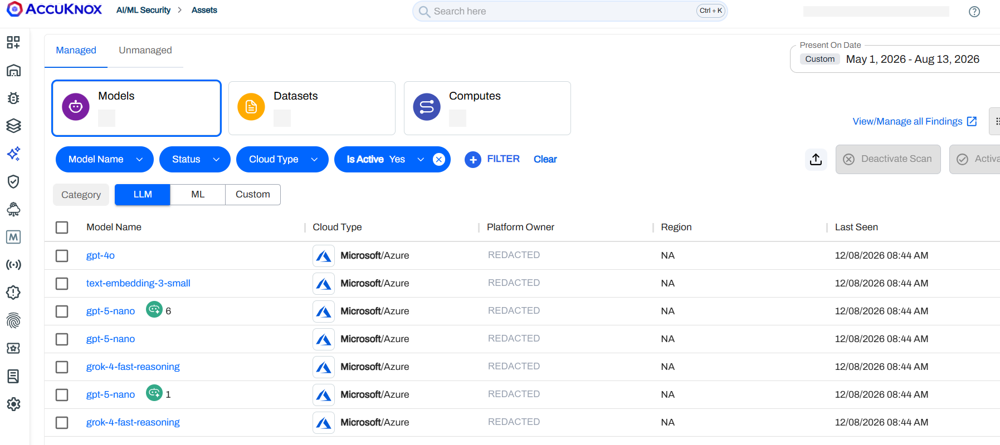
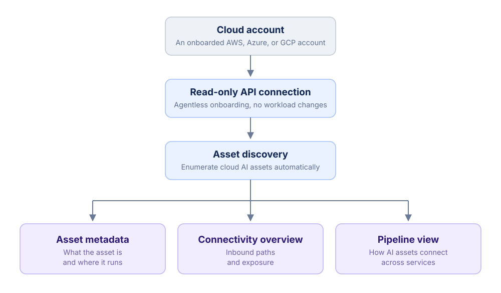
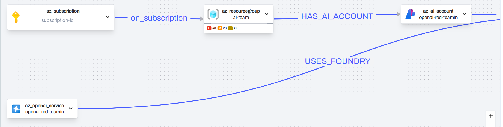
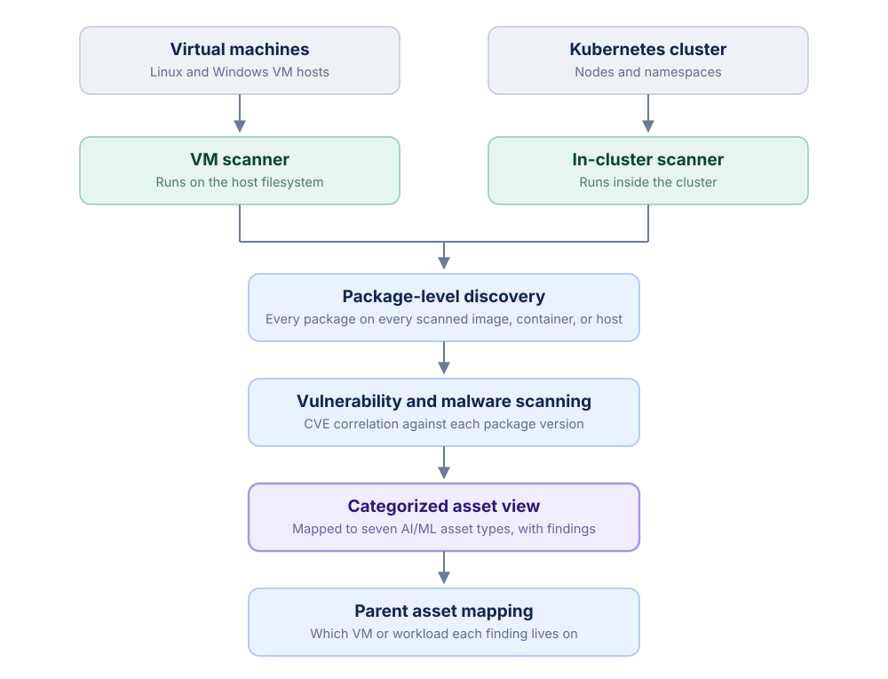
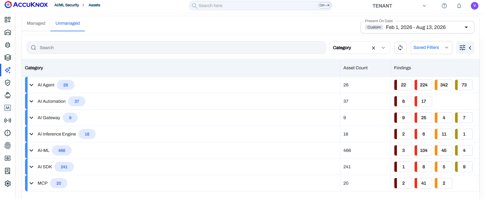
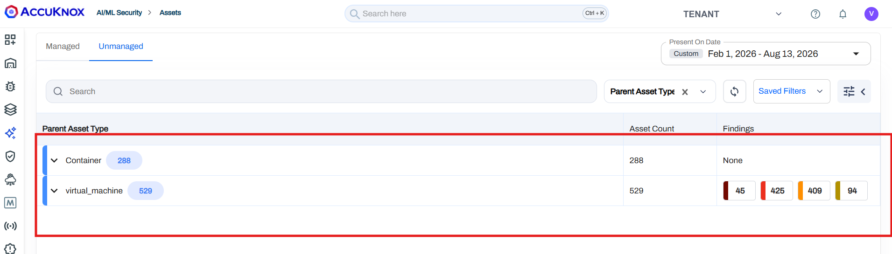
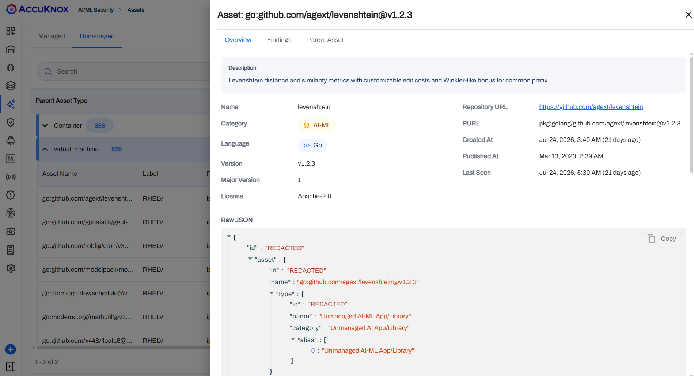
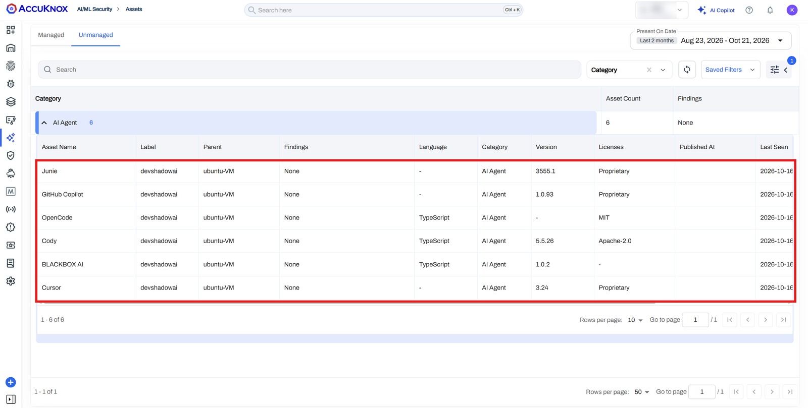
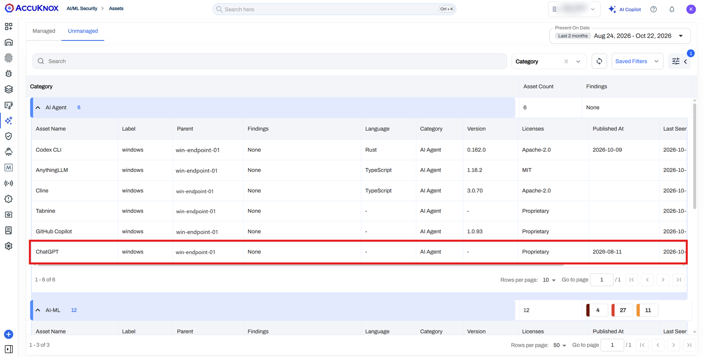
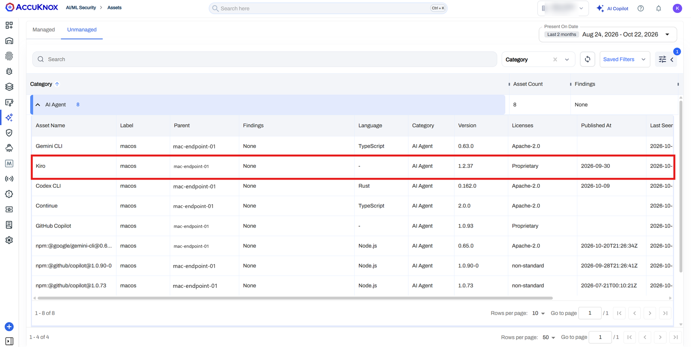

# Shadow AI Discovery

Shadow AI Discovery finds the AI tools, agents, SDKs and Model Context Protocol (MCP) components installed across your endpoints, VMs, Kubernetes clusters and cloud accounts. It lists each one in an inventory with its parent asset, version and findings, including software that never went through an approval process.

Discovery confirms that a tool is installed. It does not confirm that anyone uses it. A supported AI agent shows up even when it is not running and has never contacted an external AI service.

## Watch the Two-Minute Tour

Watch AccuKnox find AI agents, SDKs and MCP servers on VMs and containers.

<iframe width="560" height="315" src="https://www.youtube.com/embed/Rxs4fX6yKz0" title="AccuKnox Shadow AI Discovery product tour" frameborder="0" referrerpolicy="strict-origin-when-cross-origin" allowfullscreen></iframe>

## Two Discovery Paths Feed Two Inventory Tabs

AccuKnox discovers cloud AI resources and installed AI software in different ways, so the inventory under **AI/ML Security → Assets** splits them into two tabs.

| Tab | What it holds | How AccuKnox finds it |
| --- | --- | --- |
| **Managed** | AI resources in your cloud accounts, such as models, datasets, compute and managed agents | A read-only API connection to the onboarded cloud account |
| **Unmanaged** | AI software installed on endpoints, VMs and containers | The Omni agent on Linux, Windows and macOS endpoints, and the in-cluster scanner in Kubernetes |

The **Unmanaged** tab is where shadow AI appears. It lists AI software that sits outside centrally managed cloud AI resources and outside the approved software inventory.

## Cloud Discovery Maps AI Resources and Their Connections

After you onboard a cloud account, AccuKnox reads it through a read-only API. For each AI asset it records normalized metadata, inbound connectivity and exposure, and the services the asset connects to. The pipeline view then traces those connections, so a model endpoint appears with the subscription, resource group and services it is reachable through.

*The Managed tab groups cloud-discovered assets into Models, Datasets, and Computes, filterable by category, cloud type, and scan status.*

*The pipeline graph shows a model endpoint with the subscription, resource group, and services it is reachable through.*

The cloud path also discovers managed AI agents from Microsoft Copilot Studio, Microsoft 365 Agents, Azure AI Foundry, AWS Bedrock AgentCore and AWS Bedrock Agent. Each agent shows its source cloud, deployment status and finding counts. The detail pane shows memory configuration, IAM role and attached knowledge bases. See [AI App Inventory](../getting-started/3.5-release.md#ai-app-inventory-managed-agents-models-and-unmanaged-assets).

!!! info "Cloud onboarding guides"
    - [AWS AI/ML Cloud Onboarding](../how-to/aiml-aws-onboard.md)
    - [Azure AI/ML Cloud Onboarding](../how-to/aiml-azure-onboard.md)
    - [GCP AI/ML Cloud Onboarding](../how-to/aiml-gcp-onboard.md)

## Endpoint Discovery Finds AI Tools on the Host

On endpoints and VMs, the Omni agent scans the local filesystem for installation evidence of supported AI tools. Because Omni reads what is on disk, it finds CLI agents, desktop AI apps and IDE extensions whether or not anyone has opened them.

Discovery runs in five steps:

1. **Onboard the endpoint.** Install and configure Omni on a supported Linux, Windows or macOS endpoint.
2. **Scan locally.** Omni scans the endpoint for supported AI installation artifacts and packages.
3. **Report results.** Omni uploads the scan results to your AccuKnox tenant through the artifact API.
4. **Classify assets.** AccuKnox matches the results against its AI/ML classification rules and assigns each component a category.
5. **Review assets.** The components appear under **AI/ML Security → Assets → Unmanaged**, mapped to the endpoint and the artifact label.

The AI tool does not need network access to be discovered. Omni needs a path to upload results to AccuKnox. On an air-gapped endpoint, Omni can still scan, but the results reach the console only through an approved transfer process.

In Kubernetes, the in-cluster scanner does the same job. It walks nodes and namespaces, reads container images and the workloads scheduled on them, and maps each AI component to its parent workload.

### Package-Level Discovery Catches AI Inside Custom Applications

Omni does not search for a fixed list of AI product names. It inventories every package on the scanned host, image or container across language ecosystems and OS package managers, then records the package name, version, known vulnerabilities and the host or image where it was found.

AccuKnox compares those packages against its AI/ML classification rules. A workload that bundles a model-serving runtime is classified as an **AI Inference Engine**, even inside a custom wrapper. A workload that bundles a vendor model client is classified as an **AI SDK**.

| Category | What it covers | Representative packages |
| --- | --- | --- |
| AI Agent | AI assistants and agent frameworks installed on endpoints or workloads | LangChain agents, CrewAI, AutoGen |
| AI Automation | Tools that build or run AI workflows | Flowise, Langflow |
| AI Gateway | Components that route or control access to models | LiteLLM, Portkey |
| AI Inference Engine | Runtimes that run or serve models | vLLM, TGI, Triton, llama.cpp, Ollama |
| AI-ML | Machine learning frameworks and libraries | PyTorch, TensorFlow, scikit-learn, Transformers |
| AI SDK | Kits that call AI models from an application | OpenAI, Anthropic, Cohere, Google GenAI |
| MCP | Model Context Protocol servers and clients | MCP server and client packages |

Detection rules decide the category, and not every category is detected on every operating system.

*Scanner output rolled up into the seven AI/ML asset categories, each with its asset count and findings broken out by severity.*

### Every Asset Traces Back to Its Host

Each discovered asset can carry the asset name, category, technology, version, license, parent VM or endpoint, artifact label and discovery timestamp. A field stays empty when the installation artifact does not record that value.

*Group the Unmanaged tab by parent asset type to see how many AI components sit on VMs versus containers.*

*The asset detail view shows the category, version, license and raw classification payload, plus Findings and Parent Asset tabs.*

## Each Operating System Has Its Own Onboarding Guide

Pick the guide for the operating system. Each guide covers installation, verification and troubleshooting.

| Endpoint | Guide | Scan schedule | Air-gapped install |
| --- | --- | --- | --- |
| Linux VM | [Agent-Based VM Scanning for Linux](../how-to/vm-security/agent-based/linux.md) | `omni.timer`, daily | Yes |
| Windows endpoint | [Agent-Based VM Scanning for Windows](../how-to/vm-security/agent-based/windows.md) | Scheduled task `AccuKnox Omni Vuln Scan` | Yes |
| macOS endpoint | [Agent-Based Scanning for macOS](../how-to/vm-security/agent-based/macos.md) | `launchd` job `com.accuknox.omni`, daily | Not documented |
| Kubernetes | [In-cluster container image scanning](../how-to/k8s-security-onboarding.md#in-cluster-container-image-scanning) | In-cluster scanner | Not applicable |

## Validated Use Cases Cover CLI Agents, Desktop Apps and IDE Extensions

AccuKnox validated endpoint discovery by installing one AI tool of each type on a test endpoint, then running an Omni scan. Each tool appeared under **AI/ML Security → Assets → Unmanaged**, mapped to the expected endpoint and artifact label.

| Tool type | Linux VM | Windows | macOS |
| --- | --- | --- | --- |
| CLI coding agent | Junie, GitHub Copilot, OpenCode, Cody, BLACKBOX AI, Cursor | Codex CLI | Gemini CLI |
| Desktop AI application | Not tested | ChatGPT desktop app | Kiro |
| IDE extension | Not tested | Cline in Visual Studio Code | Continue in Visual Studio Code |

=== "Linux VM"

    

    *Six AI coding agents found on one Ubuntu VM, each with its version and license. None had to be running.*

=== "Windows"

    

    *One Windows endpoint shows a CLI agent (Codex CLI), a desktop app (ChatGPT) and an IDE extension (Cline) in the same AI Agent list.*

=== "macOS"

    

    *One Mac shows Gemini CLI, the Kiro desktop app and the Continue extension, plus the npm packages behind Gemini CLI and GitHub Copilot.*

Hostnames and the tenant name are redacted in every screenshot. The onboarding guides show each test in two shots: the tool installed on the endpoint, then the same tool on the **Unmanaged** tab.

### Repeat the Validation on Your Own Endpoint

1. Install an AI tool on a test endpoint, such as Codex CLI, the ChatGPT desktop app or the Cline extension in Visual Studio Code.
2. Confirm that the tool runs on the endpoint.
3. Install Omni with your artifact endpoint, tenant ID, artifact label and Artifact API token. Use the guide for the operating system from [the onboarding guides](#each-operating-system-has-its-own-onboarding-guide).
4. Let the first scan finish. Check the scan log for errors.
5. Open **AI/ML Security → Assets → Unmanaged** in the AccuKnox console.
6. Find the tool and confirm that it lists the expected endpoint and artifact label.

You do not need to sign in to the AI tool or send it a prompt. An installed tool is enough for discovery.

## Discovery Also Covers Agentic Runtimes and Browser Usage

**Agentic runtimes.** Agentic AI runtimes install like any other package, so the same package-level scan finds them. AccuKnox scans VMs for OpenClaw instances and reports each one under the **Unmanaged** tab with its parent host, version and vulnerability data.

**GenAI usage in the browser.** The AccuKnox browser plugin detects access to known GenAI services such as ChatGPT, Claude, Gemini and Copilot. It records the user identity, timestamp and accessed domain, which gives you audit evidence and policy violation detection for AI use that installs nothing on the endpoint.

## What Endpoint Discovery Does Not Do

- **It does not show usage.** Discovery confirms installation evidence. It does not record who ran a tool, when, or what data the tool sent.
- **It covers supported tools only.** Coverage depends on the operating system, the Omni version, the detection rules and the evidence the install leaves on disk.
- **It needs a reporting path.** An endpoint that cannot reach the AccuKnox artifact endpoint scans locally, and its results reach the console only through an approved transfer process.
